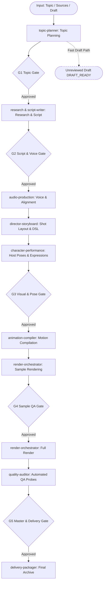

# AI Animation Studio Skills

[简体中文](README.md) · English

An architecture and agent skill package tailored for solo creators producing **Chinese-language animated explainer videos**. From a single topic or an existing draft, it coordinates in-depth research, sectioned scriptwriting, voice synthesis, shot-by-shot storyboarding, original anime host performance, procedural technical diagrams, human approval gates, and final delivery packaging.

Two profiles serve distinct production needs: **1–3 minute shorts** (default 180s, 120s sweet spot) and **chapter-based programs of about eight minutes** (450–510s, target 480s).

**Implementing the studio or collaborating via AI Agents?** Please consult the [Project Agent Guide (AGENT.md)](AGENT.md) and [Handoff Status & Evidence](docs/upgrade/handoff-status.en.md) first, and refer to the [Handoff Prompts](docs/upgrade/handoff-prompts.en.md). Milestone T00 has passed all offline acceptance checks; the next milestone is T01 (environment diagnostics and a 12-second audio-visual technical clip).

---

## Quick Navigation

| What you need | Where to find it |
| --- | --- |
| **Agent Collaboration & Engineering Guide** | [Project Agent Guide](AGENT.md) · [Agent Router](AGENTS.md) |
| **Scope, Milestones & Staffing Assumptions** | [Project Plan](docs/upgrade/project-plan.en.md) |
| **Architecture & Original Anime Host Design** | [Upgrade Design](docs/upgrade/design.en.md) · [Foundation Design](docs/architecture.en.md) |
| **Test-Driven Development (TDD) Plan** | [TDD Execution Plan](docs/upgrade/tdd.en.md) |
| **Acceptance Criteria & Test Matrix** | [Acceptance Plan](docs/upgrade/acceptance.en.md) · [Evidence Index](docs/upgrade/handoff-status.en.md) · [Acceptance Matrix](evals/acceptance.en.md) |
| **Model or Team Handoff Package** | [GitHub Handoff ZIP](output/AI-Animation-Studio-Skills.zip) · [ZIP Verification Record](output/交接包复验.json) |
| **Printable Documentation (PDF)** | [Upgrade & Acceptance Combined PDF](output/pdf/AI-Animation-Studio-升级实施与验收.pdf) · [Foundation Design PDF](output/pdf/AI-Animation-Studio-详细设计.pdf) |

---

## Production Workflow & Approval Architecture

Production operates under a strict state-machine model governed by five human approval gates (G1 through G5) and safety policies:



---

## Skills & Tool Adapters

### 13 Modular Agent Skills
Every skill provides bilingual documentation (`#chinese` and `#english`) and strict data contracts:

| Skill Directory | Name | Role & Responsibility | Approval Gate |
| --- | --- | --- | --- |
| [topic-to-video](skills/topic-to-video/SKILL.md) | Entry Orchestration | Global workflow scheduling, parameter parsing, and state management | G1–G5 |
| [topic-planner](skills/topic-planner/SKILL.md) | Topic Planning | Audience analysis, thesis framing, and duration/budget allocation | G1 |
| [research-evidence](skills/research-evidence/SKILL.md) | Evidence Research | Fact verification, reference citation, and argument-source binding | - |
| [script-writer](skills/script-writer/SKILL.md) | Script Writing | Sectioned spoken scriptwriting, cue annotations, and timing estimates | G2 |
| [audio-production](skills/audio-production/SKILL.md) | Audio Production | TTS synthesis, phoneme-level forced alignment, and subtitle generation | - |
| [scene-art-direction](skills/scene-art-direction/SKILL.md) | Scene Art Direction | Visual composition, procedural infodiagrams, and layer separation | - |
| [character-performance](skills/character-performance/SKILL.md) | Character Performance | Anime host rigging, expressions, phonemes, and gesture direction | G3 |
| [director-storyboard](skills/director-storyboard/SKILL.md) | Storyboard Direction | Shot-by-shot DSL layout, camera moves, and audio-visual rhythm | G3 |
| [animation-compiler](skills/animation-compiler/SKILL.md) | Animation Compiler | Compiles symbolic graphs into Remotion/SVG timeline animations | G4 |
| [render-orchestrator](skills/render-orchestrator/SKILL.md) | Render Orchestrator | Parallel chapter/shot multi-layer rendering and asset caching | - |
| [quality-auditor](skills/quality-auditor/SKILL.md) | Quality Auditor | Automated detection of black frames, silent gaps, sync drifts, and format flaws | - |
| [revision-planner](skills/revision-planner/SKILL.md) | Revision Planner | Granular shot/section change analysis and dependency minimization | Contextual |
| [delivery-packager](skills/delivery-packager/SKILL.md) | Delivery Packager | Multi-format master encoding, manifest validation, and asset archiving | G5 |

### 9 External Service Adapter Contracts
Defined in `tools/` with formal input/output schemas (`contract.yaml`):
- `search_sources`: Authoritative source query and citation retrieval
- `generate_tts`: High-fidelity neural voice synthesis with pronunciation overrides
- `align_audio`: Phoneme-level forced alignment for subtitles and mouth shapes
- `bake_character`: Host pose, expression, and layer compositing
- `generate_image`: Concept art and background illustration generation
- `generate_video`: Dynamic background and video shot diffusion synthesis
- `render_shot`: Multi-layer shot rendering and light compositing
- `inspect_media`: FFprobe media metadata, stream, and frame probe
- `package_project`: Deliverable archiving, checksum calculation, and project packaging

---

## Duration Profiles & Media Technical Specifications

| Profile | Default / Range | Key Technical Characteristics | Reference Example |
| --- | --- | --- | --- |
| **`short`** | Default 180s, supports 60–180s | Fast-paced, concise, single continuous timeline | [Web Caching (120s / 14 shots / 3,600 frames)](examples/topic-cache-speed/) |
| **`standard8`** | Default 480s, window 450–510s | 7 chapters, continuity checks, recovery checkpoints | [Kafka to Doris (480s / 34 shots / 14,400 frames)](examples/topic-kafka-to-doris/) |

- **Video Specifications**: $1920 \times 1080$ (16:9 widescreen), constant $30.00\text{ fps}$, H.264 `yuv420p`, MP4 container (`isom` / `iso2` / `mp41`).
- **Audio Specifications**: $48,000\text{ Hz}$ (48 kHz), 16-bit stereo AAC-LC, exactly $1,600$ PCM audio samples per video frame ($48,000 \div 30 = 1,600$).
- **Shot Boundaries**: Half-open frame intervals `[start_frame, end_frame)`. Duration in frames $= end\_frame - start\_frame$. Contiguous cuts: $start\_frame_{n} = end\_frame_{n-1}$.

---

## Planning an Episode

Clone the repository and run all commands from the project root:

```sh
git clone https://github.com/xiongcp/short-video-skill.git
cd short-video-skill
```

Instruct your AI agent to read the [Entry Skill (topic-to-video)](skills/topic-to-video/SKILL.md#english):
> "Use the topic-to-video skill to plan a two-minute Chinese animation explaining web caching to beginners. Provide the topic brief and draft script for review first."

For eight-minute requests, the system automatically schedules chapter budgets, chapter checkpoints, and inter-chapter continuity constraints.

---

## Local Offline Verification & Testing

The repository supports complete offline verification using Python 3.9+ with PyYAML, jsonschema, and referencing:

```sh
# Install test dependencies
python3 -m pip install -r evals/requirements.txt

# 1. Check contracts, schemas, policies, and planning examples
python3 -B evals/check_design.py

# 2. Run full unit and negative regression suite (25 test cases)
python3 -B -m unittest discover -s evals -p 'test_*.py' -v

# 3. Replay media acceptance fixtures across all 6 calibration durations (requires FFmpeg)
python3 -B docs/upgrade/evidence/replay_media.py

# 4. Probe an actual rendered 120-second MP4 master
python3 -B evals/check_design.py --media renders/final.mp4 --profile short --target-seconds 120
```

---

## License & Asset Rights

This project is licensed under the [Apache License 2.0](LICENSE). When producing commercial episodes with third-party voice models, fonts, host characters, or background music, record their respective commercial licenses in the project's asset ledger.
