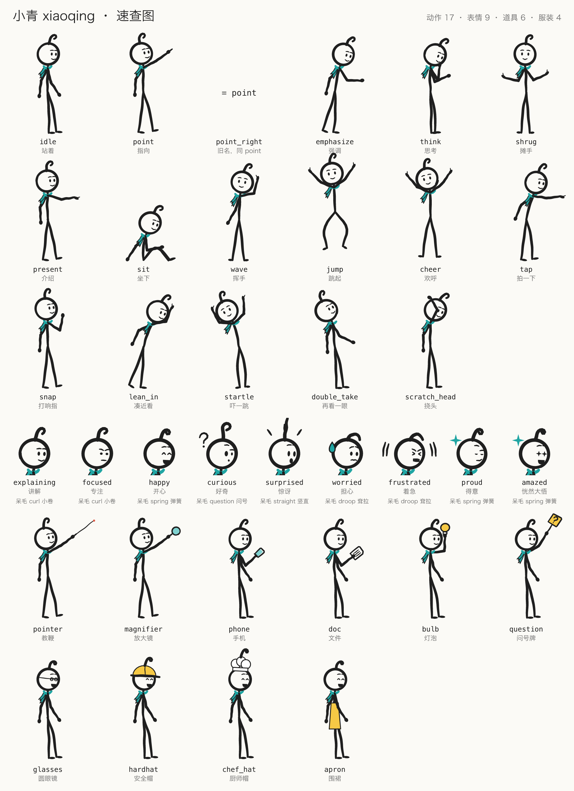

# topic-to-video: a skill for Chinese explainer videos

[简体中文](README.md) · [Website](https://xiongcp.github.io/short-video-skill/)

A lightweight skill for agy, Claude Code, Codex and other agents. Say one sentence, such as "make an explainer on why the sky is blue", and it writes the script and storyboard for you to approve, then renders the video on your machine: 小青 (Xiaoqing), an original hand-drawn stick-figure host, with voice-over, captions, 1080p60 landscape or 1080×1920 portrait. The voice uses `edge-tts` (free, needs a network connection) with 8 male and female voice presets you can audition first; macOS `say` works offline, or you can bring your own recording.

## Video from one sentence

1. Install the skill and run `doctor.mjs` once to check your environment (see Install below).
2. Tell your agent one sentence:

   > Use topic-to-video to make an explainer video on "为什么天空是蓝色的" (why the sky is blue).

3. Read the script and storyboard and reply "OK". About 3 minutes later you get `out/final.mp4`, captions, a cover image and a QA report.

Length, audience, aspect ratio and voice have defaults (120 seconds, a general audience, 16:9, the female voice Xiaoxiao); say so to change them, for example "1 minute, portrait, male voice".

## How it works

1. **Script and storyboard.** It writes `project.json`, `讲稿.md` (script) and `分镜.md` (storyboard), and checks sentence length, timing estimates, one shot for every sentence, that on-screen keywords come from the narration and that no picture stays still too long.
2. **Approval ①.** Nothing is voiced or rendered until you approve. You can say "no need to confirm, just render"; the video then carries a "未审核初稿" (unreviewed draft) badge in the top-left corner.
3. **Local render (L1, the default).** When `doctor.mjs` reports a complete environment, it voices, renders and runs automatic QA, then delivers the video.
4. **Prompt pack (L0, the fallback).** If FFmpeg or another dependency is missing, or you only want text, it delivers `提示词包.md` for Jimeng, Kling, Vidu, Hailuo, Veo and similar models, and tells you what is missing and how to install it.

When you change the script or storyboard it redoes only what changed, tells you which approvals that voids, and re-renders only the changed shots.

## Delivery levels

| Level | Status | Output |
| --- | --- | --- |
| L1 local render | Available (the default when the environment is complete) | `out/final.mp4` (1080p60, optional 1440p/4K), `.srt`/`.ass` captions, a cover image, chapter timestamps, a contact sheet and a QA report; synthesized sound effects and background music are added automatically, the music ducks under speech, and `--audition-sound` lets you listen first; `--ratio 9:16` renders native 1080×1920 portrait with text kept clear of the Douyin, TikTok and Shorts overlays |
| L0 text package | Available, no dependencies | `project.json`, `讲稿.md`, `分镜.md`, `提示词包.md` |

The L1 design is in the [render quality design](docs/lite/出片质量设计.md), the [stick-figure host design](docs/lite/火柴人主持人设计.md) and the [surpass roadmap](docs/lite/超越路线图.md) (in Chinese): hand-drawn stick-figure full-body rig with 2-bone IK, 60 fps, matched-element transitions, motion blur on fast moves, keyword-level sync and automated BT.709, jump, freeze and occlusion QA.

## The host

The host is 小青 (Xiaoqing), an original hand-drawn stick figure: black ink lines, a teal scarf and a cowlick on top that changes shape with each mood, with 17 joints drawn by code. The storyboard picks from 17 gestures, 9 expressions, 6 props and 4 outfits by name; each video sets a visual metaphor, one of 5 style packs (`paper`/`chalkboard`/`blueprint`/`kraft`/`night`) and 8 hand-drawn scenes. In the primary `stage` layout, Xiaoqing stands on the same ground line with 72 built-in hand-drawn props (plus custom geometric props) for 8 stage interactions (opening, carrying and dropping, pushing or pulling, holding up, drawing on boards, sitting on seats, and reacting to object states) plus `state` transitions and `send` packets traveling along stage links or `flow` arrows, while in `host-left` shots Xiaoqing can walk over to a diagram element and point at it. A sentence with no gesture gets one picked from its meaning.



## Examples

- The [website](https://xiongcp.github.io/short-video-skill/) plays the demo rendered from [examples/cache-speed](examples/cache-speed/): a fridge and a supermarket on one stage, about 67 seconds.
- The example's text package, in Chinese: the [script](examples/cache-speed/讲稿.md), the [storyboard](examples/cache-speed/分镜.md), the [prompt pack](examples/cache-speed/提示词包.md) and [project.json](examples/cache-speed/project.json).
- The pre-launch local acceptance run (one video from each of two sentences, with timings and QA): [acceptance record](tests/scenarios/results/launch-summary.md), in Chinese.

## Install

Copy the whole `skills/topic-to-video/` folder into the agent's skills folder:

| Agent | User | Project |
| --- | --- | --- |
| Claude Code | `~/.claude/skills/` | `.claude/skills/` |
| Codex | `~/.agents/skills/` | `.agents/skills/` |
| agy | `~/.gemini/antigravity/skills/` | `.gemini/skills/` |

```sh
git clone https://github.com/xiongcp/short-video-skill.git
cp -R short-video-skill/skills/topic-to-video ~/.claude/skills/
# Local rendering also needs one runtime package and system FFmpeg (macOS: brew install ffmpeg)
npm install --prefix ~/.claude/skills/topic-to-video/scripts
node ~/.claude/skills/topic-to-video/scripts/doctor.mjs
```

When `doctor.mjs` prints `l1_ready: true` and `tts_ready: true` you can render; for anything missing it prints the install command for your system. Linux, Windows, team deployment, upgrades, uninstalling and common problems are in the [install guide](docs/guide/安装部署.md) (in Chinese).

## Usage

| You want | You can say |
| --- | --- |
| A video | "Make '为什么冬天静电多' (why static is worse in winter) a 1-minute portrait video" |
| A video from sources | "Make a 2-minute explainer from this article" |
| Text only | "Just the script and prompts, I'll generate it on Jimeng" |
| A revision | "Shorten section 2", "make sh05 a comparison" |
| A different voice | "Let me hear a few male voices first", "switch to 男声·云希" |
| A portrait version | "Render a portrait version too" |

Output files, how to read the QA report, and quality and speed options are in the [usage guide](docs/guide/使用指南.md) (in Chinese).

## Roadmap

| Phase | Scope | Status |
| --- | --- | --- |
| P0–P1 | Archive the previous Studio at tag `studio-v1` and slim the repository down to one skill; L0 text package and scenario evaluations ([summary](tests/scenarios/results/p1-summary.md), in Chinese) | Done |
| S1, M1–M5 | The host 小青; local renderer: 60 fps/4K, hand-drawn props, style packs and scenes, `stage` interactions, free online `edge-tts` voices (needs a network connection) or offline macOS `say`; transitions, motion blur and automatic QA | Done |
| v1.0 | Video from one sentence: renders an MP4 by default when the environment is complete, unapproved videos carry a badge, 72 props, install and usage guides | Done |
| Next | Full Windows testing; refinements from scenario evaluations and user feedback | Planned |

The full plan (in Chinese) is in [docs/lite/轻量化Skill计划书.md](docs/lite/轻量化Skill计划书.md).

## Development

Requires Node 22 or later.

```sh
npm install
npm test
```

GitHub Actions runs `npm test` on every push. Scenario evaluations (`npm run scenario`) spend agent quota; ask the owner before running them. See [AGENTS.md](AGENTS.md) for the development rules. The previous Studio implementation (13 skills, a TypeScript runtime and G1–G5 gates) is kept at tag `studio-v1` and branch `archive/studio-v1`.

## License

The code is released under the [Apache License 2.0](LICENSE). Usage rights for the host 小青 (Xiaoqing) are decided by the project owner; see [rights.json](skills/topic-to-video/assets/host/rights.json). The voice uses Microsoft's online text-to-speech service by default; check its terms before commercial use, or use macOS `say` or your own recording instead.
