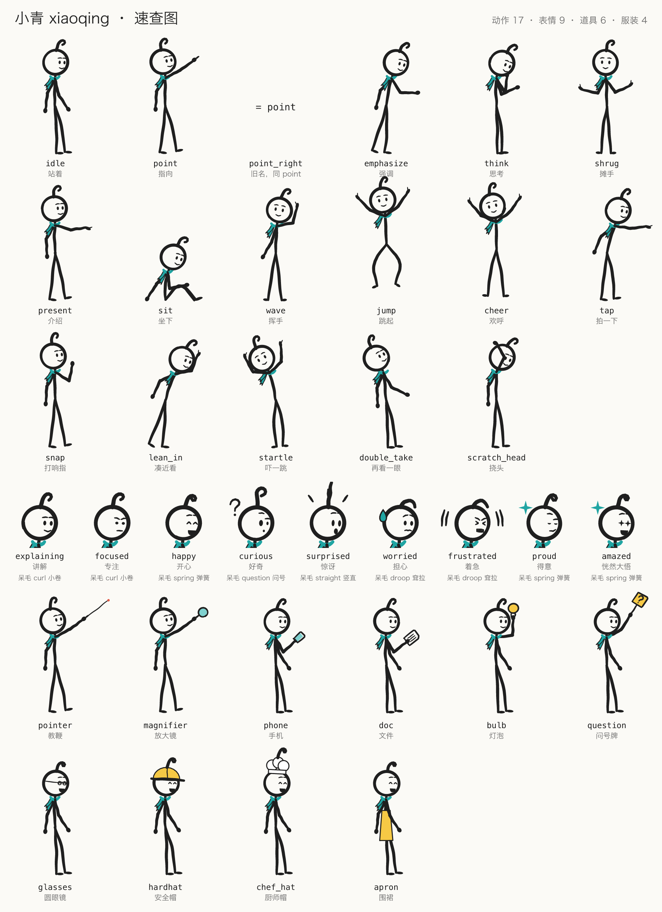

# topic-to-video：中文知识解说视频 Skill

[English](README.en.md) · [官网](https://xiongcp.github.io/short-video-skill/)

给 agy、Claude Code、Codex 等 Agent 用的轻量 skill。说一句话，比如"把为什么天空是蓝色的做成解说视频"，它先写好讲稿和分镜请你确认，然后在本机渲染成片：原创手绘火柴人主持人"小青"出镜，配音、字幕、1080p60 横屏或 1080×1920 竖屏。配音用 `edge-tts`（免费，需要联网），男女声 8 个人设，可以先试听；也能用 macOS `say` 离线配音或你自己的录音。

## 一句话出片

1. 安装 skill，运行一次 `doctor.mjs` 检查环境（见下文"安装"）。
2. 在 Agent 里说一句话：

   > 用 topic-to-video 把"为什么天空是蓝色的"做成解说视频。

3. 看过讲稿和分镜，回一句"可以"。约 3 分钟后拿到 `out/final.mp4`、字幕、封面和 QA 报告。

时长、受众、比例、配音都有默认值（120 秒、零基础观众、16:9、女声·晓晓），想改直接说，比如"1 分钟，竖屏，男声"。

## 它怎么工作

1. **写讲稿和分镜**：产出 `project.json`、`讲稿.md`、`分镜.md`，并自检每句字数、估时、句子与镜头是否一一对应、画面关键词是否出自口播、画面有没有长时间不动。
2. **确认①**：你确认讲稿和分镜后才配音、出片。说"不用确认，直接出片"也可以，成片左上角会带"未审核初稿"角标。
3. **本机出片（L1，默认）**：`doctor.mjs` 显示环境齐全时，配音、渲染、自动 QA，交付成片。
4. **提示词包（L0，兜底）**：缺 FFmpeg 等依赖，或你只要文本时，交付 `提示词包.md`，交给即梦、可灵、Vidu、海螺、Veo 等平台出片，并告诉你缺什么、怎么装。

改讲稿或分镜时，它只重做改到的部分，说明哪些确认因此失效，重出时只重渲改动的镜头。

## 交付档位

| 档位 | 状态 | 交付物 |
| --- | --- | --- |
| L1 本地成片 | 可用（环境齐全时的默认） | `out/final.mp4`（1080p60，可选 1440p/4K）、`.srt`/`.ass` 字幕、封面、章节时间戳、联系表和 QA 报告；自动配上代码合成的音效和背景音乐，说话时音乐自动压低，`--audition-sound` 可以先试听；`--ratio 9:16` 出原生 1080×1920 竖屏，文字避开抖音、TikTok、Shorts 的界面遮挡 |
| L0 文本包 | 可用，不需要任何依赖 | `project.json`、`讲稿.md`、`分镜.md`、`提示词包.md` |

L1 的设计见 [出片质量设计](docs/lite/出片质量设计.md)、[火柴人主持人设计](docs/lite/火柴人主持人设计.md) 和 [超越路线图](docs/lite/超越路线图.md)：手绘火柴人全身骨架与两节逆解、60fps、同元素补间转场、快动作运动模糊、关键词级音画对齐，以及 BT.709、跳变、卡顿、遮挡自动 QA。

## 主持人

主持人是原创手绘火柴人"小青"：黑色墨线，系一条青色围巾，头顶一根会随情绪变形的呆毛，全身 17 个关节由代码画出。分镜按名字选 17 个动作、9 种表情、6 件道具和 4 套服装；每期先定比喻、5 套风格包（`paper`/`chalkboard`/`blueprint`/`kraft`/`night`）和 8 个手绘场景。在主力 `stage` 舞台版式里，小青能与 72 个内置手绘物件（及自定义几何道具）站在同一条地面线上做 8 种同台互动（打开、拿放、推拉、高举、板书、坐上、按状态反应），还能用 `state` 切换状态、用 `send` 沿连线或 `flow` 箭头传物件；在 `host-left` 镜头里也能走到图解元素旁边指着讲，没写动作的句子会按句意自动配上动作。



## 示例

- [官网](https://xiongcp.github.io/short-video-skill/) 上有 [examples/cache-speed](examples/cache-speed/) 渲染出的演示片：冰箱与超市同台互动，约 67 秒。
- 这个示例的文本包：[讲稿](examples/cache-speed/讲稿.md)、[分镜](examples/cache-speed/分镜.md)、[提示词包](examples/cache-speed/提示词包.md) 和 [project.json](examples/cache-speed/project.json)。
- 上线前的本机验收（两句话各出一条片，含耗时与 QA）：[验收记录](tests/scenarios/results/launch-summary.md)。

## 安装

把 `skills/topic-to-video/` 整个目录复制到 Agent 的 skills 目录：

| Agent | 用户级 | 项目级 |
| --- | --- | --- |
| Claude Code | `~/.claude/skills/` | `.claude/skills/` |
| Codex | `~/.agents/skills/` | `.agents/skills/` |
| agy | `~/.gemini/antigravity/skills/` | `.gemini/skills/` |

```sh
git clone https://github.com/xiongcp/short-video-skill.git
cp -R short-video-skill/skills/topic-to-video ~/.claude/skills/
# 本机出片还要一个运行时包和系统 FFmpeg（macOS：brew install ffmpeg）
npm install --prefix ~/.claude/skills/topic-to-video/scripts
node ~/.claude/skills/topic-to-video/scripts/doctor.mjs
```

`doctor.mjs` 输出 `l1_ready: true` 和 `tts_ready: true` 就能出片；缺什么它会给出当前系统上的安装命令。Linux、Windows、团队部署、升级卸载和常见问题见 [安装与部署](docs/guide/安装部署.md)。

## 使用

| 想要 | 可以这样说 |
| --- | --- |
| 出片 | "把'为什么冬天静电多'做成 1 分钟的竖屏视频" |
| 从资料出片 | "根据这篇文章做一个 2 分钟的解说" |
| 只要文本 | "只要讲稿和提示词，我拿去即梦生成" |
| 返修 | "第 2 段改短一点"、"sh05 换成对比图" |
| 换配音 | "先让我听听几个男声"、"换成男声·云希" |
| 再出竖屏 | "再出一个竖屏版" |

输出文件、QA 报告怎么读、清晰度与耗时选项见 [使用指南](docs/guide/使用指南.md)。

## 路线图

| 阶段 | 内容 | 状态 |
| --- | --- | --- |
| P0–P1 | 旧版工作室归档到 tag `studio-v1`，仓库瘦身为单一 skill；L0 文本包与场景评测（[汇总](tests/scenarios/results/p1-summary.md)） | 完成 |
| S1、M1–M5 | 小青主持人；本地渲染器：60fps/4K、手绘物件、风格包与场景、`stage` 同台互动、edge-tts 免费在线配音（需要联网）或 macOS `say` 离线配音；转场、运动模糊与自动 QA | 完成 |
| v1.0 | 一句话出片：环境齐全时默认出 MP4，未经确认的成片带角标，72 个物件，安装与使用文档 | 完成 |
| 之后 | Windows 完整实测；按场景评测和用户反馈继续打磨 | 计划中 |

完整计划见 [轻量化 Skill 计划书](docs/lite/轻量化Skill计划书.md)。

## 开发

需要 Node 22 或更新版本。

```sh
npm install
npm test
```

GitHub Actions 在每次推送时运行 `npm test`。场景评测（`npm run scenario`）会消耗 Agent 额度，运行前先问 owner。开发规则见 [AGENTS.md](AGENTS.md)。旧版工作室实现（13 个 skill、TypeScript runtime、G1–G5 门禁）保存在 tag `studio-v1` 和分支 `archive/studio-v1`。

## 许可

代码以 [Apache License 2.0](LICENSE) 发布。主持人"小青"的使用权由项目 owner 决定，见 [rights.json](skills/topic-to-video/assets/host/rights.json)。配音默认使用微软的在线朗读服务，商用前请自行确认它的使用条款；也可以改用 macOS `say` 或你自己的录音。
