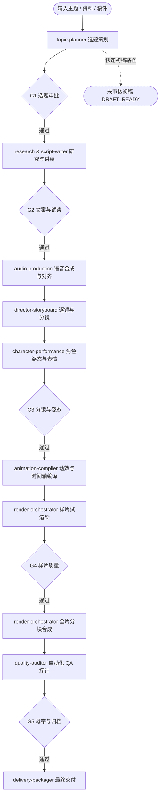

# AI Animation Studio Skills

[简体中文](#) · [English](README.en.md)

面向个人创作者的中文知识解说 Skill 架构包。输入主题或已有稿件，通过一个统一入口组织深度研究、分段讲稿、语音合成、逐镜分镜、原创日系动漫主持人、程序化动态图解、审核门禁与最终交付。短片支持 **1–3 分钟**（默认 180 秒，精选 120 秒），长篇章节式节目以 **8 分钟**（450–510 秒，基准 480 秒）为目标。

**接手工作室开发或使用 Agent 协作**时先读 [代理指南 (AGENTS.md)](AGENTS.md) 与 [交接状态与证据](docs/upgrade/交接状态与证据.md)，再参考 [模型交接提示词](docs/upgrade/模型交接提示词.md)。系统当前已全量通过 T00 离线验收，下一阶段任务为 T01 环境诊断与 12 秒有声技术片。

---

## 快速导航

| 想做的事 | 项目内入口 |
| --- | --- |
| **Agent 协作与开发规范** | [项目代理指南](AGENTS.md) |
| **确认升级范围、里程碑及资源假设** | [项目计划书](docs/upgrade/项目计划书.md) |
| **理解架构设计与原创动漫主持人方案** | [升级详细设计](docs/upgrade/升级详细设计.md) · [基础架构详细设计](docs/AI-Animation-Studio-详细设计.md) |
| **按依赖实施 TDD，记录红绿重构** | [TDD 执行计划](docs/upgrade/TDD执行计划.md) |
| **独立核对短片与长片的验收矩阵** | [验收计划](docs/upgrade/验收计划.md) · [离线实测证据](docs/upgrade/交接状态与证据.md) · [验收矩阵](evals/acceptance.md) |
| **把完整项目交给另一位模型或团队** | [GitHub 交接包](output/AI-Animation-Studio-Skills.zip) · [交接包复验记录](output/交接包复验.json) |
| **打印阅读或提交审阅** | [升级实施与验收合订本 (PDF)](output/pdf/AI-Animation-Studio-升级实施与验收.pdf) · [基础架构打印版 (PDF)](output/pdf/AI-Animation-Studio-详细设计.pdf) |

---

## 生产流程与审核架构

生产流转采用状态机驱动，严格受控于 5 道人工审核门禁（G1–G5）与安全策略：



---

## 技能 (Skills) 与工具 (Tools) 清单

### 13 个专业 Agent 技能
全部技能均包含双语使用指南及严格输入输出契约：

| 技能目录 | 名称 | 职责定位 | 审批门禁 |
| --- | --- | --- | --- |
| [topic-to-video](skills/topic-to-video/SKILL.md) | 主入口编排 | 全流程调度、参数解析与状态管理 | G1–G5 |
| [topic-planner](skills/topic-planner/SKILL.md) | 选题策划 | 受众分析、核心论点提炼与片长预算分配 | G1 |
| [research-evidence](skills/research-evidence/SKILL.md) | 证据检索 | 资料事实核实、来源引用与论据绑定 | - |
| [script-writer](skills/script-writer/SKILL.md) | 讲稿编写 | 逐段口语化文案撰写、词锚标注与时间预估 | G2 |
| [audio-production](skills/audio-production/SKILL.md) | 音频生产 | TTS 语音生成、音素级强制对齐与字幕生成 | - |
| [scene-art-direction](skills/scene-art-direction/SKILL.md) | 场景美术 | 场景构图、程序化信息图解与视觉分层 | - |
| [character-performance](skills/character-performance/SKILL.md) | 角色表演 | 日系动漫主持人姿态、表情、嘴形与视线调度 | G3 |
| [director-storyboard](skills/director-storyboard/SKILL.md) | 导演分镜 | 逐镜 DSL 设计、机位运动与音画节奏对齐 | G3 |
| [animation-compiler](skills/animation-compiler/SKILL.md) | 动效编译 | 符号图解编译为 Remotion/SVG 时间轴动画 | G4 |
| [render-orchestrator](skills/render-orchestrator/SKILL.md) | 渲染编排 | 章节与镜头级并行多层渲染调度与缓存管理 | - |
| [quality-auditor](skills/quality-auditor/SKILL.md) | 质量审计 | 黑场、漏音、音画不同步及格式合规自动化探查 | - |
| [revision-planner](skills/revision-planner/SKILL.md) | 返修规划 | 单镜/单段增量返修分析与依赖变更最小化 | 针对性 |
| [delivery-packager](skills/delivery-packager/SKILL.md) | 交付打包 | 多格式母带压制、工程清单校验与资产归档 | G5 |

### 9 个外部服务适配器契约
工具接口均在 `tools/` 目录定义了参数与响应契约（`contract.yaml`）：
- `search_sources`：权威信息源搜索与知识检索
- `generate_tts`：高质量语音合成（支持多音字与停顿标记）
- `align_audio`：语音与字幕音素级对齐
- `bake_character`：日系角色姿态与表情图层烘焙
- `generate_image`：概念图与背景插画生成
- `generate_video`：动态背景与视频片段扩散生成
- `render_shot`：单镜头多图层光线合成与渲染
- `inspect_media`：FFprobe 媒体技术参数探针
- `package_project`：交付资产包签名打包与哈希核验

---

## 片长与媒体技术规格

| 规格档位 | 默认目标 / 范围 | 关键设计指标 | 规划样例 |
| --- | --- | --- | --- |
| **short** | 默认 180 秒，支持 60–180 秒 | 紧凑快节奏，无章节切分 | [缓存原理 (120 秒 / 14 镜 / 3,600 帧)](examples/topic-cache-speed/) |
| **standard8** | 默认 480 秒，范围 450–510 秒 | 7 大章节，跨章连续性与恢复检查点 | [Kafka 到 Doris (480 秒 / 34 镜 / 14,400 帧)](examples/topic-kafka-to-doris/) |

- **画面规格**：$1920 \times 1080$（16:9），精准 $30.00\text{ fps}$，H.264 `yuv420p`，MP4 容器
- **音频规格**：$48,000\text{ Hz}$（48 kHz），16-bit 立体声 AAC，每视频帧严格对应 $1,600$ 个采样
- **时间切片**：镜头区间采用半开区间 `[start_frame, end_frame)`，总帧数 $= end\_frame - start\_frame$

---

## 策划一期节目

克隆仓库并在项目根目录下运行：

```sh
git clone https://github.com/xiongcp/short-video-skill.git
cd short-video-skill
```

让 Agent 加载 [主入口技能](skills/topic-to-video/SKILL.md)：
> “请按照本项目 topic-to-video 技能，策划一支 2 分钟的中文动画短视频，向初学者讲解网页缓存原理。先输出选题简报与分段讲稿供我审核。”

对于约 8 分钟的长视频请求，系统将自动启用章节预算分配、章节状态检查点（Checkpoint）和断点恢复机制。

---

## 离线环境核验与测试

系统支持纯离线本地验证，依赖仅需 Python 3.9+ 以及 PyYAML、jsonschema 与 referencing：

```sh
# 安装离线验证依赖
python3 -m pip install -r evals/requirements.txt

# 1. 静态结构、Schema 契约与纸面规划项目检查
python3 -B evals/check_design.py

# 2. 运行完整单元测试与负向回归测试（包含 25 个测试用例）
python3 -B -m unittest discover -s evals -p 'test_*.py' -v

# 3. 运行完整媒体校准与极端故障样本测试（需 FFmpeg & ffprobe）
python3 -B docs/upgrade/evidence/replay_media.py

# 4. 逐帧检测实测成片 MP4
python3 -B evals/check_design.py --media renders/final.mp4 --profile short --target-seconds 120
```

---

## 许可证与资产声明

本项目遵循 [Apache License 2.0](LICENSE) 开源协议。在正式商业制作项目中引入的人物角色模型、配音音色、商用字体及背景音乐等素材，请按规定另行登记并确保获得合法商业使用授权。
