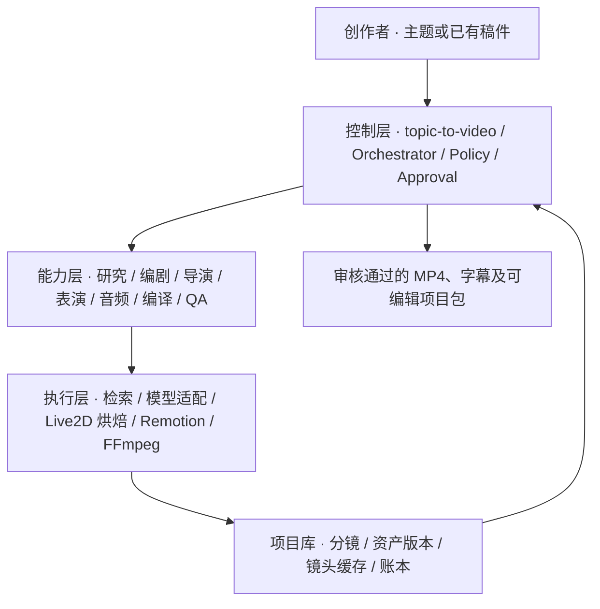

# AI Animation Studio ｜ Skill 架构与详细设计

简体中文 · [English](architecture.en.md)

设计基线 v1.0 · 2026 年 11 月 19 日

面向个人创作者的中文知识解说制作工作台。以原创日系主持人、可编辑图解和固定版本的镜头资产，将一个主题制作成 1–3 分钟短片或约 8 分钟的章节式节目。

| 读者 | 建议先读 |
| --- | --- |
| 创作者 / 导演 | 第 03–04 节看片长与样例，第 10 节看审什么，第 12 节看如何返修 |
| Skill / 服务开发 | 第 02、05–07、09–12 节看职责、合同、状态、缓存及失败恢复 |
| 美术 / 音频 / QA | 第 06、08、13–14 节看资产、对齐、交付和验收 |

## 01　设计基线与交付范围

个人创作者输入主题、资料或已有稿件，得到可逐镜修改的中文知识解说工程。点开任意镜头，应能找到它用了哪一句旁白、哪条证据、哪个角色版本，以及改动后需要重做哪些层。MP4 是这个工程的一次导出。

| 设计依据 | 沿用的决定 | 本次细化 |
| --- | --- | --- |
| 《项目计划书》§1、4–6 | 单用户本地制作，一位原创日系主持人，Live2D 与程序图解合成，画质优先 | 两档共用生产链。短片先跑通全程，约 8 分钟增加章节与跨章验收 |
| 《需求分析与 PRD》§3–9 | 一句话入口、可追溯事实、质量优先与快速初稿、局部返修、G1–G5 | G4 绑定成片与 QA，G5 单独绑定导出清单，草稿保留未审标识 |
| 《Agent Skill 架构设计书》§2–10 | 一个编排器、三层架构、13 个 Skill、9 个工具、版本化合同和预算 | 每个 Skill 有可读取的入口，合同、权限、流程和片长均有独立文件 |
| 本次制作目标 | 1–3 分钟与约 8 分钟都属于正式设计范围 | 短片接受 60–180 秒，长片以 480 秒为目标，暂取 450–510 秒为“左右”的范围 |

### 首版产品设定

默认横屏 1920 × 1080、30 fps、48 kHz、中文口播、单一原创主持人、固定服装与有限视角。平台尺寸与片长分开建模，短片沿用相同的横屏视觉基线。输入中明确指定的受众和时长优先，省略时读取项目默认值，全新项目默认 180 秒。

### 本包可以怎样使用

仓库提供 Skill 指令、注册表、权限和审核策略、工具合同、跨阶段 Schema、可机读的两条状态路径、两个完整纸面分镜与离线校验器。真人审批服务、Studio 工作台、供应商连接、原创 Rig、媒体烘焙和导出均列入实施路线。示例中的素材均有版本化引用，状态为 planned，预算未配置，审批为 pending。

## 02　系统分层与执行入口



| 边界 | 读取与写入 | 发生异常时由谁决定 |
| --- | --- | --- |
| 控制层 | 入口合并默认值，Orchestrator 持有运行状态、预算预留、审批与任务依赖 | 编排器持久化阻塞原因，所有者批准事实、脚本、样片、成片及导出 |
| 能力层 | 从指定快照读，向项目服务交付符合 Schema 的结果。模型可提议 DSL、候选资产和修订 | 返回有定位的缺口或替代方案，由对应 Skill 返工 |
| 执行层 | 适配器接收允许的项目引用和受控参数，生成有哈希的资产及标准回执 | 工具报告执行事实，未知计费状态由作业系统对账 |

工作台采用 React 与 TypeScript。项目 API 和单一 Orchestrator 采用 Node.js 与 TypeScript，管理 SQLite 事务和本地内容哈希目录。独立 Worker 消费编译快照，先用 Cubism Web SDK 生成角色层，再交 Remotion 合成、FFmpeg 编码和 ffprobe 核验。后续若改用 PostgreSQL 或 S3 兼容存储，项目和资产引用仍使用相同合同。

### 一次调用

例如“用两分钟给初学者讲网页缓存”。入口确定 120 秒和初学者受众，生成 TopicBrief 与 RunPlan，研究、编剧依次产出可审文稿，正式配音决定实际时间轴。导演从词锚分镜，美术和角色提案可以独立准备，编译器在依赖齐备后冻结快照。样片与全片分别审核，导出时将文件清单再交所有者确认。

在当前包中打开 `skills/topic-to-video/SKILL.md` 即可按指引做策划。宿主接入时按 `registry.yaml` 发现其余能力，从 `workflows/` 读取状态图。Skill 的扩展元数据集中在 frontmatter 的 `metadata`，合同名称相对 `schemas/` 解析。

## 03　短片档（60–180 秒）

短片的内容预算围绕一个观众能复述的问题。先决定观众看完应当会解释什么，再安排主持人提问、图解机制、举例或反例、回扣。下面三列是同一结构的剪辑起点，可以按明确的写作要求改配。

| 节拍 | 60 秒 | 120 秒示例 | 180 秒 | 画面任务 |
| --- | --- | --- | --- | --- |
| 提问 | 5 秒 | 8 秒 | 10 秒 | 让观众看见一个结果或反常现象 |
| 建立对象 | 10 秒 | 22 秒 | 32 秒 | 固定名词、角色站位和图例 |
| 解释机制 | 20 秒 | 40 秒 | 62 秒 | 每次揭示一个因果变化 |
| 例子或边界 | 17 秒 | 35 秒 | 55 秒 | 用同一对象重走一次流程 |
| 收束 | 8 秒 | 15 秒 | 21 秒 | 回答开场问题，留阅读时间 |
| 总帧数 | 1,800 | 3,600 | 5,400 | 30 fps，含片头、停顿、转场和片尾 |

### 讲稿与镜头怎么定

给术语和图表单独留时间。初稿可用“净口播秒数 × 试读语速 ÷ 60”估字数。假设试读 240 字/分钟、120 秒中有 12 秒纯画面，约可写 432 字。这个数用于删稿，配音到位后由采样数和实际停顿决定镜头长度。60 秒优先保留机制与一个结果，180 秒可多给一个边界条件。

### 两分钟示例

“为什么缓存能让网页变快”有 5 个段落组、14 镜。第一遍访问走完请求和响应，第二遍重用同一张图标，再展示过期后的验证分支。第 2 段取第 240–899 帧做 G3 样片，共 22 秒，既有图解也有主持人。图标、副本和请求箭头始终保持同一视觉含义。

当用户同时要求“刚好 60 秒”和额外解释三个机制时，入口展示各部分会占用的时长，请用户选择保留的重点。已批准脚本发生实质删改，重新提交 G2。

## 04　约 8 分钟档的章节与连续性

以 480 秒建立纸面预算，共 14,400 帧。每章回答一个子问题、交出一个可见结果，并给下一章留一个明确的起点。成片是否落在约 8 分钟的窗口，由最终媒体探针复核，用户给出精确时长时以该约定为准。

| 章节样例 · Kafka 到 Doris | 时间码 | 秒数 / 镜数 | 观众在章末应当能指出 |
| --- | --- | --- | --- |
| 订单去了哪里 | 0:00–0:20 | 20 / 2 | 蓝色订单卡与本期问题 |
| 先读懂地图 | 0:20–1:10 | 50 / 4 | 生产端、分区和目标表 |
| 给事件定位 | 1:10–2:40 | 90 / 6 | 一个分区及其中的位置 |
| 导入作业怎样工作 | 2:40–4:30 | 110 / 8 | 作业、任务与字段映射 |
| 跟一笔订单核对 | 4:30–6:10 | 100 / 7 | 源字段、进度和目标行 |
| 报表没更新时看哪里 | 6:10–7:30 | 80 / 5 | 积压或暂停应查看的线索 |
| 回答片头问题 | 7:30–8:00 | 30 / 2 | 从订单事件到可查询行的全程 |

### 长片特有的工作量

每章记录角色入场姿态、视线、图例颜色、道具位置、术语读法、背景声和出场状态。导演在章口对照前一镜尾帧与后一镜首帧。案例中的分区图全片保持左到右，同一笔订单保持蓝色。换景或跳时以显式切换说明。

章是审稿、预览、缓存和崩溃恢复的单位，镜头和图层仍是最小返修单位。先用代表样片验证最难解释的一组镜头。该示例的 G3 可用三个全片帧窗口 [0,180)、[5580,5880)、[7950,8190)，合计 24 秒，涵盖主持人、FE/BE 图解及第 4 至 5 章切换。G4 仍播放全片。

配音后逐章比较预计与实测时长。先压缩重复解释或调整图表停留，章末位移只重排后续绝对时间。若精确时长无法满足或将超出 450–510 秒，向用户展示差额与两个可删改的段落再更新脚本。

同一选题要做两版时，可以在各自项目登记同一批来源、主持人和基础图解，复用底层素材哈希。短版聚焦一个机制，长版展开案例与边界。两版分别保存讲稿、时间线和审核记录。

## 05　13 个 Skill 的输入、产物与交接

用户可始终通过 topic-to-video 发起任务。各 Skill 共享同一份契约和版本化资产索引，依赖图允许导演锁定分镜后并行准备角色与场景。

| Skill | 主要输入 → 可检查的输出 | 交接条件 |
| --- | --- | --- |
| topic-to-video | 请求与默认值 → TopicBrief、RunPlan | 交选题，恢复时带上阻塞原因 |
| topic-planner | 主题、受众、片长 → 问题树、ResearchPlan | 子问题有检索方向和范围 |
| research-evidence | 问题树与来源策略 → EvidenceSet、论点来源关系 | 人类 G1 审研究 |
| script-writer | 证据与受众 → ScriptDocument、段落和 cue | 人类 G2 审脚本与时长 |
| audio-production | 脚本、音色 → AudioManifest、Alignment | 能追溯字词和实测采样 |
| director-storyboard | 脚本、对齐、能力表 → Storyboard | 纸面与已对齐分镜显式区分 |
| character-performance | 分镜、Rig、字词 → CharacterActionPlan | 动作和角度在能力表内 |
| scene-art-direction | 分镜、证据、资产库 → ScenePlan、素材请求 | 精确图文可程序绘制 |
| animation-compiler | 角色、场景、音频、分镜 → CompiledTimeline | 已解析引用，快照不可变 |
| render-orchestrator | 编译快照与预算 → RenderJob、ShotArtifacts | 校验镜头，再汇总样片或母版 |
| quality-auditor | 媒体、快照、来源 → QAReport 和 Issues | 有问题附帧号、证据及严重度 |
| revision-planner | 修改请求、快照、依赖 → ChangePlan | 显示重做、复用、费用与重审范围 |
| delivery-packager | 母版、QA、批准 → ExportManifest、FinalPackage | G5 确认清单后核对归档哈希 |

### 接手一个子任务

先打开该 Skill 的 SKILL.md，按其 input_contracts 读取项目快照。将产物按 output_contracts 保存，向编排器回传对象引用、版本和状态。导演可以编排手势，渲染编排器按自己的权限请求烘焙，两者的任务记录用同一镜头 ID 关联。

## 06　研究、讲稿、配音与对齐

### 从来源到镜头

ResearchPlan 把每个子问题关联到需要查证的内容和检索范围。来源记录 URL、标题、时间、原文定位及摘要。论点与来源用多对多关系连接，关系为 supports、limits 或 contradicts。supported 需要支持来源，partial 写清适用范围，disputed 保留分歧，unsupported 交回编辑处理。G1 绑定具体证据快照。

短片样例的论点 validate 可沿 RFC 9111 §4.3、段落 sec_004、提示词组 cue_011、镜头 shot_011 一路查到过期验证分支。版本未获人类批准前，其 review_status 保持 pending。长片的订单号和金额是教学设例，技术行为另有 Apache 官方来源。

### 口播生产顺序

1. 脚本固定段落 ID、论点、口播、发音词典、视觉意图和估时。已有稿件保留段落映射，G2 展示实质改写与时长差异。
2. 正式配音读取 G2 的版本。逐段生成或导入 WAV，保存采样率、音色、模型或录音来源、参数及音频哈希。人声、BGM、SFX 各自保留轨道。
3. 强制对齐给出字词的起止采样与置信度。术语、数字、缩写和长停顿可逐句试听，手校的新版本同时驱动字幕、口型和动作锚点。
4. 对齐通过后再锁定镜头切点。音素到视素的映射独立于时间戳，嘴型曲线受 Rig 表中开闭范围约束，停顿回到休止姿态。

### 整数时间基

30 fps 和 48 kHz 下每帧恰好对应 1,600 个采样。音频保留原始整数采样，需要切段的共享边界只量化一次，可取最近帧 floor((sample + 800) / 1600)。分段两侧引用同一个量化结果。音频末尾允许用静音补足最后一个画面帧，并记录补齐量。SRT 用累计绝对边界换算毫秒，检查最终解码后的音画端点。

短片 3,600 帧对应 5,760,000 个采样，8 分钟 14,400 帧对应 23,040,000 个采样。这两个值是目标时间网格，不代表示例已有实录音频。

## 07　数据合同与分镜 DSL

project_id 划定项目边界，每个对象通过稳定 ID 和版本定位。文稿、资产、分镜逐次保存修订，对象 ID 在编辑、拆章和改名后保持稳定。资产地址采用 asset://项目/资产/v版本。可用资产还要有内容哈希和使用范围。已批准快照写入新版本时保留旧对象。

| 合同族 | 关键字段和约束 |
| --- | --- |
| 主题与证据 | TopicBrief 固定受众、范围、时长档、目标秒数和未知项。EvidenceSet 把论点、来源、关联及冲突分开保存 |
| 文稿与声音 | ScriptDocument 用 section_id、claim_ids、cue_id 关联到逐段文本。AudioManifest 保留真实采样，Alignment 把 cue 映射到字词 |
| 美术与分镜 | CharacterProfile 定义 Rig 能力，Scene 定义层与命名元素，Storyboard 记录绝对帧区间、局部图层动画、章节、音频锚点和动作 |
| 编译与作业 | CompiledTimeline 固定输入快照及逐镜缓存键，RenderJob 记录输入哈希、状态、幂等键、供应商回执和预留 |
| 审核与交付 | Approval 绑定目标哈希，QAReport 绑定被查对象，ExportManifest 列出逐文件哈希，FinalPackage 单独记录 G5 收据及归档哈希 |

### 从样例读一个镜头

```json
{
  "shot_id": "shot_004",
  "chapter_id": "ch_002",
  "section_id": "sec_002",
  "frame_range": {"start": 420, "end": 660},
  "camera": "insert",
  "scene_ref": "asset://cache-speed/diagram_ch_002/v1",
  "audio_anchors": ["cue_004"]
}
```

这是两分钟样例中的字段摘录。完整对象还包括目的、图层、表演、审批状态与 visual_cues。镜头长 240 帧。元素 beat_004 在局部第 30 帧高亮，对应全片第 450 帧。JSON Schema Draft 2020-12 是交换合同。TypeScript 接入 Zod 时，CI 将其导出的结构与本包合同比对，并运行同一组正反例。跨对象引用、时间连续、动作能力与同项目归属另由编译器检查。[Zod JSON Schema](https://zod.dev/json-schema)

Schema 的主版本编码在 $id 的 /v1/ 路径中，内容修订用对象的 version 表示。读旧项目时识别合同主版本，兼容改动用旧样例回归。破坏性升级在副本上迁移，保留新旧哈希和迁移记录。遇到没有迁移器的主版本，将具体对象和所需版本返回给项目所有者。

## 08　角色、场景与确定性合成

### 原创主持人资产包

美术交付含 Character Bible、正面与 45 度参考、分层 PSD、Rig、表情与手势库、音色与读音表。锁定面部比例、发色、服装、主光方向和禁改特征。能力表由实际绑定可用范围填写，极限角度逐一出图审核。样例的发夹、服装和嘴型参数仅供说明数据结构。

接入时分别登记角色原画、字体、音乐、音色和模型的使用范围，并按实际用途核验 Cubism SDK 与 Remotion 的许可。可用资产进入正式工程时固定版本和内容哈希。

### 三类镜头模板

| 模板 | 图层与动作 | 人工看什么 |
| --- | --- | --- |
| 主持人 | 后景、角色透明层、前景道具、字幕。表演从目光、嘴型和一个主要手势开始 | 线稿、发夹、嘴型、眼神、手指和字幕是否抢同一焦点 |
| 知识图解 | SVG/Canvas 绘制数字、单位、代码、箭头及标签，层内元素可逐步显示或高亮 | 讲到哪个对象，画面就突出哪个对象，数字能回到来源 |
| 主题插画 | 后中前景独立、有限视差与遮挡，主持人按需入镜，复杂英雄镜头作为可选候选 | 角色身份、构图和光照是否连贯，生成素材是否获准使用 |

### 顺序烘焙，按帧取样

Cubism 的物理计算随时间步进，设计上由 Baker 在固定 Rig、初始状态、种子、固定步长下按镜头顺序计算，产出透明层及末态。接续姿态需要时引用上一镜末态哈希。不同镜头可以在各自初值就绪后分别烘焙。Remotion 合成读取固定的局部帧，Sequence 内帧号随起点平移，必须保留全片与镜头两个坐标。[Cubism Web 物理实现](https://github.com/Live2D/CubismWebFramework/blob/develop/src/physics/cubismphysics.ts) · [Remotion 帧号](https://www.remotion.dev/docs/use-current-frame)

先合成背景、角色和图解，再按遮挡叠前景及字幕。叠化需要显式持有两边画面的过渡帧，主时间线仍连续且只计算一次时长。最终混音读取连续的母带和全片自动化曲线，统一编码 H.264 / AAC、yuv420p，代理片和母版都记录输出规格。编码配置是本设计默认值，帧序与颜色在 W2 实机样片中核对。

## 09　受控工具与统一回执

| 注册工具 | 输入 → 产物 | 提交与失败约定 |
| --- | --- | --- |
| search_sources | 问题、来源策略 → URL、定位和摘要 | 受限检索，无可靠结果返回缺口 |
| generate_tts | 段落、音色、词典 → 音频与采样数 | 按脚本版本预留费用，回执不明保留原键 |
| align_audio | 音频、原文、语言 → 字词区间和置信度 | 低置信项允许手校 |
| generate_image | 场景需求、风格参考 → 候选图片 | 记录候选数量、授权与来源 |
| generate_video | 参考素材、目标帧数 → 候选插入镜头 | 默认关闭，显式启用后按镜头预算取候选 |
| bake_character | 固定 Rig、表演计划、帧数 → 透明层与末态 | 镜头断点从固定初态或经验证的快照恢复 |
| render_shot | 编译快照、图层、规格 → 镜头、章节或母版 | 复用缓存，scope 区分合成粒度 |
| inspect_media | 媒体引用、预期规格 → 探针和异常证据 | 只读，区分检测失败与质量缺陷 |
| package_project | 固定清单、G5 收据 → 已核验归档 | 清单与实物逐项匹配，完成后写收据 |

### 工具调用边界

写调用携带 project_id、expected_version 和 idempotency_key。公共回执包含 status、job_id、artifact_refs、warnings、cost、retryable、next_action。status 有 succeeded、partial、failed、unknown 四种。cost 分开记录币种、估计和实支，金额使用最小货币单位，未知实支保留 null。

例如合成完成但有一帧字幕溢出，工具可以成功返回媒体，QA 另行产生 blocking 问题。付费提交超时返回 unknown、retryable=false、next_action=reconcile，编排器按原单号或幂等键查询。这样可区分“工具完成”“内容合格”和“人类已批准”。

适配器由宿主注册，只能读取当前项目登记的版本资源。来源页、附件和素材元数据按不可信资料解析，权限、预算、模型选择和审批身份来自项目服务。密钥留在服务端，日志只写必要标识、耗时和脱敏错误。

## 10　状态机、审核与草稿模式

| 人工关口 | 提交给审核人的材料 | 通过后允许 | 驳回或版本改变 |
| --- | --- | --- | --- |
| G1 研究 | 范围、论点、原文定位、冲突与限定 | 正式编剧 | 给论点或范围留意见，返研究 |
| G2 脚本 | 分段口播、术语、预计时长和画面意图 | 正式配音或接收正式导入音频 | 改段落并重估时长 |
| G3 样片 | 20–30 秒连续片段或代表镜头组，附声音、图解及 QA | 启动正式全片渲染 | 定位镜头、层或读音，重制样片 |
| G4 成片 | 完整母版、字幕、事实状态、QA 和变更摘要 | 准备本次导出清单 | 回到最早受影响阶段 |
| G5 导出 | G4 母版及本次包的文件、版本、哈希与使用范围 | 按该清单打包和核验交付 | 修订清单并再次确认 |

### 正式路径

NEW → BRIEF_READY → RESEARCH_RUNNING → RESEARCH_REVIEW → SCRIPT_RUNNING → SCRIPT_REVIEW → AUDIO_RUNNING → AUDIO_READY → ALIGNMENT_READY → STORYBOARD_READY → ASSET_READY → COMPILED。之后生成样片，依次经过 RENDERING、QA_RUNNING、SAMPLE_REVIEW，通过 G3 后进入 FINAL_RENDER、FINAL_REVIEW，再经 APPROVED、EXPORT_REVIEW、PACKAGING 到 DELIVERED。

每个转移必须有可重放的事件。G1–G5 的记录由有权审核的人签发，绑定 project_id、gate、target_hash。脚本、模型、素材或清单变化时，根据实际依赖重开关口，旧决定仍能证明旧版本的审核历史。

### 快速初稿与恢复

草稿在已授权预算内可用待审研究和讲稿继续，经 COMPILED → DRAFT_RENDER → DRAFT_READY，预览和文件保留“未审核初稿”及问题清单。转正式时建立 quality 运行，仅复用版本、实物和哈希匹配的产物，补齐对相应版本的人工决定。中断时保留阶段与阻塞任务，恢复前校验输入快照。完整事件表见 [状态机](../workflows/topic-to-video.yaml)。

## 11　项目服务、任务恢复与成本

### 本地存储与接口

个人工作台从 SQLite 和内容寻址的文件目录起步。projects 保存默认值和当前修订号，objects 与 assets 保存不可变版本和内容哈希，edges 保存依赖，tasks、events、approvals、reservations、ledger 分别记录工作单元、迁移、审核、预留和实支。大文件先写临时文件再原子归位，核验哈希后在事务中提交引用。启动时核对缺失实物和未绑定的临时文件。

| 设计接口 | 请求重点 | 并发或重试结果 |
| --- | --- | --- |
| POST /projects | 主题、模式、时长、默认值 | 返回 project_id、版本和第一个计划 |
| POST /projects/{id}/events | event、expected_version、幂等键 | 同键同输入复用结果，同键不同输入或旧版本返回冲突 |
| POST /projects/{id}/approvals | gate、target_hash、decision、notes | 身份来自认证会话，核对目标仍有效 |
| POST /projects/{id}/revisions | 基线快照及自然语言变更 | 先返回影响集合与预计费用，确认后产生新版本 |
| GET /projects/{id}/jobs/{job} | 项目及作业标识 | 返回已记录的状态、产物和下一动作 |

### 外部任务的提交窗口

1. 对规范化输入计算幂等键。事务中锁定余额、写 reserve 和待提交任务，提交意图落盘后才联系供应商。
2. 获得回执则保存 provider_job_id 并轮询。若在发出请求后崩溃或超时，保留预留并进入 UNKNOWN。使用原键或供应商作业记录对账，无法判明时等待人工核验。
3. 完成时按账单结算实支并释放余额，已确认未创建或明确失败后按计费事实结清。缓存命中沿用产物，账本记录命中和新增费用为零。

可用余额等于项目上限减已结算支出和有效预留。同一业务任务的并发请求由唯一键约束。项目总额、单任务限额、单位报价和每镜候选数由所有者配置，附件中的金额不进入默认值。分别计量配音、生成、算力、存储、许可和人工返修，再按实际成片分钟计算成本。

## 12　依赖、缓存与镜头级返修

| 用户修改 | 必须失效的内容 | 可复用的内容 |
| --- | --- | --- |
| 只改字幕颜色 | 字幕层、涉及镜头或母版的合成、相关 QA | TTS、对齐、角色烘焙、背景和图解 |
| 改一个镜头的表情 | 该角色层与镜头合成，显式继承末态的相邻镜头也复查 | 无依赖的角色镜头、图解与旁白 |
| 改一个词的发音 | 对应语音最小可替换单元、对齐、相关嘴型和字幕 | 其他段落音频、静态场景 |
| 修改图表数值 | 来源与论点核对、矢量图层、相关镜头和 QA | 与图表无关的美术和角色 |
| 改写导致段落缩短 | 该段音频和对齐、相关动画、后续绝对位置、字幕与最终混音 | 后续不依赖绝对时间的镜头局部层 |
| 升级 Rig | 引用该版本且受改动影响的角色烘焙和合成 | 其他角色、独立图解和旧版工程 |

### 依赖按层登记

镜头的合成键包含局部时间、图层内容哈希、相机、字体、渲染器、输出规格和缓存算法版本。角色键另外绑定 Rig、实际使用的表演参数、视素曲线和初末态依赖。生成资产键记录模型、参数、种子及输入哈希。对有序依赖及规范化 JSON 编码取 SHA-256，并把规范化算法版本写入键。字幕颜色只进入字幕层与合成键。镜头局部缓存以所用字段投影生成，全局版本和绝对起点保存在编译快照或拼接键，让无关镜头继续命中缓存。

### 8 分钟样例改短 10 秒

若第 4 章由 110 秒改为 100 秒，其新结尾由第 8,100 帧移至第 7,800 帧。后面各章的绝对起点前移 300 帧。保持其他内容不变时，全片从 480 秒变为 470 秒。可向用户展示“按 7:50 交付”与“给后面图解增加 10 秒阅读时间”，若约定精确 480 秒，先达成重新分配方案。

revision-planner 输出 ChangePlan，列出基线哈希、改动字段、受影响对象、复用对象、需重开的 G1–G5 子集和预算差。执行时再次校对基线，与其他编辑冲突则重新计算。恢复某次长片任务时，先比对已完成章与镜头的实物哈希，再领取未完成的工作单元。

## 13　工作台、QA 与交付包

项目库及主题向导负责新建、默认值和恢复。制作视图左侧为论点、段落和镜头，中间为画布与安全框，右侧为角色、场景、图层及声音属性，底部为旁白、词锚、口型、字幕和音效轨。研究页可由 claim 跳到来源，镜头页可由 cue 跳到波形，顶部显示阶段、预算和待审对象。预览、样片、正式母版分别标记。

| QA 维度 | 自动检查与证据 | 人工验收 |
| --- | --- | --- |
| 结构与知识 | Schema、引用、无环、帧覆盖、论点来源状态 | 核对限定条件、图表数字与讲稿 |
| 画面与连续性 | 黑帧、空帧、闪帧、缺字体、边界、字幕版面、角色版本 | 参考画对照、章口首尾帧、镜头联系表 |
| 声音与嘴型 | 声轨缺失、静音、峰值、响度、字词对齐和音画端点 | 专名试听、嘴型自然度、BGM 对讲解的遮盖 |
| 导出与恢复 | 探针读取宽高、帧率、编码、采样率与实际时长，归档解包核对哈希 | G4 看完整节目，G5 查文件清单和版本 |

每个问题记录 issue_id、目标对象、绝对帧区间、严重度和证据。blocking 阻断正式交付，涉及审美或低置信度的 needs_review 由人决定。中文口型沿用原 PRD 的待校准目标。选取至少 100 个手标锚点，中位绝对误差 ≤80 ms、P95 ≤150 ms，记录样本与音色，实测后决定是否作为发布阈值。

### 一个可编辑的交付目录

```text
project-output/
  project.json                manifest.json
  topic/brief.json            research/evidence-set.json
  script/                     storyboard/       chapters/
  audio/voice-master.wav      audio/alignment-v002.json
  characters/                 scenes/            shots/
  renders/final-v001.mp4      subtitles/final.srt
  approvals/                  qa/                cost/usage-ledger.json
```

清单固定 DSL、Skill、模型、提示模板、字体、音色、Rig、渲染器版本。复制到另一目录后从包内相对位置解析资产并校验，无字幕母版和封面按项目选择添加。G5 对不含自身签名的清单载荷签收，归档回执另存清单哈希与包哈希。交付范围为本地文件。

## 14　实施顺序与验收证据

| 阶段 | 工程与美术工作 | 可复核的交付 |
| --- | --- | --- |
| M1 · W1–4 | 入口、合同、主角原画和绑定、透明角色层及合成链 | W2 做 10–15 秒技术片，W4 审 45–60 秒原创样片 |
| M2 · W5–8 | 本地工程与编辑器、角色能力表、三种模板、逐镜预览 | 可编辑 60 秒项目，测试一个不支持的动作 |
| M3 · W9–12 | 来源、脚本、TTS、导入音频、中文对齐、导演编译 | 1、2、3 分钟分别查帧数，至少一支真实短片走完审核和导出 |
| M4 · W13–16 | 镜头与章缓存、任务持久化、预算及变更影响 | 改字幕零次 TTS，注入中断后复用已完成镜头，未知提交不重复计费 |
| M5 · W17–20 | 代表样片、角色与画质修整、事实和音频 QA | 固定镜头组人工评审，登记嘴型误差、返修率和单位成本 |
| M6 · W21–24 | 约 8 分钟的连续生产、归档与恢复 | 连续三期实片，逐期保留 G1–G5、重渲记录、成本、可重开工程 |
| 缓冲 · W25–26 | 解决未过门的美术、声音或供应商问题 | 针对不合格项目重新取证 |

阶段节奏沿用原计划的人员假设，配置两名工程师，前期有美术与绑定投入，内容负责人按期审核。两种片长共用同一份合同，长片的章节和缓存从 M1 即进入数据设计。里程碑推进以实际素材、可播放媒体和审片记录为依据。

### 需求与证据对照

IN / RES / SCR 对应主题、证据、口播及 G1/G2，AUD / SB / CHR 对应声音、分镜与表演，RND / EDIT 对应依赖图和局部重做，QA / APR / EXP 对应检查、审核及归档。P1 的分层场景、资产复用、自然语言返修和可选视频插入均定义了接口，P2 的多项目队列与多人协作保留在后续范围。

离线检查覆盖 13 个 Skill、9 个工具合同、跨文件引用、审批图、两种片长的帧与段落归属、角色能力和图层锚点。实际画质、成本、端到端延迟、真实渲染器恢复和人类审片属于运行时验收。完整用例及取证方式见 [验收矩阵](../evals/acceptance.md)。

### 阅读原始依据

《项目计划书》页 4–8、PRD 页 4–8、Skill 架构设计书页 3–8 分别给出技术路线、功能验收与注册目录。示例中的缓存和导入事实可从来源文件回查。[RFC 9111](https://www.rfc-editor.org/rfc/rfc9111.html) · [Apache Kafka 入门](https://kafka.apache.org/42/getting-started/introduction/) · [Apache Doris Routine Load](https://doris.apache.org/docs/3.x/data-operate/import/import-way/routine-load-manual/)
