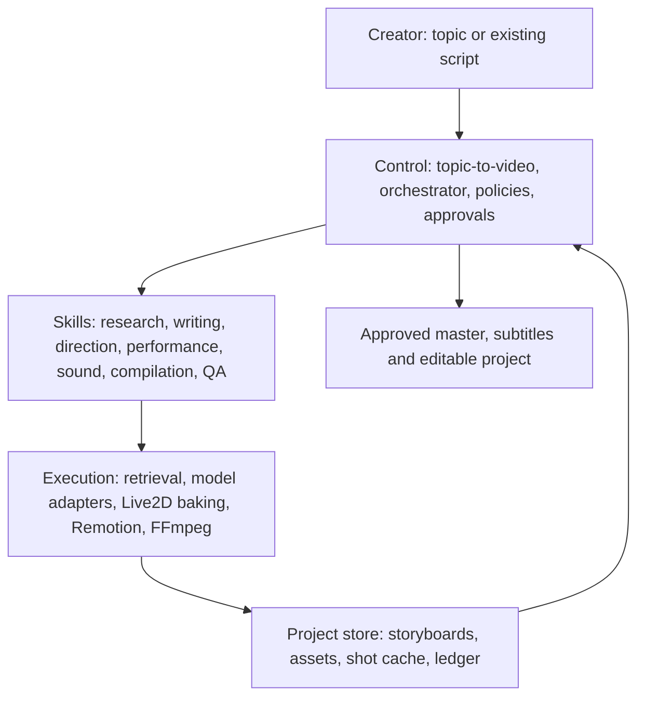

# AI Animation Studio | Skill architecture and detailed design

[简体中文](AI-Animation-Studio-详细设计.md) · English

Design baseline v1.0, November 19, 2026. A solo creator turns a topic into a 1–3 minute short or a chapter-based program of roughly eight minutes. Each project combines a recurring original anime host, editable diagrams and versioned shot assets.

| Reader | Where to start |
| --- | --- |
| Creator or director | Sections 03–04 explain pacing, 10 covers approvals, and 12 covers revisions. |
| Skill or service developer | Sections 02, 05–07 and 09–12 cover ownership, contracts, state and recovery. |
| Art, sound or QA | Sections 06, 08 and 13–14 cover assets, alignment, deliverables and acceptance. |

## 01 · Scope and baseline

The input can be a topic, reference material or an existing script. Opening any shot in the editable project should reveal its narration, source claim, character version and the layers a change would invalidate. The MP4 is an export of that project.

| Design input | Decision retained | Detail added here |
| --- | --- | --- |
| Project plan, sections 1 and 4–6 | Single-user local production, one original host, Live2D and procedural diagrams, emphasis on image quality | Both profiles share the production chain. Qualify the short first, then add chapters and cross-chapter review. |
| PRD, sections 3–9 | Single request, traceable facts, quality and fast-draft modes, targeted revisions, G1–G5 | G4 binds the master and QA, G5 binds the export manifest. Drafts retain a visible review status. |
| Agent Skill architecture, sections 2–10 | One orchestrator, three layers, 13 skills, nine tools, versioned contracts and budgets | Each skill has a file. Permissions, workflow and duration profiles are independently readable. |
| Requested durations | Both formats are production targets | Shorts span 60–180 seconds. The eight-minute target is 480 seconds, with a working window of 450–510 seconds. |

### First release

Default output is 1920×1080 landscape, 30 fps, 48 kHz, with Chinese narration, one host, a fixed costume and limited camera angles. Aspect ratio is independent of duration. Explicit audience and duration settings take precedence over project defaults. A new project with no setting starts at 180 seconds.

### What the package contains

The repository ships skill instructions, a registry, permissions and approval policies, adapter contracts, schemas, two machine-readable workflow paths, two complete paper storyboards and offline checks. The implementation plan covers the human approval service, Studio UI, providers, original rig, baking and production export. Assets in the examples are versioned and `planned`, budgets are unconfigured and approvals are `pending`.

## 02 · Layers and entry point



| Layer | Reads and writes | Failure ownership |
| --- | --- | --- |
| Control | The entry point resolves defaults. The orchestrator owns state, reservations, approvals and job dependencies. | Persist blockers. The owner approves research, script, sample, master and export. |
| Skills | Read an identified snapshot and submit schema-valid results. Models may propose DSL, candidate assets and revisions. | Return a located gap or alternative to the responsible skill. |
| Execution | Adapters receive approved project references and bounded parameters, then emit hashed artifacts and receipts. | Report execution facts. The job service reconciles uncertain charges. |

The planned Studio uses React and TypeScript. A single Node.js/TypeScript orchestrator owns the project API, SQLite transactions and a local content-addressed store. Workers consume frozen timelines, bake character layers with the Cubism Web SDK, compose in Remotion, encode with FFmpeg and inspect with ffprobe. A later PostgreSQL or S3-compatible store can retain the project and asset contracts.

### A request in practice

“Explain web caching to beginners in two minutes” resolves to 120 seconds and a beginner audience. The entry point produces `TopicBrief` and `RunPlan`. Research and script go to review. Recorded speech supplies the actual timing, and the director binds shots to words. Art and character work can proceed independently until the compiler freezes a complete snapshot. Review the sample, then the full program, then the export file list.

Start with the [entry skill](../skills/topic-to-video/SKILL.md#english). Hosts discover other skills from the [registry](../registry.yaml) and load the [workflow](../workflows/topic-to-video.yaml). Extended skill information lives in frontmatter `metadata`. Contract names resolve under `schemas/`.

## 03 · Short profile, 60–180 seconds

Choose one question the viewer should be able to answer. Build the episode around the question, the mechanism, one example or exception and a return to the opening. The following budgets are editorial starting points.

| Beat | 60 s | 120 s example | 180 s | On-screen task |
| --- | ---: | ---: | ---: | --- |
| Question | 5 s | 8 s | 10 s | Show a result or surprising observation. |
| Establish the objects | 10 s | 22 s | 32 s | Fix terminology, host position and legend. |
| Explain the mechanism | 20 s | 40 s | 62 s | Reveal one causal change at a time. |
| Example or boundary | 17 s | 35 s | 55 s | Walk the same object through the process. |
| Close | 8 s | 15 s | 21 s | Answer the question and allow reading time. |
| Frames at 30 fps | 1,800 | 3,600 | 5,400 | Includes opening, pauses, transitions and ending. |

### Script and shot budgets

Reserve time for terms, diagrams and breaths. Estimate Chinese characters as net speaking seconds × measured reading rate in characters/minute ÷ 60. At 240 characters/minute with 12 seconds of silent visuals in a 120-second short, the draft budget is about 432 characters. Use it for editing. Actual samples and pauses determine shot duration. A 60-second cut prioritizes the mechanism and one result. A 180-second cut can add a boundary case.

### Two-minute example

The [caching project](../examples/topic-cache-speed/) has five section groups and 14 shots. Show the first request and response, reuse the same icon for the second visit, then show stale-data validation. Section two contributes frames 240–899 inclusive (22 seconds) for G3, including the host and diagram. Icons, copies and request arrows retain their meaning throughout.

When an exact 60-second limit competes with three extra mechanisms, show the cost in seconds and ask which ideas to retain. Reopen G2 for substantive edits to an approved script.

## 04 · Eight-minute chapters and continuity

Budget 480 seconds or 14,400 frames. Each chapter answers one subquestion, delivers a visible outcome and hands the next chapter a starting point. Probe the final media against the agreed window or the explicitly requested exact length.

| Kafka to Doris chapter | Timecode | Seconds / shots | What viewers can identify at the end |
| --- | --- | --- | --- |
| Where did the order go? | 0:00–0:20 | 20 / 2 | Blue order card and central question |
| Read the map | 0:20–1:10 | 50 / 4 | Producer, partition and destination table |
| Locate the event | 1:10–2:40 | 90 / 6 | A partition and the event’s position in it |
| How ingestion works | 2:40–4:30 | 110 / 8 | Job, tasks and field mapping |
| Verify a single order | 4:30–6:10 | 100 / 7 | Source fields, progress and destination row |
| Investigate a stale report | 6:10–7:30 | 80 / 5 | Clues for backlog or a paused job |
| Answer the opening question | 7:30–8:00 | 30 / 2 | Complete path from event to queryable row |

### Additional work in the longer program

At each boundary record entry and exit poses, gaze, legend colors, props, pronunciation and background sound. Compare the last frame of one shot with the first of the next. The partition map in this example always runs left to right, and the same order stays blue. Make a scene or time jump explicit.

Chapters support review, preview, caching and crash recovery. Shots and layers support local revisions. Test the hardest sequence early. The G3 example draws from absolute frame ranges `[0,180)`, `[5580,5880)` and `[7950,8190)` for a total of 24 seconds. It covers the host, the FE/BE diagram and the chapter 4–5 transition. Play the whole master at G4. [Eight-minute project](../examples/topic-kafka-to-doris/)

Compare planned and measured narration per chapter. First trim repetition or adjust diagram holds. A shifted endpoint changes absolute placement downstream. If the exact target or 450–510 second window cannot be met, show the difference and two candidate cuts before revising the script.

For two versions of one topic, register the same sources, host and base diagrams in each project and reuse the underlying hashes. The short concentrates on one mechanism. The long develops the case and its limits. Each version owns its script, timeline and approvals.

## 05 · The 13 skills

Users can stay at `topic-to-video`. Skills share contracts and a versioned asset index. Once the director locks the storyboard, character and scene preparation can proceed independently.

| Skill | Input → inspectable output | Handoff condition |
| --- | --- | --- |
| topic-to-video | Request and defaults → TopicBrief, RunPlan | Route to planning. Include the blocker on resume. |
| topic-planner | Topic, audience, length → question tree, ResearchPlan | Each question has a search scope and direction. |
| research-evidence | Questions and source policy → EvidenceSet and claim links | Human G1 research review |
| script-writer | Evidence and audience → ScriptDocument, sections, cues | Human G2 script and timing review |
| audio-production | Script and voice → AudioManifest, Alignment | Words trace to measured samples. |
| director-storyboard | Script, alignment, capabilities → Storyboard | Explicit timing basis for paper and aligned boards |
| character-performance | Board, rig, words → CharacterActionPlan | Supported actions and angles |
| scene-art-direction | Board, evidence, assets → ScenePlan, asset requests | Exact text and figures can be drawn programmatically. |
| animation-compiler | Performance, scene, audio, board → CompiledTimeline | Resolved references, immutable snapshot |
| render-orchestrator | Compiled snapshot and budget → RenderJob, ShotArtifacts | Verify shots, then assemble the sample or master. |
| quality-auditor | Media, snapshot, sources → QAReport and issues | Attach frame, evidence and severity. |
| revision-planner | Edit request, snapshot, dependencies → ChangePlan | Show reruns, reuse, cost and reopened reviews. |
| delivery-packager | Master, QA, approvals → ExportManifest, FinalPackage | After G5 verifies the manifest, check the archive hash. |

### Taking a subtask

Read its `SKILL.md`, resolve `input_contracts` against the project snapshot, save outputs under `output_contracts` and return reference, revision and status. The director can plan a gesture. The rendering orchestrator requests the bake with its own permissions. Both records share the shot ID.

## 06 · Research, writing, voice and alignment

### From source to shot

`ResearchPlan` links each question to evidence and search scope. A source records URL, title, dates, locator and summary. Claims link many-to-many through `supports`, `limits` and `contradicts`. A `supported` claim needs supporting evidence. Qualify `partial` claims, preserve disagreements for `disputed` and return `unsupported` items to the editor. G1 binds the evidence snapshot.

Trace the short example’s `validate` claim through RFC 9111 section 4.3, `sec_004`, `cue_011` and `shot_011` to the stale-response validation branch. Its `review_status` remains `pending` until a human approves that version. The order number and amount in the long example are teaching data. Apache sources support the system behavior.

### Narration sequence

1. Pin section IDs, claims, narration, pronunciation dictionary, visual intent and estimates. Preserve the mapping to an author’s existing script. At G2 show substantive edits and timing differences.
2. Use the approved script revision for formal audio. Import or generate a WAV per section. Record sample rate, voice, model or recording source, parameters and audio hash. Retain separate voice, BGM and SFX tracks.
3. Forced alignment produces word boundaries in samples and confidence scores. Audition terms, numbers, abbreviations and long pauses. A corrected revision drives subtitles, visemes and gesture cues together.
4. Lock cuts after alignment. Keep phoneme-to-viseme mapping separate from timestamps, constrain mouth curves to the rig’s limits and return to rest during pauses.

### Integer timebase

At 30 fps and 48 kHz, one frame is 1,600 samples. Preserve integer samples. Quantize shared cuts once using `floor((sample + 800) / 1600)`, then reference the same result on both sides. Silence may pad the final frame, with the amount recorded. Derive SRT milliseconds from absolute cumulative boundaries and verify both decoded endpoints. The 120-second example targets 5,760,000 samples and the 480-second example 23,040,000. These are planning grids.

## 07 · Contracts and storyboard DSL

`project_id` scopes every object. Stable IDs survive edits, chapter splits and renames. Scripts, assets and boards have immutable revisions. An asset uses `asset://project/asset/vN`, with a content hash and usage scope once materialized. Retain previous approved objects on version changes.

| Family | Fields and invariants |
| --- | --- |
| Topic and evidence | TopicBrief fixes audience, scope, profile, target seconds and unknowns. EvidenceSet separates claims, sources, links and conflicts. |
| Script and sound | ScriptDocument links sections and text through `section_id`, `claim_ids` and `cue_id`. AudioManifest carries real sample counts. Alignment binds cues to words. |
| Art and storyboard | CharacterProfile declares rig capability. Scene declares layers and elements. Storyboard carries absolute frame ranges, local layer actions, chapters, voice anchors and performances. |
| Compiler and jobs | CompiledTimeline pins the input snapshot and shot cache keys. RenderJob records input hash, state, idempotency key, provider receipt and reservation. |
| Approval and export | Approval binds a target hash. QAReport identifies the inspected object. ExportManifest lists file hashes. FinalPackage separately retains the G5 receipt and archive hash. |

### Reading a shot

```json
{
  "shot_id": "shot_004",
  "chapter_id": "ch_002",
  "section_id": "sec_002",
  "frame_range": {"start": 420, "end": 660},
  "camera": "insert",
  "scene_ref": "asset://cache-speed/diagram_ch_002/v1",
  "audio_anchors": ["cue_004"]
}
```

This excerpt spans 240 frames. The full object includes the purpose, layers, performance, approval status and `visual_cues`. Element `beat_004` highlights at local frame 30, absolute frame 450. JSON Schema Draft 2020-12 is the interchange format. For a Zod integration, compare the exported structure with the project schemas in CI and run the same positive and negative cases. The compiler additionally checks references, timeline coverage, capabilities and project boundaries. [Zod JSON Schema](https://zod.dev/json-schema)

The `/v1/` path in `$id` identifies a schema major version. Object `version` identifies a content revision. Replay legacy examples for compatible changes. Migrate breaking changes on a copy and retain both hashes and the migration record. For an unsupported major version, identify the object and required migrator to the owner.

## 08 · Character, scenes and deterministic composition

### The original host asset pack

Art delivers a character bible, front and 45-degree references, layered PSD, rig, expressions, gestures, voice and pronunciation sheet. Lock facial proportions, hair color, costume, key-light direction and protected features. Measure capabilities on the real rig and review images at each extreme. The example hair clip, outfit and mouth parameters illustrate the data structure.

Register usage scope for original art, fonts, music, voice and models. Check Cubism SDK and Remotion terms against the intended use at integration time. Pin the version and content hash of assets admitted to production.

### Three shot templates

| Template | Layers and actions | Human review |
| --- | --- | --- |
| Host | Background, transparent character, foreground props, subtitles. Begin with gaze, mouth and one primary gesture. | Check line art, hair clip, eyes, mouth, fingers and captions for competing focus. |
| Knowledge diagram | SVG/Canvas numbers, units, code, arrows and labels. Named elements can appear or highlight in sequence. | Highlight the object being discussed and trace every number to its source. |
| Topic illustration | Separate background, middle and foreground, limited parallax and occlusion. Optional host or generated insert. | Check identity, composition, lighting continuity and usage permission. |

### Bake sequentially, sample by frame

Cubism physics advances over time. For each shot the proposed baker uses a fixed rig, starting pose, seed and step to generate transparent frames and an end state. An inheriting shot references the previous end-state hash. Independent shots can bake once their own initial states are available. Remotion samples fixed local frames. Its sequence frame numbers are relative to sequence start, so retain local and absolute coordinates. [Cubism Web physics](https://github.com/Live2D/CubismWebFramework/blob/develop/src/physics/cubismphysics.ts) · [Remotion frame numbers](https://www.remotion.dev/docs/use-current-frame)

Composite background, character and diagrams, then foreground occluders and subtitles. A dissolve needs handles on both sides while the master counts the overlap once. Mix from the continuous master and automation curves, then encode H.264/AAC, yuv420p. Record specifications for proxies and masters. Verify frame order and color on the W2 target-machine sample.

## 09 · Adapters and receipts

| Registered tool | Input → output | Submission and failure |
| --- | --- | --- |
| search_sources | Question and source policy → URL, locator, summary | Respect retrieval scope. Return a gap if reliable evidence is unavailable. |
| generate_tts | Section, voice, dictionary → audio and samples | Reserve against the script revision. Retain the original key after an uncertain receipt. |
| align_audio | Audio, text, language → word spans and confidence | Support manual correction of low-confidence anchors. |
| generate_image | Scene requirements and references → image candidates | Record count, rights and origin. |
| generate_video | References and target frames → insert candidates | Disabled by default. Use the shot budget after explicit enablement. |
| bake_character | Fixed rig, performance, frame count → alpha layer and end state | Resume from a verified snapshot or fixed initial state. |
| render_shot | Compiled snapshot, layers, spec → shot, chapter or master | Reuse valid cache entries. `scope` sets assembly granularity. |
| inspect_media | Media reference and expected spec → probe and defect evidence | Read-only. Distinguish inspection failure from a detected defect. |
| package_project | Frozen manifest and G5 receipt → verified archive | Match files to the manifest, then write the receipt. |

### Invocation boundary

Writes carry `project_id`, `expected_version` and `idempotency_key`. Common results include `status`, `job_id`, `artifact_refs`, `warnings`, `cost`, `retryable` and `next_action`. Status values are `succeeded`, `partial`, `failed` and `unknown`. Record currency, estimate and actual cost separately, in minor currency units. An unknown charge stays `null`.

A render can succeed while QA reports a blocking subtitle overflow. A paid submission timeout returns `unknown`, `retryable=false` and `next_action=reconcile`. Query by original order or idempotency key. Execution receipts, quality findings and human approvals have separate records.

The host registers adapters and restricts asset access to the project’s registered revisions. Treat source pages, attachments and asset metadata as untrusted content. The project service owns permissions, budgets, model choices and reviewer identity. Keep credentials server-side. Log relevant IDs, elapsed time and redacted errors.

## 10 · State, approvals and fast drafts

| Gate | What the reviewer sees | On approval | On rejection or revision |
| --- | --- | --- | --- |
| G1 research | Scope, claims, original locators, conflicts, qualifications | Formal scripting | Return comments to research. |
| G2 script | Spoken sections, terms, estimated duration, visual intent | Formal voice or verified import | Revise sections and timing. |
| G3 sample | 20–30 seconds, continuous or selected excerpts, with sound, diagram and QA | Full production render | Identify shot, layer or pronunciation and remake the sample. |
| G4 master | Complete master, subtitles, claim status, QA, change summary | Prepare export manifest | Reopen the earliest affected stage. |
| G5 export | G4 master plus the package’s files, revisions, hashes and usage scope | Package and verify the listed files | Revise the manifest and request review again. |

### Quality path

`NEW → BRIEF_READY → RESEARCH_RUNNING → RESEARCH_REVIEW → SCRIPT_RUNNING → SCRIPT_REVIEW → AUDIO_RUNNING → AUDIO_READY → ALIGNMENT_READY → STORYBOARD_READY → ASSET_READY → COMPILED`. For the sample, continue through `RENDERING → QA_RUNNING → SAMPLE_REVIEW`. G3 releases `FINAL_RENDER → FINAL_REVIEW`, followed by `APPROVED → EXPORT_REVIEW → PACKAGING → DELIVERED`.

Persist a replayable event per transition. Authorized human decisions bind `project_id`, `gate` and `target_hash`. Reopen affected gates when script, model, asset or manifest dependencies change. Retain earlier approvals for their original versions.

### Fast draft and recovery

Within authorized budget, a draft can use pending research and text, then take `COMPILED → DRAFT_RENDER → DRAFT_READY`. Preview and files display “未审核初稿” (unreviewed draft) and the issue list. Start a quality run to promote it. Reuse matching versions, artifacts and hashes, and obtain missing approvals for those versions. After interruption, retain stage and blocker and verify the input snapshot before resume. [Workflow](../workflows/topic-to-video.yaml)

## 11 · Project service, recovery and cost

### Local storage and API design

SQLite stores `projects` with defaults and current revision, immutable `objects` and `assets` with hashes, `edges` for dependencies, plus `tasks`, `events`, `approvals`, `reservations` and `ledger`. Write large artifacts to temporary files, move atomically, verify their hashes and commit references in a transaction. Reconcile missing artifacts and unbound temporary files at startup.

| Proposed endpoint | Request | Concurrency or retry outcome |
| --- | --- | --- |
| POST /projects | Topic, mode, duration, defaults | Return project ID, revision and initial plan. |
| POST /projects/{id}/events | Event, expected version, idempotency key | Same key and input replays the result. Different payload or stale version returns a conflict. |
| POST /projects/{id}/approvals | Gate, target hash, decision, notes | Authenticate the session and recheck the target. |
| POST /projects/{id}/revisions | Baseline snapshot and requested edit | Return impact and estimate first. Confirmation creates a revision. |
| GET /projects/{id}/jobs/{job} | Project and job IDs | Return recorded state, artifacts and next action. |

### External submissions

1. Derive the idempotency key from normalized inputs. Lock the balance, reserve cost and persist job and submission intent in one transaction before contacting the provider.
2. Save `provider_job_id` and poll once acknowledged. On a crash or timeout after sending, preserve the reservation and set `UNKNOWN`. Reconcile using the original key or provider record. Escalate an unresolved result to human review.
3. On completion, settle actual charges and release the unused reservation. For a verified failure or a confirmed uncreated job, settle from billing evidence. Cache hits reuse artifacts and record zero incremental cost.

Available balance equals the project cap minus settled charges and active reservations. A unique key deduplicates concurrent requests for the same operation. The owner sets caps, unit quotes and candidate limits. Track voice, generation, compute, storage, licensing and human rework separately, then divide by finished minutes.

## 12 · Dependencies, caches and local revisions

| Change | Invalidate | Reuse |
| --- | --- | --- |
| Subtitle color | Subtitle layer, affected composites, media QA | TTS, alignment, character bake, background and diagram |
| One expression | Character layer, composite, any explicit inherited end state | Unrelated shots, diagrams and voice |
| Pronunciation of one word | Smallest replaceable audio unit, alignment, affected visemes and subtitles | Other sections and static scenes |
| Chart value | Source/claim checks, vector layer, affected shots and QA | Independent art and character assets |
| Shorter section | Its sound, alignment and animation, downstream absolute positions, captions and final mix | Downstream local layers independent of absolute time |
| Rig update | Affected bakes and composites referencing that version | Other characters, independent diagrams and earlier project revisions |

### Register dependencies by layer

A composite key includes local time, layer hashes, camera, font, renderer, output specification and cache algorithm version. A character key adds the rig, actually used performance parameters, viseme curves and start/end dependencies. Generated assets record model, parameters, seed and input hashes. Hash ordered, canonical JSON inputs with SHA-256 and version the canonicalization. Subtitle color enters subtitle and composition keys. Project-wide revision and absolute start belong to the compiled snapshot or assembly key, so unrelated local layers can still hit the cache.

### Shortening the eight-minute example by ten seconds

If chapter four goes from 110 to 100 seconds, its end moves from frame 8,100 to 7,800. Later chapters move 300 frames earlier. With no other timing changes, duration becomes 470 seconds. Offer delivery at 7:50 or an extra ten-second diagram hold elsewhere. If the agreement is exactly 480 seconds, settle the allocation first.

`revision-planner` emits a `ChangePlan` with baseline hash, fields, impacted and reusable objects, gates to reopen and budget delta. Recheck the baseline before applying and recalculate on conflict. When resuming, verify completed chapter and shot artifacts before claiming unfinished work.

## 13 · Studio, QA and editable delivery

The project library and topic wizard create, configure and resume projects. In production view, the left panel holds claims, sections and shots. The center shows canvas and safe area, the right panel character, scene, layer and sound properties. Tracks below show voice, words, visemes, subtitles and effects. Navigate from claim to source or cue to waveform. Show stage, budget, pending review and whether the media is preview, sample or master.

| QA area | Automated evidence | Human check |
| --- | --- | --- |
| Structure and facts | Schemas, references, cycles, frame coverage, source status | Qualifications and agreement between chart and narration |
| Visual continuity | Black/empty/flash frames, fonts, boundaries, subtitle layout, character revision | References, chapter boundary frames, shot contact sheet |
| Audio and lips | Missing tracks, silence, peaks, loudness, word alignment, audio/video endpoints | Proper names, natural mouth shapes, music masking the voice |
| Export and restore | Probe size, cadence, codecs, sample rate and duration. Extract and hash files. | Full program at G4, manifest and versions at G5 |

Record `issue_id`, target, absolute frame range, severity and evidence. `blocking` stops formal delivery, and `needs_review` goes to a human. The PRD’s provisional Chinese lip-sync targets use at least 100 manually marked anchors, median absolute error ≤80 ms and P95 ≤150 ms. Record the sample and voice. Decide whether to adopt release thresholds after calibration.

### Editable delivery directory

```text
project-output/
  project.json                manifest.json
  topic/brief.json            research/evidence-set.json
  script/                     storyboard/       chapters/
  audio/voice-master.wav      audio/alignment-v002.json
  characters/                 scenes/            shots/
  renders/final-v001.mp4      subtitles/final.srt
  approvals/                  qa/                cost/usage-ledger.json
```

Pin DSL, skill, model, prompt, font, voice, rig and renderer revisions in the manifest. Resolve and verify relative assets after relocation. Include a clean master or cover when requested. G5 signs the manifest payload with its own signature excluded. A separate receipt stores both manifest and archive hashes. Delivery is to local files.

## 14 · Milestones and acceptance evidence

| Milestone | Engineering and art | Verifiable output |
| --- | --- | --- |
| M1 · W1–4 | Entry, contracts, original host art and rig, alpha layer and composition | 10–15 second technical clip at W2, 45–60 second original sample at W4 |
| M2 · W5–8 | Local project and editor, capabilities, three templates, shot previews | Editable 60-second project and a rejected unsupported action |
| M3 · W9–12 | Sources, script, TTS/import, Chinese alignment, directing and compilation | Verify 1-, 2- and 3-minute outputs. At least one real short passes review and export. |
| M4 · W13–16 | Shot/chapter cache, durable jobs, budgets and change impact | Subtitle recoloring triggers zero TTS. Recovery reuses completed shots. An unknown submission has one charge at most. |
| M5 · W17–20 | Representative sample, art polish, fact and audio QA | Human review of a fixed shot set, lip error, rework rate and unit cost |
| M6 · W21–24 | Repeated eight-minute production, archiving and recovery | Three consecutive real episodes with G1–G5, rerender history, cost and a reopenable project each |
| Buffer · W25–26 | Resolve remaining art, voice or provider issues | New evidence for each failed gate |

The schedule assumes two engineers, early art and rigging help and regular content-owner review. Both durations share contracts. Chapter and cache design start in M1. Actual playable media, assets and reviewer records release milestones.

### Requirements and evidence

IN/RES/SCR map to brief, evidence, script and G1/G2. AUD/SB/CHR map to sound, storyboard and performance. RND/EDIT cover dependencies and targeted reruns. QA/APR/EXP cover inspection, review and archive. P1 defines interfaces for layered scenes, reusable assets, natural-language revisions and optional inserts. P2 covers future multi-project queues and collaboration.

Offline checks cover 13 skills, nine adapter contracts, cross-file references, approval paths, both duration grids, section membership, rig capabilities and layer anchors. Actual picture quality, cost, latency, renderer recovery and human approval require runtime evidence. [Acceptance matrix](../evals/acceptance.en.md)

### Source documents and example references

The original project plan (pp. 4–8), PRD (pp. 4–8) and Skill architecture brief (pp. 3–8) set out the technology route, feature acceptance and registry. The example source records point back to the technical references for caching and ingestion. [RFC 9111](https://www.rfc-editor.org/rfc/rfc9111.html) · [Apache Kafka introduction](https://kafka.apache.org/42/getting-started/introduction/) · [Apache Doris Routine Load](https://doris.apache.org/docs/3.x/data-operate/import/import-way/routine-load-manual/)
