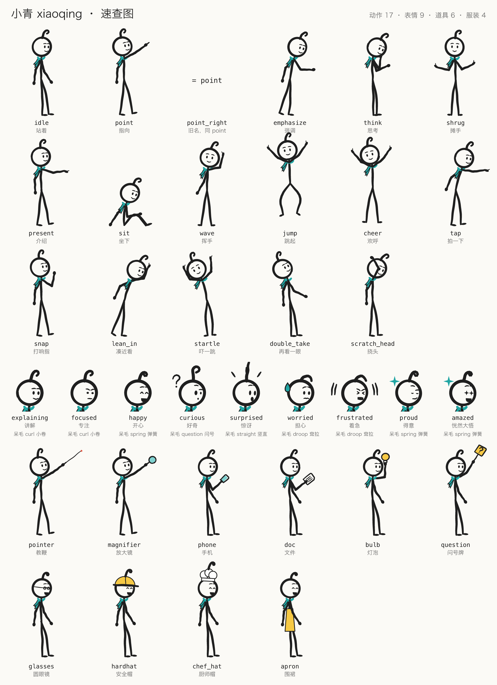

# S1 火柴人主持人"小青"：形象与 L0 实施计划

> **For agentic workers:** REQUIRED SUB-SKILL: Use superpowers:subagent-driven-development (recommended) or superpowers:executing-plans to implement this plan task-by-task. Steps use checkbox (`- [ ]`) syntax for tracking.

**Goal（目标）：** 落地 [火柴人主持人设计](火柴人主持人设计.md) 的 S1：把主持人"晴"换成原创手绘火柴人"小青"（ID `xiaoqing`）。数据契约和分镜自检支持 8 种表情、12 个动作、6 件道具和 `move`、`prop` cue；新增手绘笔触 `ink.mjs` 和骨架 `rig.mjs`，用代码画出参考图、速查图和官网小动画；L0 文档、README、官网和示例同步换人。

**Architecture（架构）：** `rig.mjs` 是纯函数：`manifest.json` 里的骨长、角度范围和姿态经正向运动学算出 17 个关节的位置，再用 `ink.mjs` 的锥形笔触画成 SVG 片段 `<g data-host>`。同样的输入（以镜头 ID 为种子）画出完全相同的 SVG。仓库根目录的开发脚本 `tools/export-host.mjs` 用 `rig.mjs` 拼出整页 SVG，用 `@resvg/resvg-js`（根目录开发依赖）转成 PNG，并把源 SVG 的 sha256 写进 PNG 的 tEXt 块；测试只比对这个哈希，不需要加载 resvg，就能发现"改了骨架却没重新导出"。自检沿用现有结构：新错误进 `project.mjs`，新警告进 `match.mjs`。补间、走路、反向求解、口型和渲染器属于 S2（并入 P2b），不在本计划内；道具的画法先放在 `rig.mjs`，P2b 建 `icons.mjs` 时再按需要搬过去，所以 skill 目录正好是设计 §9.3 说的 17 个文件。

**Tech Stack（技术栈）：** Node ≥ 22（`node --test`；导出脚本用 `node:zlib` 的 `crc32`，需要 22.2 以上）、ajv 8（开发依赖）、`@resvg/resvg-js`（新增开发依赖，只给导出脚本用）、agy（场景复测）。

**Spec（设计文档）：** [火柴人主持人设计.md](火柴人主持人设计.md)；它修订的 [出片质量设计.md](出片质量设计.md) 和 [轻量化Skill计划书.md](轻量化Skill计划书.md)。

## Global Constraints

- 在分支 `lite/stickman` 上工作（从 `lite/slim` 当前 HEAD 拉出），不提交到 `main`；不推送，推送和开 PR 先问 owner。
- skill 目录 ≤ 5 MB、≤ 45 个文件，完成后正好 17 个（删 5 张旧图，加 `ink.mjs`、`rig.mjs`、`host-ref.png`）；`SKILL.md` ≤ 150 行、≤ 8 KB；每份 reference ≤ 250 行、≤ 10 KB；一次完整 L0 运行读取的 skill 文件（`SKILL.md` + 三份 reference + `profile.json`）≤ **28 KB**。原上限 24 KB，Task 2 提高到 28 KB，这一条要 owner 同意。
- `scripts/lib/*.mjs` 只用 Node 内置能力，不引入 npm 包；`@resvg/resvg-js` 只进根目录 `package.json` 的 `devDependencies`，skill 仍然没有运行时依赖。安装它要从 npm 下载平台相关的原生包，安装前先告诉 owner 包名和大小，同意后再装。
- schema 只做向后兼容的新增，`version` 仍为 1；不改已有的 ID、枚举值、文件名和 schema 键；`point_right` 保留，作为 `point` 的旧名。
- 主持人的名字是"小青"，ID 是 `xiaoqing`；`settings.host` 只接受 `xiaoqing`。
- `examples/cache-speed` 始终零错误、零警告，`docs` 为空。
- 不改 `skills/topic-to-video/assets/host/rights.json` 的 `usage`（保持 `pending`）；官网和 README 不声称小青的使用权已核清，也不声称 L1 已可用。
- 参考项目 stickman-video-director 的图片只在本地并排比较，不提交进仓库；不用它的图片、发丝、耳朵和人物名。
- `SKILL.md` 和 `references/` 只写中文；`README.md` 与 `README.en.md` 内容对称；`AGENTS.md` 用英文。
- 官网的本地资源用相对路径；官网不加 JS。
- markdown 里的相对链接只能指向已存在的文件；还没创建的文件写成行内代码。
- PNG 一律由 `npm run export-host` 生成，不手工编辑。改了 `rig.mjs`、`ink.mjs` 或 `manifest.json` 就重新导出，把 PNG、`manifest.json` 的 `ref.sha256` 和 `site/index.html` 的 hero 块一起提交。
- 跑场景要花 agy 配额，开跑前先问 owner；agy 场景并行跑。
- 提交信息末尾加 `Co-Authored-By: Claude Opus 5.5 <noreply@anthropic.com>`。

## Review Focus

1. **旧项目写着 `"host": "hare"`**：报 `UNKNOWN_HOST`，并告诉用户直接改成 `xiaoqing`。→ Task 2 `reports a host other than the profile, with the way to migrate an old project`
2. **`title`、`number` 镜头里写元素序号的 `move`**：报 `CUE_NOT_SUPPORTED`，并提示改用 `left`、`center`、`right`；写站位照常通过。→ Task 2 `a title shot can move to a preset spot but not to an element`
3. **旧动作名 `point_right`**：schema 通过，能消掉 `POINT_MISSING`，画出来和 `point` 一样。→ Task 2 `the legacy gesture point_right`、`point, the old point_right, present or tap, as a gesture or a cue, clears POINT_MISSING`；Task 4 `point_right resolves to the point pose …`；Task 5 `point_right draws the same pose as point`
4. **cue 指向本镜头以外的句子**（`checkProject` 已报 `CUE_OUTSIDE_SHOT`）：分镜警告不能崩溃，也不能误报 `STATIC_STRETCH` 或 `FOCUS_SPLIT`。→ Task 2 `cues on a sentence outside the shot raise neither STATIC_STRETCH nor FOCUS_SPLIT`
5. **`prop` cue 的 `none`（放下道具）**：画出空手，不报"未知道具"。→ Task 5 `the prop none means an empty hand`

## 文件结构

| 文件 | 职责 | 任务 |
| --- | --- | --- |
| `skills/topic-to-video/schema/project.schema.json` | 新表情、新动作、`$defs.prop`、`move` 和 `prop` cue | 2 |
| `skills/topic-to-video/scripts/lib/project.mjs` | `HOST_ID`、`UNKNOWN_HOST`；`move`、`prop` 的 cue 检查 | 2 |
| `skills/topic-to-video/scripts/lib/match.mjs` | `MOVE_TOO_MANY`、`FOCUS_SPLIT`、`STATIC_STRETCH`；放宽 `POINT_MISSING` | 2 |
| `skills/topic-to-video/assets/host/profile.json` | 小青的 ID、名字、给外部模型的描述，以及可选的表情、动作、道具 | 2 |
| `skills/topic-to-video/scripts/lib/ink.mjs`（新） | 手绘笔触：种子随机数、锥形线、重描的圆、马克笔填色 | 3 |
| `skills/topic-to-video/assets/host/manifest.json` | 骨架、视角、表情、姿态、道具、围巾、口型参数 | 4 |
| `skills/topic-to-video/scripts/lib/rig.mjs`（新） | 正向运动学（Task 4）；脸、符号、道具和整个人的 SVG（Task 5） | 4、5 |
| `tools/export-host.mjs`（新） | 开发脚本：参考图、速查图、官网 hero 和姿态联系表 | 6 |
| `skills/topic-to-video/assets/host/host-ref.png`（新） | 给外部模型的参考图，不带字 | 6 |
| `site/assets/host-cheatsheet.png`（新）、`site/index.html` | 速查图；官网换人 | 6 |
| `references/storyboard.md`、`script.md`、`prompt-pack.md`，`SKILL.md` | L0 规则 | 2、7、8 |
| `README.md`、`README.en.md`、`AGENTS.md` | 说明 | 6、7 |
| `examples/cache-speed/` | host 迁移、补 cue、演示新表演 | 2、8 |
| `tests/ink.test.mjs`、`tests/rig.test.mjs`、`tests/host-rig.test.mjs`（新） | 取代 `tests/host-sprites.test.mjs` | 2–6 |

删除：`assets/host/` 里的 `body-idle.png`、`body-point_right.png`、`body-wave.png`、`body-emphasize.png`、`faces.png`；`site/assets/` 里的 `body-idle.png`、`body-wave.png`、`faces.png`；`tests/host-sprites.test.mjs`。

---

## Task 1: 分支与设计定稿

**Files:**
- Modify: `docs/lite/火柴人主持人设计.md`（状态行，以及 §2、§9.1、§9.4、§10.1、§14 里的 `<host-id>`）
- Modify: `docs/lite/出片质量设计.md`（§5 开头注释里的章节号）
- Commit: 上面两份，加上 `docs/lite/轻量化Skill计划书.md` 和本计划

**Interfaces:**
- Consumes: 无
- Produces: 分支 `lite/stickman`；设计文档里主持人统一写作"小青"、`xiaoqing`

- [ ] **Step 1: 拉分支**

```bash
git switch -c lite/stickman
git status --short
```

预期：只看到 `docs/lite/` 下的 4 个文件，2 个已修改（出片质量设计、轻量化Skill计划书），2 个未跟踪（火柴人主持人设计、本计划）。

- [ ] **Step 2: 设计文档填上名字和 ID**

在 `docs/lite/火柴人主持人设计.md` 里逐条替换：

| 位置 | 原文 | 改为 |
| --- | --- | --- |
| 第 4 行 | `- 状态：已在对话中逐节确认（含对照参考项目后的四节修订），书面文档待 owner 审阅` | `- 状态：owner 已审阅通过（2026-11-24）；实施计划见 [S1 实施计划](S1火柴人形象实施计划.md)` |
| §2 末段 | `名字和 ID 由 owner 在 S1 开工前确定，本文用"火柴人"和 `<host-id>` 指代。` | `名字和 ID 已由 owner 确定：小青，`xiaoqing`。本文也用"火柴人"指代小青。` |
| §9.1 表 | `` `settings.host` `` 一行的 `取值换成 `<host-id>`；`script.md` 里"固定写 `hare`"改成新 ID` | `取值换成 `xiaoqing`；`script.md` 里"固定写 `hare`"改成 `xiaoqing`` |
| §9.4 | `"host": "<host-id>",` | `"host": "xiaoqing",` |
| §10.1 表 | `` `script.md` `` 一行的 `host ID 换成 `<host-id>`` | `host ID 换成 `xiaoqing`` |
| §14 | `2. S1 开工前确定火柴人的名字和 ID。` | `2. 火柴人的名字和 ID：已定为小青、`xiaoqing`（2026-11-24）。` |

检查：

```bash
grep -n "host-id" docs/lite/火柴人主持人设计.md
```

预期：没有输出。

- [ ] **Step 3: 修正出片质量设计里的章节号**

`docs/lite/出片质量设计.md` §5 开头的注释里，`P2a 见该文 §9 的 S1` 改成 `P2a 见该文 §12 的 S1`（S1 在设计文档的 §12）。

- [ ] **Step 4: 跑测试**

```bash
npm test
```

预期：全部通过。`links.test.mjs` 会检查新加的相对链接都指向存在的文件。

- [ ] **Step 5: 提交**

```bash
git add docs/lite/火柴人主持人设计.md docs/lite/出片质量设计.md docs/lite/轻量化Skill计划书.md docs/lite/S1火柴人形象实施计划.md
git commit -F - <<'MSG'
docs(lite): add the stick-figure host design and its S1 plan

Co-Authored-By: Claude Opus 5.5 <noreply@anthropic.com>
MSG
```

---

## Task 2: 数据契约与分镜自检

**Files:**
- Modify: `skills/topic-to-video/schema/project.schema.json`
- Modify: `skills/topic-to-video/scripts/lib/project.mjs`
- Modify: `skills/topic-to-video/scripts/lib/match.mjs`
- Modify: `skills/topic-to-video/assets/host/profile.json`（整份替换）
- Modify: `skills/topic-to-video/references/storyboard.md`、`skills/topic-to-video/references/script.md`
- Modify: `examples/cache-speed/project.json`、`examples/cache-speed/分镜.md`、`tests/fixtures/minimal-project.json`
- Modify: `tests/host-sprites.test.mjs`（删掉比较 profile 与旧立绘的一条，Task 4 再整份删除）
- Create: `tests/host-rig.test.mjs`
- Test: `tests/schema.test.mjs`、`tests/project.test.mjs`、`tests/match.test.mjs`、`tests/references.test.mjs`、`tests/budget.test.mjs`

**Interfaces:**
- Consumes: `checkShape(project)`、`estimateReport(project) → { shots: [{ id, seconds, starts }] }`（project.mjs，已有）；`splitSentences(text)`（captions.mjs）
- Produces:
  - schema：`$defs.expr` 8 个值；`$defs.gesture` 12 个值，顺序为 `idle, point_right, wave, emphasize, point, think, shrug, present, sit, jump, cheer, tap`；新 `$defs.prop` 为 `pointer, magnifier, phone, doc, bulb, question`；`cue.do` 加 `move`、`prop`
  - `project.mjs`：`export const HOST_ID`（读 `profile.json` 的 `id`，即 `'xiaoqing'`）；错误码 `UNKNOWN_HOST`
  - `match.mjs`：`export const MAX_MOVES = 2`、`export const STATIC_SECONDS = 8`；警告码 `MOVE_TOO_MANY`、`FOCUS_SPLIT`、`STATIC_STRETCH`
  - `profile.json`：`id`、`name`、`expressions`、`gestures`、`props`，Task 4 的 `manifest.json` 必须与之一致

- [ ] **Step 1: 写失败的测试**

`tests/fixtures/minimal-project.json` 里的 `"host": "hare"` 改成 `"host": "xiaoqing"`。

`tests/schema.test.mjs`：在 `valid` 里 `'an expression cue on a host shot'` 那一行之后加：

```js
  'a new expression and a new gesture': (p) => { p.shots[0].host = { expr: 'proud', gesture: 'think' }; },
  'the legacy gesture point_right': (p) => { p.shots[0].host.gesture = 'point_right'; },
  'a move cue to an element': (p) => { p.shots[0].cues = [{ sentence: 0, do: 'move', target: 1 }]; },
  'a move cue to a preset spot': (p) => { p.shots[0].cues = [{ sentence: 0, do: 'move', target: 'right' }]; },
  'a prop cue and putting the prop down': (p) => { p.shots[0].cues = [{ sentence: 0, do: 'prop', target: 'magnifier' }, { sentence: 0, do: 'prop', target: 'none' }]; },
```

在 `invalid` 里 `'a cue without target'` 那一行之后加：

```js
  'a move cue to an unknown spot': (p) => { p.shots[0].cues = [{ sentence: 0, do: 'move', target: 'top' }]; },
  'a move cue to a negative element': (p) => { p.shots[0].cues = [{ sentence: 0, do: 'move', target: -1 }]; },
  'a prop cue with an unknown prop': (p) => { p.shots[0].cues = [{ sentence: 0, do: 'prop', target: 'umbrella' }]; },
  'a prop cue with an element number': (p) => { p.shots[0].cues = [{ sentence: 0, do: 'prop', target: 0 }]; },
  'an unknown cue action': (p) => { p.shots[0].cues = [{ sentence: 0, do: 'walk', target: 'left' }]; },
```

`tests/project.test.mjs`：import 一行加上 `HOST_ID`：

```js
import { checkProject, estimateReport, estimateSeconds, HOST_ID, isApproved, lintScript, SCHEMA_FIELDS, VISUAL_LIMITS } from '../skills/topic-to-video/scripts/lib/project.mjs';
```

在 `test('reports a host cue on a full-screen shot', …)` 之后加：

```js
test('reports move and prop cues on a full-screen shot', () => {
  const p = minimal();
  p.shots[1].cues = [{ sentence: 1, do: 'move', target: 'left' }, { sentence: 1, do: 'prop', target: 'bulb' }];
  assert.deepEqual(placed(p), ['CUE_NEEDS_HOST /shots/1/cues/0/do', 'CUE_NEEDS_HOST /shots/1/cues/1/do']);
});

test('a move to an element is checked like a reveal', () => {
  const p = minimal();
  p.shots[0].visual = { template: 'bullets', data: { items: ['阳光', '空气'] } };
  p.shots[0].cues = [{ sentence: 0, do: 'move', target: 1 }];
  assert.deepEqual(checkProject(p), []);
  p.shots[0].cues[0].target = 2;
  assert.deepEqual(placed(p), ['CUE_TARGET_RANGE /shots/0/cues/0/target']);
});

test('a title shot can move to a preset spot but not to an element', () => {
  const p = minimal();
  p.shots[0].cues = [{ sentence: 0, do: 'move', target: 'right' }];
  assert.deepEqual(checkProject(p), []);
  p.shots[0].cues[0].target = 0;
  assert.deepEqual(codes(p), ['CUE_NOT_SUPPORTED']);
  assert.match(checkProject(p)[0].message, /left、center 或 right/);
});

test('reports a host other than the profile, with the way to migrate an old project', () => {
  assert.equal(HOST_ID, 'xiaoqing');
  const p = minimal();
  p.settings.host = 'hare';
  assert.deepEqual(placed(p), ['UNKNOWN_HOST /settings/host']);
  assert.match(checkProject(p)[0].message, /hare 直接改成 xiaoqing/);
});
```

`tests/match.test.mjs`：把 `test('a point_right gesture or gesture cue clears POINT_MISSING', …)` 整条换成：

```js
test('point, the old point_right, present or tap, as a gesture or a cue, clears POINT_MISSING', () => {
  const p = minimal();
  p.sections[0].text = '先看右边这张图。答案藏在阳光里。';
  for (const gesture of ['point', 'point_right', 'present', 'tap']) {
    p.shots[0].host.gesture = gesture;
    assert.deepEqual(lintStoryboard(p), [], gesture);
  }
  p.shots[0].host.gesture = 'idle';
  p.shots[0].cues = [{ sentence: 0, do: 'gesture', target: 'point' }];
  assert.deepEqual(lintStoryboard(p), []);
  p.shots[0].cues[0].target = 'think';
  assert.match(lintStoryboard(p)[0].message, /point、present 或 tap/);
});
```

在文件末尾加：

```js
// A host-left bullets shot over both sentences of the fixture, so cues can walk between elements.
const acting = () => {
  const p = minimal();
  p.shots = [{ ...p.shots[0], sentences: [0, 1], visual: { template: 'bullets', data: { items: ['阳光', '空气', '散射'] } } }];
  return p;
};

test('warns about more than two moves in one shot', () => {
  const p = acting();
  p.shots[0].cues = [{ sentence: 0, do: 'move', target: 0 }, { sentence: 1, do: 'move', target: 1 }, { sentence: 1, do: 'move', target: 'left' }];
  assert.deepEqual(codes(p), ['MOVE_TOO_MANY /shots/0/cues']);
  assert.match(lintStoryboard(p)[0].message, /sh01 有 3 次 move，最多 2 次/);
  p.shots[0].cues.pop();
  assert.deepEqual(lintStoryboard(p), []);
});

test('warns when a sentence moves to one element and reveals another', () => {
  const p = acting();
  p.shots[0].cues = [{ sentence: 1, do: 'move', target: 1 }, { sentence: 1, do: 'reveal', target: 2 }];
  assert.deepEqual(codes(p), ['FOCUS_SPLIT /shots/0/cues']);
  assert.match(lintStoryboard(p)[0].message, /sh01 第 1 句 move 到元素 1，reveal 的却是元素 2/);
});

test('one focus per sentence: the same element, a preset spot or different sentences are fine', () => {
  const p = acting();
  p.shots[0].cues = [{ sentence: 1, do: 'move', target: 2 }, { sentence: 1, do: 'reveal', target: 2 }];
  assert.deepEqual(lintStoryboard(p), []);
  p.shots[0].cues = [{ sentence: 1, do: 'move', target: 'right' }, { sentence: 1, do: 'highlight', target: 0 }];
  assert.deepEqual(lintStoryboard(p), []);
  p.shots[0].cues = [{ sentence: 0, do: 'move', target: 1 }, { sentence: 1, do: 'highlight', target: 0 }];
  assert.deepEqual(lintStoryboard(p), []);
});

// Sentences 1 and 2 have 15 and 17 characters: they start at 0 and 4 seconds, and the shot lasts about 9 seconds.
const longShot = () => {
  const p = minimal();
  p.sections[0].text = '天空为什么是蓝的？阳光穿过空气时蓝光被散射得更多。散射的蓝光从四面八方进入我们的眼睛。';
  p.shots[1] = { ...p.shots[1], sentences: [1, 2], visual: { template: 'bullets', data: { items: ['阳光', '散射'] } }, cues: [] };
  return p;
};

test('warns when the picture stays still for more than 8 seconds by the estimate', () => {
  const p = longShot();
  assert.deepEqual(codes(p), ['STATIC_STRETCH /shots/1']);
  assert.match(lintStoryboard(p)[0].message, /sh02 在 0–9 秒之间画面没有变化，超过 8 秒/);
});

test('a cue splits a long shot into stretches under 8 seconds', () => {
  const p = longShot();
  p.shots[1].cues = [{ sentence: 2, do: 'reveal', target: 1 }];
  assert.deepEqual(lintStoryboard(p), []);
});

test('cues on a sentence outside the shot raise neither STATIC_STRETCH nor FOCUS_SPLIT', () => {
  const p = minimal();
  p.shots[1].cues = [{ sentence: 0, do: 'reveal', target: 0 }];
  assert.deepEqual(lintStoryboard(p), []);
  const q = acting();
  q.shots[0].cues = [{ sentence: 5, do: 'move', target: 1 }, { sentence: 5, do: 'reveal', target: 2 }];
  assert.deepEqual(lintStoryboard(q), []);
});
```

`tests/references.test.mjs`：在 import 区加一行

```js
import { MAX_MOVES, STATIC_SECONDS } from '../skills/topic-to-video/scripts/lib/match.mjs';
```

把 `test('storyboard.md documents every template, expression and gesture in the schema', …)` 整条换成：

```js
test('storyboard.md documents every template, expression, gesture, prop and cue in the schema', () => {
  const text = ref('storyboard.md');
  const templates = schema.$defs.visual.oneOf.map((v) => schema.$defs[v.$ref.split('/').at(-1)].properties.template.const);
  const cues = schema.$defs.cue.properties.do.enum;
  for (const name of [...templates, ...schema.$defs.expr.enum, ...schema.$defs.gesture.enum, ...schema.$defs.prop.enum, ...cues, 'none', 'left', 'center', 'right']) {
    assert.ok(text.includes(`\`${name}\``), name);
  }
});
```

把 `test('storyboard.md maps sentence intent to host acting and names the storyboard warnings', …)` 的函数体换成：

```js
  const text = ref('storyboard.md');
  for (const word of ['句意', 'VISUAL_NOT_IN_NARRATION', 'POINT_MISSING', 'MOVE_TOO_MANY', 'FOCUS_SPLIT', 'STATIC_STRETCH']) assert.ok(text.includes(word), word);
  assert.ok(text.includes(`超过 ${STATIC_SECONDS} 秒没有变化`), 'the still-picture limit');
  assert.ok(text.includes(`最多 ${MAX_MOVES} 次 \`move\``), 'the move limit');
```

`tests/host-sprites.test.mjs`：删掉 `test('profile names the same expressions and gestures as the sprites', …)` 整条（profile 不再跟旧立绘一一对应）。

新建 `tests/host-rig.test.mjs`：

```js
import { test } from 'node:test';
import assert from 'node:assert/strict';
import { readFileSync } from 'node:fs';
import { join } from 'node:path';

const SKILL = join(import.meta.dirname, '../skills/topic-to-video');
const HOST = join(SKILL, 'assets/host');
const json = (file) => JSON.parse(readFileSync(file, 'utf8'));
const profile = json(join(HOST, 'profile.json'));
const schema = json(join(SKILL, 'schema/project.schema.json'));

test('profile lists the expressions, gestures and props of the schema', () => {
  assert.deepEqual(profile.expressions, schema.$defs.expr.enum);
  assert.deepEqual(profile.gestures, schema.$defs.gesture.enum);
  assert.deepEqual(profile.props, schema.$defs.prop.enum);
});

test('profile names the host and locks its look for external models', () => {
  assert.deepEqual([profile.id, profile.name], ['xiaoqing', '小青']);
  assert.match(profile.prompt_lock.zh, /火柴人.*青色围巾/);
  assert.match(profile.prompt_lock.en, /stick-figure.*teal scarf/);
});
```

- [ ] **Step 2: 运行，确认失败**

```bash
npm test
```

预期：schema 的新正例和负例失败；`project.test.mjs` 因为 `HOST_ID` 不存在整份报错；`match.test.mjs` 的新用例失败；`references.test.mjs` 的两条失败；`host-rig.test.mjs` 两条失败。

- [ ] **Step 3: 改 schema**

`skills/topic-to-video/schema/project.schema.json` 的 `$defs` 里：

```json
    "expr": { "enum": ["explaining", "focused", "happy", "curious"] },
    "gesture": { "enum": ["idle", "point_right", "wave", "emphasize"] },
```

换成：

```json
    "expr": { "enum": ["explaining", "focused", "happy", "curious", "surprised", "worried", "frustrated", "proud"] },
    "gesture": { "enum": ["idle", "point_right", "wave", "emphasize", "point", "think", "shrug", "present", "sit", "jump", "cheer", "tap"] },
    "prop": { "enum": ["pointer", "magnifier", "phone", "doc", "bulb", "question"] },
```

`cue` 的 `do`：

```json
        "do": { "enum": ["reveal", "highlight", "expr", "gesture", "move", "prop"] },
```

`cue` 的 `allOf` 末尾（`gesture` 那条 `if/then` 之后）加两条：

```json
        {
          "if": { "properties": { "do": { "const": "move" } } },
          "then": { "properties": { "target": { "anyOf": [{ "type": "integer", "minimum": 0 }, { "enum": ["left", "center", "right"] }] } } }
        },
        {
          "if": { "properties": { "do": { "const": "prop" } } },
          "then": { "properties": { "target": { "anyOf": [{ "$ref": "#/$defs/prop" }, { "const": "none" }] } } }
        }
```

- [ ] **Step 4: 整份替换 `skills/topic-to-video/assets/host/profile.json`**

旧的 `mouths` 字段去掉：没有代码读它，口型参数在 Task 4 进 `manifest.json`。新的 `prompt_lock` 只写外观，不带表情：上次复测发现旧锁定以"表情亲切"结尾，和镜头表情冲突（`tests/scenarios/results/p1-summary.md` 的遗留问题 3）。

```json
{
  "id": "xiaoqing",
  "name": "小青",
  "style_lock": ["手绘黑色墨线火柴人", "空心圆头，没有头发和耳朵", "椭圆形黑眼睛", "脖子上系一条青色围巾", "手脚是小椭圆"],
  "expressions": ["explaining", "focused", "happy", "curious", "surprised", "worried", "frustrated", "proud"],
  "gestures": ["idle", "point_right", "wave", "emphasize", "point", "think", "shrug", "present", "sit", "jump", "cheer", "tap"],
  "props": ["pointer", "magnifier", "phone", "doc", "bulb", "question"],
  "prompt_lock": {
    "zh": "原创手绘火柴人知识节目主持人：黑色墨线，线条有轻微粗细变化和手抖感；空心圆头，没有头发和耳朵，椭圆形黑眼睛，简笔的眉和嘴；四肢是单根细线，手脚是小椭圆；脖子上系一条青色围巾，两条短飘带垂在身后；约 4 头身，全身入镜。",
    "en": "Original hand-drawn stick-figure explainer host: black ink lines with slight pressure variation and a hand-drawn wobble; a hollow circle head with no hair or ears, black oval eyes, simple line brows and mouth; single thin lines for limbs, small ovals for hands and feet; a teal scarf around the neck with two short tails hanging behind; about 4 heads tall, full body in frame."
  }
}
```

- [ ] **Step 5: `project.mjs`：主持人 ID 和新 cue**

文件开头的 import 之后加：

```js
import { readFileSync } from 'node:fs';
import { countChars, splitSentences } from './captions.mjs';

const PROFILE = JSON.parse(readFileSync(new URL('../../assets/host/profile.json', import.meta.url), 'utf8'));
/** The only host this skill draws; settings.host must name it (assets/host/profile.json). */
export const HOST_ID = PROFILE.id;
```

（`import { countChars, splitSentences }` 是原有的一行，`readFileSync` 的 import 放在它前面。）

`elementCount` 上面的注释改成：

```js
/** Elements a reveal, highlight or move cue can address: list items, flow nodes, bars, or the two compare columns. */
```

`checkProject` 里 `checkFields(project, add);` 之后加：

```js
  if (project.settings.host !== HOST_ID) {
    add('/settings/host', 'UNKNOWN_HOST', `settings.host 是 ${project.settings.host ?? '空'}，主持人只有 ${HOST_ID}（${PROFILE.name}）；旧项目的 hare 直接改成 ${HOST_ID}（见 script.md）`);
  }
```

整个 `checkCues` 换成：

```js
const HOST_CUES = ['expr', 'gesture', 'move', 'prop'];

function checkCues(shot, at, add) {
  (shot.cues ?? []).forEach((cue, j) => {
    const path = `${at}/cues/${j}`;
    if (!shot.sentences.includes(cue.sentence)) add(`${path}/sentence`, 'CUE_OUTSIDE_SHOT', `镜头 ${shot.id} 的 cue 指向不属于本镜头的第 ${cue.sentence} 句`);
    // move takes an element number or a preset spot (left, center, right); only a number has to exist.
    if (cue.do === 'reveal' || cue.do === 'highlight' || (cue.do === 'move' && Number.isInteger(cue.target))) {
      const count = elementCount(shot.visual);
      const instead = cue.do === 'move' ? '；move 改用 left、center 或 right' : '';
      if (count === 0) add(`${path}/do`, 'CUE_NOT_SUPPORTED', `模板 ${shot.visual.template} 没有可单独指定的元素${instead}`);
      else if (cue.target >= count) add(`${path}/target`, 'CUE_TARGET_RANGE', `镜头 ${shot.id} 的 cue 目标 ${cue.target} 超出元素个数 ${count}`);
    }
    if (HOST_CUES.includes(cue.do) && shot.layout !== 'host-left') {
      add(`${path}/do`, 'CUE_NEEDS_HOST', `镜头 ${shot.id} 不显示主持人，不能用 ${cue.do} cue`);
    }
  });
}
```

- [ ] **Step 6: `match.mjs`：三个新警告，放宽 `POINT_MISSING`**

文件头两行注释换成：

```js
// Storyboard advice from references/storyboard.md: what is on screen against what is said, and how the host acts.
// Warnings only: VISUAL_NOT_IN_NARRATION, POINT_MISSING, MOVE_TOO_MANY, FOCUS_SPLIT and STATIC_STRETCH.
```

import 一行换成：

```js
import { checkShape, estimateReport } from './project.mjs';
```

`const DEICTIC_WORDS = …` 之后加：

```js
// Gestures that aim at the focus element; point_right is the old name of point.
const POINTING = ['point', 'point_right', 'present', 'tap'];
export const MAX_MOVES = 2;
export const STATIC_SECONDS = 8;
```

`lintStoryboard` 里从 `if (word && gestureAt(shot, n) !== 'point_right') {` 到函数末尾的 `return warnings;` 和 `}`，整段换成下面的代码。`shot.sentences.forEach` 之后多了一行 `lintActing`，`project.shots.forEach` 结束后多了一行 `lintStatic`：

```js
      if (word && !POINTING.includes(gestureAt(shot, n))) {
        warnings.push({ path: `/shots/${i}`, code: 'POINT_MISSING', message: `镜头 ${shot.id} 第 ${n} 句说了“${word}”，这一句的动作应是 point、present 或 tap（见 storyboard.md 的主持人一节）` });
      }
    });
    warnings.push(...lintActing(shot, i));
  });
  warnings.push(...lintStatic(project));
  return warnings;
}
```

文件末尾加：

```js
// MOVE_TOO_MANY and FOCUS_SPLIT: a host-left shot walks at most twice, and a sentence has one focus element.
function lintActing(shot, i) {
  const cues = shot.cues ?? [];
  const out = [];
  const moves = cues.filter((c) => c.do === 'move').length;
  if (moves > MAX_MOVES) out.push({ path: `/shots/${i}/cues`, code: 'MOVE_TOO_MANY', message: `镜头 ${shot.id} 有 ${moves} 次 move，最多 ${MAX_MOVES} 次；走动跟着正在讲的对象（见 storyboard.md 的主持人一节）` });
  for (const n of shot.sentences) {
    const here = cues.filter((c) => c.sentence === n && Number.isInteger(c.target));
    const walked = here.find((c) => c.do === 'move');
    const shown = here.find((c) => (c.do === 'reveal' || c.do === 'highlight') && c.target !== walked?.target);
    if (walked && shown) out.push({ path: `/shots/${i}/cues`, code: 'FOCUS_SPLIT', message: `镜头 ${shot.id} 第 ${n} 句 move 到元素 ${walked.target}，${shown.do} 的却是元素 ${shown.target}；同一句只留一个焦点（见 storyboard.md 的主持人一节）` });
  }
  return out;
}

// STATIC_STRETCH: by the planning estimate, the picture changes at the shot start, at every cue and at the shot end;
// two neighbouring changes more than STATIC_SECONDS apart leave the picture still for too long.
function lintStatic(project) {
  const estimates = new Map(estimateReport(project).shots.map((s) => [s.id, s]));
  const out = [];
  project.shots.forEach((shot, i) => {
    const estimate = estimates.get(shot.id);
    if (!estimate) return;
    const cueTimes = (shot.cues ?? []).map((c) => estimate.starts[shot.sentences.indexOf(c.sentence)]).filter((t) => t !== undefined);
    const times = [0, ...cueTimes, estimate.seconds].sort((a, b) => a - b);
    const k = times.findIndex((t, j) => j > 0 && t - times[j - 1] > STATIC_SECONDS);
    if (k > 0) out.push({ path: `/shots/${i}`, code: 'STATIC_STRETCH', message: `镜头 ${shot.id} 在 ${times[k - 1]}–${times[k]} 秒之间画面没有变化，超过 ${STATIC_SECONDS} 秒；加一个 cue 或拆成两个镜头（见 storyboard.md）` });
  });
  return out;
}
```

`lintStoryboard` 只对 `host-left` 镜头走到 `POINT_MISSING` 那段（原有的 `if (shot.layout !== 'host-left') return;`），所以 `lintActing` 只看主持人镜头；`full` 镜头里的 `move` 已经由 `CUE_NEEDS_HOST` 报错。`lintStatic` 看所有镜头。cue 的句子不在本镜头时，`indexOf` 是 −1，`starts[-1]` 是 `undefined`，被过滤掉。

- [ ] **Step 7: 写 `storyboard.md` 和 `script.md`**

`skills/topic-to-video/references/storyboard.md`，逐处替换：

1. "镜头"一节：

```markdown
- 一个镜头通常包含 1–3 句（约 4–12 秒）。同一个画面不变超过 12 秒时，加 cue 或拆成两个镜头。
```

换成：

```markdown
- 一个镜头通常包含 1–3 句（约 4–12 秒）。同一个画面超过 8 秒没有变化时，加 cue 或拆成两个镜头，否则 `check.mjs` 报 `STATIC_STRETCH`。
```

2. "版式"表的 `host-left` 一行换成：

```markdown
| `host-left` | 图解在上部，主持人在下方，能走到元素旁边 | 开场、提问、总结、情绪转折、要指着讲的元素 |
```

3. "主持人"一节从标题下的"表情：……"一段到 `POINT_MISSING` 那条为止，整段换成：

```markdown
主持人是火柴人"小青"：手绘墨线，系一条青色围巾，只在 `host-left` 镜头出场。

- **表情**（`expr`）：`explaining` 平稳讲解，`focused` 讲难点，`happy` 结论或轻松处，`curious` 提问（头旁出现问号），`surprised` 意外（惊叹线），`worried` 踩坑（汗滴），`frustrated` 着急（抖动线），`proud` 得意（闪光）。符号自动出现。
- **动作**（`gesture`）：保持型做完就保持到下一个动作：`idle` 站着，`point` 指向焦点元素，`present` 摊开手掌介绍焦点元素，`emphasize` 握拳下压，`think` 托腮，`shrug` 摊手耸肩，`sit` 坐下。一次性的做完回到之前的保持型动作：`wave` 挥手，`jump` 原地跳，`cheer` 举手欢呼，`tap` 拍一下焦点元素。`point_right` 是旧名字，等同 `point`。
- **道具**（`prop` cue）：`pointer` 教鞭（指高处），`magnifier` 放大镜（细看），`phone` 手机，`doc` 文件，`bulb` 灯泡（想通了），`question` 问号牌（抛出问题）；`none` 放下。同一时间只拿一件。
- **走位**（`move` cue）：走到某个元素旁边，或 `left`、`center`、`right` 三个站位。走到后面朝元素，不会自动指；要指再写 `point`。
- **焦点元素**：本镜最近一次 `reveal`、`highlight` 或 `move` 指定的元素，还没有时是图解区中心。指、拍和视线都对准它。
- **接戏**：每个 `host-left` 镜头从上一个 `host-left` 镜头结束时的站位、动作和道具接着演；道具不用了要放下。

按句意选：

| 句意 | 表情 | 动作 | 道具 | 走位 |
| --- | --- | --- | --- | --- |
| 开场打招呼、结尾告别 | `happy` | `wave` | — | — |
| 提问、制造悬念 | `curious` | `think` | `question` | — |
| 反问、"其实没那么简单" | `curious` | `shrug` | — | — |
| 踩坑、出问题 | `worried` | `idle` | — | — |
| 着急、"等了半天" | `frustrated` | `emphasize` | — | — |
| 意外的事实、反转 | `surprised` | `jump` | — | — |
| 讲难点、提醒注意 | `focused` | `emphasize` 或 `idle` | — | — |
| 让观众看某个元素 | `explaining` | `point` 或 `present` | 元素在高处时 `pointer` | 走到该元素 |
| 细看某个细节 | `focused` | `point` | `magnifier` | 走到该元素 |
| 敲定某个元素是关键 | `focused` | `tap` | — | 先走到该元素 |
| 讲手机、文档 | `explaining` | `present` | `phone` 或 `doc` | — |
| 想通了 | `surprised` 再接 `happy` | `idle` | `bulb` | — |
| 关键结论 | `happy` 或 `proud` | `cheer` 或 `emphasize` | — | — |
| 轻松过渡 | `happy` | `sit` 或 `idle` | — | — |

- 同一镜头里句意变了，用 `expr`、`gesture` 或 `prop` cue 在那一句切换。
- 删除测试：每个 cue 都要对应口播，去掉它观众也不会少懂的就删掉。
- 同一句只有一个焦点：`move` 和这句的 `reveal`、`highlight` 指向同一个元素，否则 `check.mjs` 报 `FOCUS_SPLIT`。
- 每个镜头最多 2 次 `move`，否则报 `MOVE_TOO_MANY`；走动跟着正在讲的对象，不要来回踱步。`tap` 之前先走到该元素。
- 每个镜头最多换一次道具；`wave` 全片最多 2 次，`jump` 和 `cheer` 全片合计最多 3 次。
- 口播里有"看右边""右侧""看这张图""看这里"这类指示词时，那一句的动作要是 `point`、`present` 或 `tap`，否则报 `POINT_MISSING`。
```

4. cue 一节的 JSON 例子，在 `{ "sentence": 3, "do": "reveal", "target": 1 },` 之后加两行：

```json
  { "sentence": 3, "do": "move", "target": 1 },
  { "sentence": 3, "do": "gesture", "target": "point" },
```

5. cue 表的 `gesture` 一行换成下面三行：

```markdown
| `gesture` | 动作名 | 主持人在这句开始时换动作（仅限 `host-left`） |
| `move` | 元素序号，或 `left`、`center`、`right` | 主持人在这句开始时走过去（仅限 `host-left`） |
| `prop` | 道具名，或 `none` | 主持人在这句开始时拿起道具，`none` 是放下（仅限 `host-left`） |
```

6. cue 表下面一条：

```markdown
- `title` 和 `number` 没有可逐个出现的元素，不能用 `reveal` 或 `highlight`。
```

换成：

```markdown
- `title` 和 `number` 没有可单独指定的元素，不能用 `reveal`、`highlight` 或写序号的 `move`。
```

7. "交付前自查"里两条换成：

```markdown
- [ ] 画面文字都在上限以内，关键词出自本镜口播；表情、动作、道具和走位与句意相符
- [ ] 开场和结尾是 `host-left`；没有超过 8 秒不变的画面
```

`skills/topic-to-video/references/script.md`：示例 JSON 里的 `"host": "hare"` 改成 `"host": "xiaoqing"`；下面那条规则里的 `` `host` 固定写 `hare`（主持人"晴"） `` 改成 `` `host` 固定写 `xiaoqing`（主持人"小青"） ``。

- [ ] **Step 8: 迁移示例，补上让画面动起来的 cue**

`examples/cache-speed/project.json`：

- `"host": "hare"` 改成 `"host": "xiaoqing"`。
- sh08 的 cues 换成 `[{ "sentence": 4, "do": "highlight", "target": 1 }, { "sentence": 5, "do": "highlight", "target": 2 }]`。
- sh12 的 cues 换成 `[{ "sentence": 5, "do": "highlight", "target": 1 }, { "sentence": 6, "do": "highlight", "target": 0 }]`。
- sh13 在 `visual` 那行之后加一行 `"cues": [{ "sentence": 1, "do": "reveal", "target": 0 }, { "sentence": 1, "do": "reveal", "target": 1 }, { "sentence": 1, "do": "reveal", "target": 2 }],`。

这三个镜头按估时都有超过 8 秒不变的画面（sh08 11 秒、sh12 12 秒、sh13 9 秒），不补会报 `STATIC_STRETCH`。

`examples/cache-speed/分镜.md` 的 cue 列：

| 镜头 | 原文 | 改为 |
| --- | --- | --- |
| sh08 | `句 4 高亮「本地副本」` | `句 4 高亮「本地副本」；句 5 高亮「显示图标」` |
| sh12 | `句 5 高亮右栏` | `句 5 高亮右栏；句 6 高亮左栏` |
| sh13 | `—` | `句 1 出现三条` |

- [ ] **Step 9: 跑测试，按 owner 的批准提高 L0 读取预算**

```bash
npm test
```

预期：只剩 `budget.test.mjs` 的 `a full L0 run reads at most 24 KB of skill files` 失败，实际约 27.5 KB（`storyboard.md` 约 8.9 KB）。把这条测试改成：

```js
// 24 KB until S1; the stick-figure host added 8 expressions, 12 gestures, 6 props and walking (火柴人主持人设计 §10).
test('a full L0 run reads at most 28 KB of skill files', () => {
  const read = ['SKILL.md', 'references/script.md', 'references/storyboard.md', 'references/prompt-pack.md', 'assets/host/profile.json'];
  const total = read.reduce((sum, f) => sum + bytes(join(SKILL, f)), 0);
  assert.ok(total <= 28 * KB, `${total} bytes`);
});
```

owner 还没同意 28 KB 时，停在这里问 owner，不要靠删规则凑预算。

- [ ] **Step 10: 跑全部测试，检查示例**

```bash
npm test
node skills/topic-to-video/scripts/check.mjs examples/cache-speed | node -e "const r = JSON.parse(require('fs').readFileSync(0, 'utf8')); console.log(r.errors, r.warnings, r.docs)"
```

预期：全部通过；第二条输出 `[] [] []`。

- [ ] **Step 11: 提交**

```bash
git add skills/topic-to-video/schema skills/topic-to-video/scripts/lib/project.mjs skills/topic-to-video/scripts/lib/match.mjs \
  skills/topic-to-video/assets/host/profile.json skills/topic-to-video/references examples/cache-speed tests
git commit -F - <<'MSG'
feat(schema): host xiaoqing with 8 expressions, 12 gestures, props and move cues

New errors: UNKNOWN_HOST; move and prop cues need a host-left shot, and a move
to an element is checked like a reveal. New warnings: MOVE_TOO_MANY,
FOCUS_SPLIT and STATIC_STRETCH; POINT_MISSING accepts point, present and tap.

Co-Authored-By: Claude Opus 5.5 <noreply@anthropic.com>
MSG
```

---

## Task 3: 手绘笔触 `ink.mjs`

**Files:**
- Create: `skills/topic-to-video/scripts/lib/ink.mjs`
- Test: `tests/ink.test.mjs`（新建）

**Interfaces:**
- Consumes: 无（纯函数，只用 JS 内置）
- Produces:
  - `hashSeed(text) → number`（32 位 FNV-1a）、`random(seed) → () => number`（mulberry32，返回 [0, 1)）
  - `num(n) → string`（最多两位小数，没有 `-0`）、`pathData(points, closed = false) → string`
  - `resample(points, count) → number[][]`（按弧长等距取点）
  - `inkStroke(points, { seed, width: [thin, thick], wobble = 0 }) → { d, base, center, widths }`：两端细、中间粗的填充轮廓，两头是圆头；`d` 是一条闭合路径
  - `circlePoints(cx, cy, r, { seed, overdraw = 0.35, count = 48 }) → number[][]`：从随机起点绕一圈再多画 `overdraw` 弧度
  - `markerFill(points, { seed, shift }) → string`：整体错位并略微松动的闭合填色路径

- [ ] **Step 1: 写失败的测试 `tests/ink.test.mjs`**

```js
import { test } from 'node:test';
import assert from 'node:assert/strict';
import { circlePoints, hashSeed, inkStroke, markerFill, num, random, resample } from '../skills/topic-to-video/scripts/lib/ink.mjs';

const line = [[0, 0], [100, 0], [200, 40]];
const opts = { seed: 'sh01:l_leg', width: [8.8, 12], wobble: 1.6 };

test('random is seeded: the same seed gives the same numbers, all in [0, 1)', () => {
  const a = random('sh01');
  const b = random('sh01');
  const xs = Array.from({ length: 1000 }, () => a());
  assert.deepEqual(xs.slice(0, 5), Array.from({ length: 5 }, () => b()));
  assert.ok(xs.every((v) => v >= 0 && v < 1));
  assert.notEqual(random('sh02')(), xs[0]);
  assert.equal(hashSeed('a'), 0xe40c292c); // FNV-1a
});

test('the same seed draws the same stroke and another seed a different one', () => {
  assert.equal(inkStroke(line, opts).d, inkStroke(line, opts).d);
  assert.notEqual(inkStroke(line, opts).d, inkStroke(line, { ...opts, seed: 'sh02:l_leg' }).d);
});

test('a stroke is thin at both ends and thick in the middle, within the width range', () => {
  const { widths } = inkStroke(line, opts);
  assert.ok(widths.every((w) => w >= 8.8 - 1e-9 && w <= 12 + 1e-9));
  assert.ok(Math.abs(widths[0] - 8.8) < 1e-9 && Math.abs(widths.at(-1) - 8.8) < 1e-9);
  assert.ok(Math.max(...widths) > 11.9);
});

test('the wobble never moves the line further than the setting', () => {
  const { base, center } = inkStroke(line, opts);
  const drift = center.map((p, i) => Math.hypot(p[0] - base[i][0], p[1] - base[i][1]));
  assert.ok(Math.max(...drift) <= 1.6 + 1e-9);
  assert.ok(Math.max(...drift) > 0.2, 'the line does wobble');
  const still = inkStroke(line, { ...opts, wobble: 0 });
  assert.deepEqual(still.center, still.base);
});

test('the outline is one closed path with round ends', () => {
  const { d } = inkStroke(line, opts);
  assert.match(d, /^M[^MZ]*A[^MZ]*A[^MZ]*Z$/);
});

test('resample spaces points evenly along the line', () => {
  assert.deepEqual(resample([[0, 0], [10, 0], [10, 10]], 5), [[0, 0], [5, 0], [10, 0], [10, 5], [10, 10]]);
});

test('a head circle goes past a full turn by the overdraw', () => {
  const pts = circlePoints(0, 0, 10, { seed: 'head', overdraw: 0.35, count: 48 });
  assert.equal(pts.length, 49);
  assert.ok(pts.every(([x, y]) => Math.abs(Math.hypot(x, y) - 10) < 1e-9));
  const turn = (a, b) => (((Math.atan2(b[1], b[0]) - Math.atan2(a[1], a[0])) % (2 * Math.PI)) + 2 * Math.PI) % (2 * Math.PI);
  assert.ok(Math.abs(turn(pts[0], pts.at(-1)) - 0.35) < 1e-9);
});

test('a marker fill is a closed path that stays within 1.3 times its shift', () => {
  const square = [[0, 0], [10, 0], [10, 10], [0, 10]];
  const d = markerFill(square, { seed: 'card', shift: 2 });
  assert.match(d, /^M.*Z$/);
  const pts = [...d.matchAll(/(-?[\d.]+) (-?[\d.]+)/g)].map((m) => [Number(m[1]), Number(m[2])]);
  pts.forEach(([x, y], i) => assert.ok(Math.abs(x - square[i][0]) <= 2.61 && Math.abs(y - square[i][1]) <= 2.61, `${i}`));
});

test('numbers are written with at most two decimals and no negative zero', () => {
  assert.equal(num(1.23456), '1.23');
  assert.equal(num(-0.001), '0');
  assert.equal(num(400), '400');
});
```

- [ ] **Step 2: 运行，确认失败**

```bash
node --test tests/ink.test.mjs
```

预期：`Cannot find module …/ink.mjs`。

- [ ] **Step 3: 新建 `skills/topic-to-video/scripts/lib/ink.mjs`**

```js
// Hand-drawn ink for the host, its props and (from P2b) diagrams and icons (火柴人主持人设计 §3.2).
// Pure functions without dependencies. Every random choice comes from a seed string, so the same input draws the same line.

/** 32-bit FNV-1a hash of a string. */
export function hashSeed(text) {
  let h = 0x811c9dc5;
  for (const ch of String(text)) h = Math.imul(h ^ ch.codePointAt(0), 0x01000193);
  return h >>> 0;
}

/** Seeded generator of floats in [0, 1) (mulberry32). */
export function random(seed) {
  let a = hashSeed(seed);
  return () => {
    a = (a + 0x6d2b79f5) >>> 0;
    let t = Math.imul(a ^ (a >>> 15), a | 1);
    t ^= t + Math.imul(t ^ (t >>> 7), t | 61);
    return ((t ^ (t >>> 14)) >>> 0) / 4294967296;
  };
}

/** A number with at most two decimals, the way every coordinate is written into SVG. */
export const num = (n) => String(Math.round(n * 100) / 100 || 0);

/** SVG path data through `points`; closed with Z when `closed`. */
export function pathData(points, closed = false) {
  return points.map(([x, y], i) => `${i ? 'L' : 'M'}${num(x)} ${num(y)}`).join('') + (closed ? 'Z' : '');
}

function lengths(points) {
  const out = [0];
  for (let i = 1; i < points.length; i += 1) out.push(out[i - 1] + Math.hypot(points[i][0] - points[i - 1][0], points[i][1] - points[i - 1][1]));
  return out;
}

/** `count` points spaced evenly by arc length along a polyline. */
export function resample(points, count) {
  const at = lengths(points);
  const total = at.at(-1);
  const out = [];
  let j = 1;
  for (let k = 0; k < count; k += 1) {
    const s = (total * k) / (count - 1);
    while (j < points.length - 1 && at[j] < s) j += 1;
    const t = Math.min(1, Math.max(0, (s - at[j - 1]) / (at[j] - at[j - 1] || 1)));
    out.push([points[j - 1][0] + (points[j][0] - points[j - 1][0]) * t, points[j - 1][1] + (points[j][1] - points[j - 1][1]) * t]);
  }
  return out;
}

// Unit normal at sample i: the direction to its neighbours turned a quarter.
function normal(points, i) {
  const a = points[Math.max(0, i - 1)];
  const b = points[Math.min(points.length - 1, i + 1)];
  const len = Math.hypot(b[0] - a[0], b[1] - a[1]) || 1;
  return [-(b[1] - a[1]) / len, (b[0] - a[0]) / len];
}

/**
 * A tapered ink line along `points`, drawn as a filled outline with round ends.
 * width: [thin, thick] in px, thin at both ends and thick in the middle; wobble: the largest sideways drift in px.
 * @returns {{ d: string, base: number[][], center: number[][], widths: number[] }}
 */
export function inkStroke(points, { seed, width, wobble = 0 }) {
  const count = Math.max(8, Math.min(64, Math.ceil(lengths(points).at(-1) / 6)));
  const base = resample(points, count);
  const rnd = random(seed);
  const phase = [rnd() * 2 * Math.PI, rnd() * 2 * Math.PI];
  const cycles = [0.5 + rnd(), 1.5 + rnd()];
  const normals = base.map((_, i) => normal(base, i));
  const center = base.map(([x, y], i) => {
    const t = i / (count - 1);
    const drift = wobble * (0.6 * Math.sin(2 * Math.PI * cycles[0] * t + phase[0]) + 0.4 * Math.sin(2 * Math.PI * cycles[1] * t + phase[1]));
    return [x + normals[i][0] * drift, y + normals[i][1] * drift];
  });
  const widths = center.map((_, i) => width[0] + (width[1] - width[0]) * Math.sin((Math.PI * i) / (count - 1)));
  const side = (sign) => center.map(([x, y], i) => [x + (sign * normals[i][0] * widths[i]) / 2, y + (sign * normals[i][1] * widths[i]) / 2]);
  const left = side(1);
  const right = side(-1).reverse();
  const cap = (r, [x, y]) => `A${num(r)} ${num(r)} 0 0 0 ${num(x)} ${num(y)}`;
  const d = `${pathData(left)}${cap(widths.at(-1) / 2, right[0])}${pathData(right).replace(/^M/, 'L')}${cap(widths[0] / 2, left[0])}Z`;
  return { d, base, center, widths };
}

/** Points around a circle from a seeded start angle; `overdraw` radians past a full turn leave the hand-drawn overlap. */
export function circlePoints(cx, cy, r, { seed, overdraw = 0.35, count = 48 }) {
  const start = random(seed)() * 2 * Math.PI;
  return Array.from({ length: count + 1 }, (_, i) => {
    const a = start + ((2 * Math.PI + overdraw) * i) / count;
    return [cx + r * Math.cos(a), cy + r * Math.sin(a)];
  });
}

/** Path data for a marker fill: the closed outline shifted and loosened a little, as if colored in by hand. */
export function markerFill(points, { seed, shift }) {
  const rnd = random(seed);
  const jitter = () => (rnd() * 2 - 1) * shift;
  const [dx, dy] = [jitter(), jitter()];
  return pathData(points.map(([x, y]) => [x + dx + jitter() * 0.3, y + dy + jitter() * 0.3]), true);
}
```

抖动由两个低频正弦叠加（0.6 + 0.4 = 1 倍 `wobble`），所以偏移永远不超过设定值；同一个种子在同一镜头里画出同一条线，不会逐帧闪烁（设计 §3.2）。

- [ ] **Step 4: 运行，确认通过**

```bash
node --test tests/ink.test.mjs && npm test
```

预期：9 条全部通过；全部测试通过。

- [ ] **Step 5: 提交**

```bash
git add skills/topic-to-video/scripts/lib/ink.mjs tests/ink.test.mjs
git commit -F - <<'MSG'
feat(ink): seeded hand-drawn strokes, overdrawn circles and marker fills

Co-Authored-By: Claude Opus 5.5 <noreply@anthropic.com>
MSG
```

---

## Task 4: 骨架与姿态库

**Files:**
- Modify: `skills/topic-to-video/assets/host/manifest.json`（整份替换）
- Create: `skills/topic-to-video/scripts/lib/rig.mjs`（本任务写骨架部分，Task 5 补画法）
- Create: `tests/rig.test.mjs`
- Modify: `tests/host-rig.test.mjs`（整份替换）
- Delete: `tests/host-sprites.test.mjs`

**Interfaces:**
- Consumes: `profile.json` 的 `expressions`、`gestures`、`props`（Task 2）；schema 的 `$defs.expr`、`$defs.gesture`、`$defs.prop`（Task 2）
- Produces:
  - `manifest.json` 的键：`host`、`name`、`rig_version`、`height_px`（H = 400）、`ref`（`{ file, width, height, sha256 }`，Task 6 由导出脚本填 `sha256`）、`ink`、`joints`（17 个，`{ parent, length（× H）, range: [lo, hi] }`）、`figure`、`views`（`front`、`three_quarter`、`side`）、`expressions`、`poses`（12 个，`point_right` 是 `{ alias: 'point' }`）、`motions.walk`、`props`、`scarf`、`lipsync`
  - 姿态的字段：`type`（`hold`、`once`、`motion`）、`seconds`（一次性动作）、`view`、`support`（`l`、`r`、`both`、`seat`）、`lift`（× H）、`finger`、`angles`、`view_angles`
  - `rig.mjs`：`JOINTS: string[]`（17 个，顺序同 manifest）、`VIEWS`、`ACTING = 'l'`、`OTHER = 'r'`、`clampAngles(manifest, angles) → Record<joint, deg>`、`resolvePose(manifest, gesture) → pose`（跟随 `alias`；`walk` 取 `motions.walk.key`；未知时抛 `unknown gesture X`）、`poseAngles(manifest, gesture, prop?, view?) → angles`、`forwardKinematics(manifest, angles, { view = 'front', facing = 1, x = 0, ground = 0, lift = 0 }) → { points, dirs, H, R, view, facing }`
  - `points` 的键：`pelvis`、`spine_mid`、`neck_base`、`head_base`、`head_center`，以及 `l_`、`r_` 开头的 `elbow`、`wrist`、`hand`、`knee`、`ankle`、`toe`；`dirs` 是各段骨头的屏幕角度（度，y 向下）

角度约定（设计 §3.1）：以父骨方向为 0°，正值向前弯；正面视角下四肢的正值是向外张。姿态按"面朝右"写，做动作的手（`point`、`present`、`tap`、教鞭、放大镜）是左手 `l`：侧面视角里它是近侧的手，正面视角里它在屏幕右边。`facing: -1` 以骨盆为轴水平翻转。最低的脚底（或坐着时的骨盆）落在 `ground` 上，再抬高 `lift × H`。

- [ ] **Step 1: 写失败的测试**

新建 `tests/rig.test.mjs`：

```js
import { test } from 'node:test';
import assert from 'node:assert/strict';
import { readFileSync } from 'node:fs';
import { join } from 'node:path';
import { clampAngles, forwardKinematics, JOINTS, poseAngles, resolvePose, VIEWS } from '../skills/topic-to-video/scripts/lib/rig.mjs';

const manifest = JSON.parse(readFileSync(join(import.meta.dirname, '../skills/topic-to-video/assets/host/manifest.json'), 'utf8'));
const H = manifest.height_px;
const dist = (a, b) => Math.hypot(a[0] - b[0], a[1] - b[1]);
const mid = (a, b) => [(a[0] + b[0]) / 2, (a[1] + b[1]) / 2];
const segment = (p, a, b) => {
  const [dx, dy] = [b[0] - a[0], b[1] - a[1]];
  const t = Math.max(0, Math.min(1, ((p[0] - a[0]) * dx + (p[1] - a[1]) * dy) / (dx * dx + dy * dy)));
  return Math.hypot(p[0] - a[0] - t * dx, p[1] - a[1] - t * dy);
};
// Every gesture with its own pose (point_right is an alias), plus the walk key pose.
const POSES = [...Object.keys(manifest.poses).filter((g) => !manifest.poses[g].alias), 'walk'];
const stand = (gesture, prop) => {
  const pose = resolvePose(manifest, gesture);
  return forwardKinematics(manifest, poseAngles(manifest, gesture, prop, pose.view), { view: pose.view, x: 400, ground: 930, lift: pose.lift ?? 0 });
};

test('forward kinematics keeps every bone at its length in every view and facing', () => {
  const bones = [['pelvis', 'spine_mid', 'waist'], ['spine_mid', 'neck_base', 'chest'], ['neck_base', 'head_base', 'neck'],
    ...['l', 'r'].flatMap((s) => [['neck_base', `${s}_elbow`, `${s}_shoulder`], [`${s}_elbow`, `${s}_wrist`, `${s}_elbow`],
      [`${s}_wrist`, `${s}_hand`, `${s}_wrist`], ['pelvis', `${s}_knee`, `${s}_hip`], [`${s}_knee`, `${s}_ankle`, `${s}_knee`]])];
  for (const view of VIEWS) {
    for (const facing of [1, -1]) {
      const { points } = forwardKinematics(manifest, manifest.poses.think.angles, { view, facing });
      for (const [a, b, joint] of bones) assert.ok(Math.abs(dist(points[a], points[b]) - manifest.joints[joint].length * H) < 1e-9, `${view} ${facing} ${joint}`);
      assert.ok(Math.abs(dist(points.head_base, points.head_center) - (manifest.joints.head.length * H) / 2) < 1e-9);
    }
  }
});

test('standing straight, the host is H tall with shoulders at 0.725 H and soles on the ground', () => {
  const { points, R } = forwardKinematics(manifest, {}, { view: 'side', ground: 930 });
  const sole = (manifest.figure.foot[1] * H) / 2;
  assert.ok(Math.abs(points.l_ankle[1] + sole - 930) < 1e-9);
  assert.ok(Math.abs(points.l_ankle[1] - (points.head_center[1] - R) - H) < 1e-9);
  assert.ok(Math.abs(points.l_ankle[1] - points.neck_base[1] - 0.725 * H) < 1e-9);
});

test('facing left mirrors the figure around the pelvis', () => {
  const opts = { view: 'three_quarter', x: 500, ground: 930 };
  const right = forwardKinematics(manifest, manifest.poses.point.angles, opts);
  const left = forwardKinematics(manifest, manifest.poses.point.angles, { ...opts, facing: -1 });
  for (const [k, [x, y]] of Object.entries(right.points)) {
    assert.ok(Math.abs(left.points[k][0] - (1000 - x)) < 1e-9, k);
    assert.equal(left.points[k][1], y, k);
  }
});

test('angles are clamped to the joint ranges and a missing joint is 0', () => {
  const a = clampAngles(manifest, { l_elbow: -20, l_knee: 200, head: 10 });
  assert.deepEqual(Object.keys(a), JOINTS);
  assert.deepEqual([a.l_elbow, a.l_knee, a.head, a.waist], [0, 150, 10, 0]);
});

test('every pose and every prop arm stays inside the joint ranges without clamping', () => {
  const inRange = (joint, deg, what) => {
    const [lo, hi] = manifest.joints[joint].range;
    assert.ok(deg >= lo && deg <= hi, `${what} ${joint} ${deg}`);
  };
  for (const gesture of POSES) {
    const pose = resolvePose(manifest, gesture);
    for (const angles of [pose.angles, ...Object.values(pose.view_angles ?? {})]) {
      for (const [joint, deg] of Object.entries(angles)) inRange(joint, deg, gesture);
    }
  }
  for (const [prop, p] of Object.entries(manifest.props)) for (const [joint, deg] of Object.entries(p.arm ?? {})) inRange(`r_${joint}`, deg, prop);
});

test('line of action: no pose mirrors its left and right limbs', () => {
  for (const gesture of POSES) {
    const { angles } = resolvePose(manifest, gesture);
    const differs = ['shoulder', 'elbow', 'wrist', 'hip', 'knee', 'ankle'].some((j) => (angles[`l_${j}`] ?? 0) !== (angles[`r_${j}`] ?? 0));
    assert.ok(differs, gesture);
  }
});

test('clear silhouette: hands stay at least 0.08 H from the torso, except think and shrug', () => {
  for (const gesture of POSES.filter((g) => !['think', 'shrug'].includes(g))) {
    const { points: p } = stand(gesture);
    for (const s of ['l', 'r']) assert.ok(segment(mid(p[`${s}_wrist`], p[`${s}_hand`]), p.pelvis, p.neck_base) >= 0.08 * H, `${gesture} ${s}`);
  }
});

test('clear silhouette: raised arms pass beside the head, not through it, except the hand on the chin in think', () => {
  for (const gesture of POSES.filter((g) => g !== 'think')) {
    const { points: p, R } = stand(gesture);
    for (const s of ['l', 'r']) assert.ok(dist(p[`${s}_elbow`], p.head_center) >= 1.2 * R, `${gesture} ${s}`);
  }
});

test('balance: the pelvis is over the support foot, between both feet, or on the ground when sitting', () => {
  const sole = (manifest.figure.foot[1] * H) / 2;
  for (const gesture of POSES) {
    const pose = resolvePose(manifest, gesture);
    const { points: p } = stand(gesture);
    const span = (feet) => feet.flatMap((s) => [p[`${s}_ankle`][0], p[`${s}_toe`][0]]);
    if (pose.support === 'seat') {
      assert.ok(Math.abs(p.pelvis[1] - 930) <= 0.02 * H, gesture);
      continue;
    }
    const xs = span(pose.support === 'both' ? ['l', 'r'] : [pose.support]);
    assert.ok(p.pelvis[0] >= Math.min(...xs) - 0.02 * H && p.pelvis[0] <= Math.max(...xs) + 0.02 * H, gesture);
    const lowest = Math.max(...['l', 'r'].flatMap((s) => [p[`${s}_ankle`][1], p[`${s}_toe`][1]])) + sole;
    assert.ok(Math.abs(lowest - (930 - (pose.lift ?? 0) * H)) < 1e-9, `${gesture} touches the ground`);
  }
});

test('point_right resolves to the point pose, walk to its key pose, and an unknown gesture is a clear error', () => {
  assert.deepEqual(resolvePose(manifest, 'point_right'), resolvePose(manifest, 'point'));
  assert.equal(resolvePose(manifest, 'walk'), manifest.motions.walk.key);
  assert.throws(() => resolvePose(manifest, 'dance'), /unknown gesture dance/);
});

test('a prop for the other hand raises that arm; a prop for the acting hand keeps the pose', () => {
  assert.equal(poseAngles(manifest, 'idle', 'bulb').r_shoulder, manifest.props.bulb.arm.shoulder);
  assert.deepEqual(poseAngles(manifest, 'point', 'pointer'), poseAngles(manifest, 'point'));
});
```

这些用例对应设计 §5.3 里静态姿态能检查的几条：动作线与不对称（左右不镜像）、剪影清晰（手离躯干 ≥ 0.08 H，抬起的手臂不穿过头）、重心（骨盆在支撑脚上方，脚踩地面）。预备、错峰、弧线和脚不打滑属于 S2。

`tests/host-rig.test.mjs` 整份换成：

```js
import { test } from 'node:test';
import assert from 'node:assert/strict';
import { readdirSync, readFileSync, statSync } from 'node:fs';
import { join } from 'node:path';
import { JOINTS } from '../skills/topic-to-video/scripts/lib/rig.mjs';

const SKILL = join(import.meta.dirname, '../skills/topic-to-video');
const HOST = join(SKILL, 'assets/host');
const json = (file) => JSON.parse(readFileSync(file, 'utf8'));
const manifest = json(join(HOST, 'manifest.json'));
const profile = json(join(HOST, 'profile.json'));
const schema = json(join(SKILL, 'schema/project.schema.json'));
const sorted = (xs) => [...xs].sort();

test('manifest has the 17 joints, and standing straight they add up to H', () => {
  assert.deepEqual(Object.keys(manifest.joints), JOINTS);
  const len = (...joints) => joints.reduce((sum, j) => sum + manifest.joints[j].length, 0);
  assert.ok(Math.abs(len('l_hip', 'l_knee', 'waist', 'chest', 'neck', 'head') - 1) < 1e-9, 'height');
  assert.ok(Math.abs(len('l_hip', 'l_knee', 'waist', 'chest') - 0.725) < 1e-9, 'shoulder height');
  assert.ok(Math.abs(len('l_shoulder', 'l_elbow', 'l_wrist') - 0.35) < 1e-9, 'arm length');
  for (const [name, j] of Object.entries(manifest.joints)) assert.ok(j.range[0] < j.range[1], name);
});

test('profile, manifest and schema list the same expressions, gestures and props', () => {
  assert.deepEqual(profile.expressions, schema.$defs.expr.enum);
  assert.deepEqual(profile.gestures, schema.$defs.gesture.enum);
  assert.deepEqual(profile.props, schema.$defs.prop.enum);
  assert.deepEqual(sorted(Object.keys(manifest.expressions)), sorted(profile.expressions));
  assert.deepEqual(sorted(Object.keys(manifest.poses)), sorted(profile.gestures));
  assert.deepEqual(sorted(Object.keys(manifest.props)), sorted(profile.props));
});

test('profile names the host and locks its look for external models', () => {
  assert.deepEqual([profile.id, profile.name, manifest.host, manifest.name], ['xiaoqing', '小青', 'xiaoqing', '小青']);
  assert.match(profile.prompt_lock.zh, /火柴人.*青色围巾/);
  assert.match(profile.prompt_lock.en, /stick-figure.*teal scarf/);
});

test('host folder stays within 1.2 MB and declares a usage state', () => {
  const total = readdirSync(HOST).reduce((sum, f) => sum + statSync(join(HOST, f)).size, 0);
  assert.ok(total <= 1.2 * 1024 * 1024, `host assets are ${total} bytes`);
  assert.ok(['pending', 'cleared'].includes(json(join(HOST, 'rights.json')).usage));
});
```

删除旧立绘的测试（它检查的 `bodies` 和 `faces` 在新的 `manifest.json` 里没有了；目录大小那条已经搬进上面的文件）：

```bash
git rm tests/host-sprites.test.mjs
```

- [ ] **Step 2: 运行，确认失败**

```bash
node --test tests/rig.test.mjs tests/host-rig.test.mjs
```

预期：`Cannot find module …/rig.mjs`。

- [ ] **Step 3: 整份替换 `skills/topic-to-video/assets/host/manifest.json`**

`ref.sha256` 先留空，Task 6 的导出脚本会填上。每个关节、视角、表情、姿态和道具各占一行，方便对比修改。

```json
{
  "host": "xiaoqing",
  "name": "小青",
  "rig_version": 1,
  "height_px": 400,
  "ref": {"file": "host-ref.png", "width": 1600, "height": 900, "sha256": ""},
  "ink": {"width": [0.022, 0.03], "wobble": 0.004, "body": {"light": "#1f1f1f", "dark": "#f2f2f2"}, "accent": "#20a5a3", "markers": {"yellow": "#f6c945", "red": "#e05a47", "teal": "#7fd1cf"}},
  "joints": {
    "pelvis": {"parent": null, "length": 0, "range": [-20, 20]},
    "waist": {"parent": "pelvis", "length": 0.135, "range": [-30, 45]},
    "chest": {"parent": "waist", "length": 0.135, "range": [-20, 30]},
    "neck": {"parent": "chest", "length": 0.04, "range": [-30, 30]},
    "head": {"parent": "neck", "length": 0.235, "range": [-35, 35]},
    "l_shoulder": {"parent": "chest", "length": 0.16, "range": [-170, 170]},
    "l_elbow": {"parent": "l_shoulder", "length": 0.15, "range": [0, 150]},
    "l_wrist": {"parent": "l_elbow", "length": 0.04, "range": [-60, 60]},
    "r_shoulder": {"parent": "chest", "length": 0.16, "range": [-170, 170]},
    "r_elbow": {"parent": "r_shoulder", "length": 0.15, "range": [0, 150]},
    "r_wrist": {"parent": "r_elbow", "length": 0.04, "range": [-60, 60]},
    "l_hip": {"parent": "pelvis", "length": 0.23, "range": [-30, 120]},
    "l_knee": {"parent": "l_hip", "length": 0.225, "range": [0, 150]},
    "l_ankle": {"parent": "l_knee", "length": 0.07, "range": [-30, 30]},
    "r_hip": {"parent": "pelvis", "length": 0.23, "range": [-30, 120]},
    "r_knee": {"parent": "r_hip", "length": 0.225, "range": [0, 150]},
    "r_ankle": {"parent": "r_knee", "length": 0.07, "range": [-30, 30]}
  },
  "figure": {"hand": [0.045, 0.03], "foot": [0.07, 0.025], "finger": 0.035},
  "views": {
    "front": {"face_shift": 0, "eyes": [-0.3, 0.3], "foot_scale": 0.75, "scarf_width": 1},
    "three_quarter": {"face_shift": 0.06, "eyes": [-0.2, 0.2], "foot_scale": 1, "scarf_width": 0.8},
    "side": {"face_shift": 0.065, "eyes": [0.15], "foot_scale": 1, "scarf_width": 0.55}
  },
  "expressions": {
    "explaining": {"eyes": "oval", "brow": {"angle": -4, "lift": 0}, "mouth": "smile"},
    "focused": {"eyes": "narrow", "brow": {"angle": 12, "lift": -0.006}, "mouth": "line"},
    "happy": {"eyes": "arc", "brow": {"angle": -8, "lift": 0.012}, "mouth": "grin"},
    "curious": {"eyes": "oval", "eye_scale": [1.25, 0.8], "brow": {"angle": 0, "lift": 0.004, "asym": 0.02}, "mouth": "o", "symbol": "question"},
    "surprised": {"eyes": "tall", "brow": {"angle": -6, "lift": 0.025}, "mouth": "gasp", "symbol": "exclaim"},
    "worried": {"eyes": "oval", "brow": {"angle": -18, "lift": 0.01}, "mouth": "wave", "symbol": "sweat"},
    "frustrated": {"eyes": "caret", "brow": {"angle": 20, "lift": -0.008}, "mouth": "teeth", "symbol": "shake"},
    "proud": {"eyes": "half", "brow": {"angle": 4, "lift": 0, "asym": 0.02}, "mouth": "smirk", "symbol": "sparkle"}
  },
  "poses": {
    "idle": {"type": "hold", "view": "three_quarter", "support": "l", "angles": {"waist": -3, "chest": 5, "neck": 3, "head": -2, "l_shoulder": 15, "l_elbow": 20, "l_wrist": 5, "r_shoulder": -25, "r_elbow": 20, "l_hip": 3, "l_knee": 3, "r_hip": 18, "r_knee": 12, "r_ankle": -10}, "view_angles": {"front": {"l_shoulder": 14, "l_elbow": 8, "r_shoulder": 10, "r_elbow": 12, "r_hip": 8, "r_knee": 4}}},
    "point": {"type": "hold", "view": "three_quarter", "support": "r", "finger": true, "angles": {"waist": -6, "chest": 8, "neck": -6, "head": -8, "l_shoulder": 120, "l_elbow": 10, "r_shoulder": -30, "r_elbow": 30, "l_hip": 18, "l_knee": 10, "l_ankle": 4, "r_hip": -6, "r_knee": 2}},
    "point_right": {"alias": "point"},
    "emphasize": {"type": "hold", "view": "three_quarter", "support": "l", "angles": {"pelvis": 4, "waist": 8, "chest": 6, "neck": 2, "head": 6, "l_shoulder": 40, "l_elbow": 45, "l_wrist": 30, "r_shoulder": -30, "r_elbow": 30, "l_hip": 8, "l_knee": 10, "r_hip": -10, "r_knee": 6}},
    "think": {"type": "hold", "view": "three_quarter", "support": "r", "angles": {"waist": -4, "chest": 6, "neck": 8, "head": 14, "l_shoulder": 35, "l_elbow": 140, "l_wrist": 10, "r_shoulder": 20, "r_elbow": 95, "l_hip": 14, "l_knee": 16, "r_hip": 2, "r_knee": 2}},
    "shrug": {"type": "hold", "view": "front", "support": "both", "angles": {"chest": -4, "neck": -4, "head": 10, "l_shoulder": 30, "l_elbow": 80, "l_wrist": 20, "r_shoulder": 34, "r_elbow": 72, "r_wrist": 25, "l_hip": 6, "l_knee": 2, "r_hip": 10, "r_knee": 6}},
    "present": {"type": "hold", "view": "three_quarter", "support": "r", "angles": {"waist": -4, "chest": 6, "neck": -2, "head": -4, "l_shoulder": 75, "l_elbow": 25, "l_wrist": -30, "r_shoulder": -30, "r_elbow": 35, "l_hip": 16, "l_knee": 8, "l_ankle": 4, "r_hip": -6, "r_knee": 2}},
    "sit": {"type": "hold", "view": "three_quarter", "support": "seat", "angles": {"pelvis": 0, "waist": 4, "chest": 6, "neck": 2, "head": -4, "l_shoulder": 40, "l_elbow": 30, "r_shoulder": -40, "r_elbow": 20, "l_hip": 110, "l_knee": 41, "l_ankle": 10, "r_hip": 92, "r_knee": 3}},
    "wave": {"type": "once", "seconds": 1.2, "view": "front", "support": "both", "angles": {"chest": 4, "head": 6, "l_shoulder": 105, "l_elbow": 65, "l_wrist": 0, "r_shoulder": 14, "r_elbow": 12, "l_hip": 8, "l_knee": 2, "r_hip": 12, "r_knee": 6}},
    "jump": {"type": "once", "seconds": 0.8, "view": "front", "support": "both", "lift": 0.12, "angles": {"chest": -4, "head": -6, "l_shoulder": 120, "l_elbow": 20, "r_shoulder": 112, "r_elbow": 26, "l_hip": 28, "l_knee": 8, "r_hip": 24, "r_knee": 12, "r_ankle": -10}},
    "cheer": {"type": "once", "seconds": 1, "view": "front", "support": "both", "lift": 0.04, "angles": {"chest": 0, "neck": -4, "head": -8, "l_shoulder": 122, "l_elbow": 18, "r_shoulder": 114, "r_elbow": 28, "l_hip": 6, "l_knee": 4, "r_hip": 9, "r_knee": 8}},
    "tap": {"type": "once", "seconds": 0.6, "view": "three_quarter", "support": "r", "angles": {"pelvis": 4, "waist": 10, "chest": 4, "head": -6, "l_shoulder": 100, "l_elbow": 15, "l_wrist": -25, "r_shoulder": -35, "r_elbow": 30, "l_hip": 20, "l_knee": 14, "l_ankle": 6, "r_hip": -2, "r_knee": 3}}
  },
  "motions": {
    "walk": {"steps_per_second": 2, "step": 0.35, "bob": 0.015, "key": {"type": "motion", "view": "side", "support": "both", "angles": {"waist": 4, "chest": 2, "head": -2, "l_shoulder": -30, "l_elbow": 20, "r_shoulder": 30, "r_elbow": 25, "l_hip": -22, "l_knee": 8, "l_ankle": 5, "r_hip": 28, "r_knee": 4, "r_ankle": 12}}}
  },
  "props": {
    "pointer": {"hand": "acting", "grip": [0, 0], "tip": [0.3, 0]},
    "magnifier": {"hand": "acting", "grip": [0, 0]},
    "phone": {"hand": "other", "grip": [0.01, 0], "arm": {"shoulder": 30, "elbow": 105, "wrist": 0}},
    "doc": {"hand": "other", "grip": [0.01, 0], "arm": {"shoulder": 30, "elbow": 100, "wrist": 0}},
    "bulb": {"hand": "other", "grip": [0.01, 0], "arm": {"shoulder": 100, "elbow": 80, "wrist": 0}},
    "question": {"hand": "other", "grip": [0, 0], "arm": {"shoulder": 120, "elbow": 30, "wrist": 0}}
  },
  "scarf": {"ring": [[-0.045, -0.022], [-0.03, -0.006], [0, 0.002], [0.03, -0.006], [0.045, -0.022]], "knot": 1, "tails": [{"angle": 18, "length": 0.11}, {"angle": 32, "length": 0.09}], "stiffness": 120, "damping": 14},
  "lipsync": {"open_max": 0.16, "width": [0.12, 0.22]}
}
```

几处取值的来由：
- 骨长按设计 §3.1：站直时腿、两节脊柱、颈和头加起来正好 1 H，肩高 0.725 H，手臂连手 0.35 H。
- `view_angles.front` 只给 `idle` 用：姿态按 3/4 侧面写，正面视角下手臂会交叉在身前，所以另给一组角度。
- `jump`、`cheer` 用正面"大"字形；`sit` 坐在地面上，所以 `support` 是 `seat`。
- `motions.walk.key` 是走路的关键姿态，只供参考图和联系表使用；走路本身在 S2 由程序生成。
- `scarf.stiffness`、`damping` 和 `lipsync` 在 S2 才用到，现在先定下来。

- [ ] **Step 4: 新建 `skills/topic-to-video/scripts/lib/rig.mjs`（骨架部分）**

```js
// The stick-figure host 小青: skeleton, poses, views, faces, emotion symbols and props, drawn as SVG
// (火柴人主持人设计 §3–§6). Pure functions without dependencies; every shape comes from manifest.json and a seed,
// so the same input draws the same SVG. Motion, inverse kinematics and tweening come in S2.

export const JOINTS = ['pelvis', 'waist', 'chest', 'neck', 'head', 'l_shoulder', 'l_elbow', 'l_wrist', 'r_shoulder', 'r_elbow', 'r_wrist',
  'l_hip', 'l_knee', 'l_ankle', 'r_hip', 'r_knee', 'r_ankle'];
export const VIEWS = ['front', 'three_quarter', 'side'];
// Poses are written for a host facing right. The acting hand (point, present, tap, pointer, magnifier) is the left one,
// which is the near hand in the side views and the hand on the right of the screen in the front view.
export const ACTING = 'l';
export const OTHER = 'r';

const RAD = Math.PI / 180;
const step = ([x, y], deg, len) => [x + Math.cos(deg * RAD) * len, y + Math.sin(deg * RAD) * len];

/** Angles clamped to the ranges in manifest.joints; a joint left out is 0. */
export function clampAngles(manifest, angles = {}) {
  return Object.fromEntries(JOINTS.map((name) => {
    const [lo, hi] = manifest.joints[name].range;
    return [name, Math.min(hi, Math.max(lo, angles[name] ?? 0))];
  }));
}

/** A gesture's pose from manifest.poses, following an alias such as point_right → point; walk is the key pose of
 *  manifest.motions.walk (the walk itself is procedural, S2). */
export function resolvePose(manifest, gesture) {
  const pose = manifest.poses[gesture] ?? manifest.motions[gesture]?.key;
  if (!pose) throw new Error(`unknown gesture ${gesture}`);
  return pose.alias ? resolvePose(manifest, pose.alias) : pose;
}

/** The angles a gesture draws with in a view: the pose's angles, its overrides for that view (view_angles),
 *  and, when the other hand holds a prop, that arm's angles from manifest.props. */
export function poseAngles(manifest, gesture, prop, view) {
  const pose = resolvePose(manifest, gesture);
  const angles = { ...pose.angles, ...(pose.view_angles?.[view ?? pose.view] ?? {}) };
  const held = prop ? manifest.props[prop] : undefined;
  if (held?.hand === 'other') for (const [joint, deg] of Object.entries(held.arm)) angles[`${OTHER}_${joint}`] = deg;
  return angles;
}

/**
 * Joint positions in px. Angles are in degrees from the parent bone (manifest.joints); positive bends forward,
 * or outward for the arms and legs in the front view. facing −1 mirrors the figure to face left. x is the pelvis;
 * the lowest foot, or the pelvis when sitting, touches `ground`, raised by `lift` × H.
 * @returns {{ points: Record<string, number[]>, dirs: Record<string, number>, H: number, R: number, view: string, facing: number }}
 */
export function forwardKinematics(manifest, angles, { view = 'front', facing = 1, x = 0, ground = 0, lift = 0 } = {}) {
  const H = manifest.height_px;
  const a = clampAngles(manifest, angles);
  const len = (joint) => manifest.joints[joint].length * H;
  const p = { pelvis: [0, 0] };
  const d = {};
  d.spine_low = -90 + a.pelvis + a.waist;
  p.spine_mid = step(p.pelvis, d.spine_low, len('waist'));
  d.spine_up = d.spine_low + a.chest;
  p.neck_base = step(p.spine_mid, d.spine_up, len('chest'));
  d.neck = d.spine_up + a.neck;
  p.head_base = step(p.neck_base, d.neck, len('neck'));
  d.head = d.neck + a.head;
  p.head_center = step(p.head_base, d.head, len('head') / 2);
  for (const s of ['l', 'r']) {
    const o = view === 'front' && s === 'r' ? -1 : 1; // which way "forward" turns this limb
    d[`${s}_upper_arm`] = d.spine_up + 180 - o * a[`${s}_shoulder`];
    p[`${s}_elbow`] = step(p.neck_base, d[`${s}_upper_arm`], len(`${s}_shoulder`));
    d[`${s}_forearm`] = d[`${s}_upper_arm`] - o * a[`${s}_elbow`];
    p[`${s}_wrist`] = step(p[`${s}_elbow`], d[`${s}_forearm`], len(`${s}_elbow`));
    d[`${s}_hand`] = d[`${s}_forearm`] - o * a[`${s}_wrist`];
    p[`${s}_hand`] = step(p[`${s}_wrist`], d[`${s}_hand`], len(`${s}_wrist`));
    d[`${s}_thigh`] = 90 + a.pelvis - o * a[`${s}_hip`];
    p[`${s}_knee`] = step(p.pelvis, d[`${s}_thigh`], len(`${s}_hip`));
    d[`${s}_shin`] = d[`${s}_thigh`] + o * a[`${s}_knee`];
    p[`${s}_ankle`] = step(p[`${s}_knee`], d[`${s}_shin`], len(`${s}_knee`));
    d[`${s}_foot`] = d[`${s}_shin`] - o * (90 + a[`${s}_ankle`]);
    p[`${s}_toe`] = step(p[`${s}_ankle`], d[`${s}_foot`], len(`${s}_ankle`) * manifest.views[view].foot_scale);
  }
  const sole = (manifest.figure.foot[1] * H) / 2;
  const lowest = Math.max(p.pelvis[1], ...['l_ankle', 'l_toe', 'r_ankle', 'r_toe'].map((k) => p[k][1] + sole));
  const dy = ground - lowest - lift * H;
  const points = Object.fromEntries(Object.entries(p).map(([k, [px, py]]) => [k, [x + facing * px, py + dy]]));
  const dirs = Object.fromEntries(Object.entries(d).map(([k, deg]) => [k, facing === 1 ? deg : 180 - deg]));
  return { points, dirs, H, R: len('head') / 2, view, facing };
}
```

肩关节都挂在 `neck_base` 上：火柴人没有画出肩宽，两条上臂从同一点出发。

- [ ] **Step 5: 运行，确认通过**

```bash
node --test tests/rig.test.mjs tests/host-rig.test.mjs && npm test
```

预期：`rig.test.mjs` 11 条、`host-rig.test.mjs` 4 条通过；全部测试通过。某个姿态没过剪影或重心检查时，只调 `manifest.json` 里那个姿态的角度，不要放宽测试。

- [ ] **Step 6: 提交**

```bash
git add skills/topic-to-video/assets/host/manifest.json skills/topic-to-video/scripts/lib/rig.mjs tests/rig.test.mjs tests/host-rig.test.mjs
git commit -F - <<'MSG'
feat(rig): 17-joint skeleton, 12 poses and forward kinematics for xiaoqing

The old sprite manifest and its test go; the PNGs stay until the new
reference image is exported.

Co-Authored-By: Claude Opus 5.5 <noreply@anthropic.com>
MSG
```

`git rm` 已经暂存了 `tests/host-sprites.test.mjs` 的删除。

---

## Task 5: 画法：脸、表情符号、道具和整个人

**Files:**
- Modify: `skills/topic-to-video/scripts/lib/rig.mjs`（加 import、`mid`、`propTransform` 和画法部分）
- Modify: `tests/rig.test.mjs`（import 一行、`draw` 辅助函数、新用例）
- Modify: `.gitignore`（加 `out/`）

**Interfaces:**
- Consumes: `inkStroke`、`circlePoints`、`markerFill`、`num`、`pathData`（Task 3）；`resolvePose`、`poseAngles`、`forwardKinematics`、`ACTING`、`OTHER`（Task 4）；`manifest.json` 的 `ink`、`figure`、`views`、`expressions`、`props`、`scarf`（Task 4）
- Produces:
  - `propTransform(manifest, fk, prop) → { x, y, angle, grip: [gx, gy], side }`：握点落在手心（手腕和手端的中点），道具跟着手转
  - `drawHost(manifest, state) → string`，`state` 为 `{ gesture, expr, view?, facing = 1, x, ground, prop?, blink = 0, theme = 'light', seed }`；`view` 默认取姿态自己的视角；`prop: 'none'` 等于空手；未知表情或道具抛 `unknown expression X`、`unknown prop X`
  - 输出结构（Task 6 的官网 CSS 依赖这些属性）：外层 `<g data-host="xiaoqing" data-gesture data-expr data-view>`；四肢 `<g data-limb="l_arm|r_arm|l_leg|r_leg">`；前臂、手、手指和手里的道具在 `<g data-joint="l_elbow|r_elbow" style="transform-origin:Xpx Ypx">` 里；头在 `<g data-joint="head" style="transform-origin:…">` 里；脸是 `<g data-face="表情名" transform="…">`，眼睛在 `<g data-face-part="eyes" style="transform-origin:…">` 里；道具是 `<g data-prop="道具名" transform="translate(x y) rotate(a) translate(-gx -gy)">`；表情符号是 `<g data-symbol="question|exclaim|sweat|shake|sparkle">`

- [ ] **Step 1: 写失败的测试**

`tests/rig.test.mjs` 的 import 一行换成：

```js
import { clampAngles, drawHost, forwardKinematics, JOINTS, poseAngles, propTransform, resolvePose, VIEWS } from '../skills/topic-to-video/scripts/lib/rig.mjs';
```

在 `const stand = …;` 之后加：

```js
const draw = (state) => drawHost(manifest, { gesture: 'idle', expr: 'explaining', x: 400, ground: 930, seed: 'sh01', ...state });
```

在文件末尾加：

```js
test('point_right draws the same pose as point', () => {
  assert.equal(draw({ gesture: 'point_right' }).replace('point_right', 'point'), draw({ gesture: 'point' }));
});

test('a held prop has its grip on the center of the hand that holds it', () => {
  for (const [prop, p] of Object.entries(manifest.props)) {
    const gesture = p.hand === 'acting' ? 'point' : 'idle';
    const svg = draw({ gesture, prop });
    const m = svg.match(new RegExp(`data-prop="${prop}" transform="translate\\(([-\\d.]+) ([-\\d.]+)\\) rotate\\(([-\\d.]+)\\) translate\\(([-\\d.]+) ([-\\d.]+)\\)"`));
    assert.ok(m, prop);
    const fk = stand(gesture, prop);
    const t = propTransform(manifest, fk, prop);
    const hand = mid(fk.points[`${t.side}_wrist`], fk.points[`${t.side}_hand`]);
    // translate(x y) rotate(a) translate(-grip) takes the grip point to (x, y).
    assert.ok(dist([Number(m[1]), Number(m[2])], hand) <= 0.5, `${prop} grip`);
    assert.ok(Math.abs(Number(m[4]) + t.grip[0]) <= 0.01 && Math.abs(Number(m[5]) + t.grip[1]) <= 0.01, `${prop} grip offset`);
    assert.equal(t.side, p.hand === 'acting' ? 'l' : 'r');
  }
});

test('the same input draws exactly the same SVG, and another shot ID moves the ink', () => {
  assert.equal(draw({ gesture: 'think', expr: 'curious' }), draw({ gesture: 'think', expr: 'curious' }));
  assert.notEqual(draw({ gesture: 'think', seed: 'sh01' }), draw({ gesture: 'think', seed: 'sh02' }));
});

test('every expression draws its face and only its own emotion symbol', () => {
  for (const [expr, e] of Object.entries(manifest.expressions)) {
    const svg = draw({ expr });
    assert.ok(svg.includes(`data-face="${expr}"`), expr);
    const symbols = [...svg.matchAll(/data-symbol="(\w+)"/g)].map((m) => m[1]);
    assert.deepEqual(symbols, e.symbol ? [e.symbol] : [], expr);
  }
});

test('facing left mirrors the face but never the emotion symbol', () => {
  const svg = draw({ expr: 'curious', facing: -1 });
  assert.match(svg, /data-face="curious" transform="[^"]*scale\(-1 1\)"/);
  assert.match(svg, /<g data-symbol="question"><path/);
});

test('far limbs are drawn behind the torso and near limbs in front; in the front view all limbs are in front', () => {
  const at = (svg, keys) => keys.map((k) => svg.indexOf(k));
  const sorted = (xs) => xs.every((x, i) => x >= 0 && (i === 0 || xs[i - 1] < x));
  assert.ok(sorted(at(draw({ view: 'three_quarter' }), ['data-limb="r_arm"', 'data-part="spine"', 'data-limb="l_leg"', 'data-limb="l_arm"'])));
  assert.ok(sorted(at(draw({ view: 'front' }), ['data-part="spine"', 'data-limb="r_arm"', 'data-limb="l_arm"'])));
});

test('point adds a finger to the acting hand only', () => {
  assert.ok(draw({ gesture: 'point' }).includes('data-part="l_finger"'));
  assert.ok(!draw({ gesture: 'point' }).includes('data-part="r_finger"'));
  assert.ok(!draw({ gesture: 'idle' }).includes('_finger"'));
});

test('the prop none means an empty hand', () => {
  assert.equal(draw({ prop: 'none' }), draw({}));
  assert.ok(!draw({ prop: 'none' }).includes('data-prop'));
});

test('dark theme draws the body in light ink and keeps the teal scarf', () => {
  const svg = draw({ theme: 'dark' });
  assert.ok(svg.includes(manifest.ink.body.dark) && !svg.includes(manifest.ink.body.light));
  assert.ok(svg.includes(manifest.ink.accent));
});

test('elbows, the head and the eyes carry their pivot so the site can animate them with CSS', () => {
  const svg = draw({ gesture: 'wave', expr: 'happy' });
  for (const part of ['data-joint="l_elbow"', 'data-joint="r_elbow"', 'data-joint="head"', 'data-face-part="eyes"']) {
    assert.match(svg, new RegExp(`${part} style="transform-origin:-?[\\d.]+px -?[\\d.]+px"`), part);
  }
});

test('an unknown gesture, expression or prop is a clear error', () => {
  assert.throws(() => draw({ gesture: 'dance' }), /unknown gesture dance/);
  assert.throws(() => draw({ expr: 'angry' }), /unknown expression angry/);
  assert.throws(() => draw({ prop: 'umbrella' }), /unknown prop umbrella/);
});
```

- [ ] **Step 2: 运行，确认失败**

```bash
node --test tests/rig.test.mjs
```

预期：`drawHost` 和 `propTransform` 不存在，整份报 `does not provide an export named`。

- [ ] **Step 3: 补全 `rig.mjs`**

文件头注释之后、`export const JOINTS` 之前加：

```js
import { circlePoints, inkStroke, markerFill, num, pathData } from './ink.mjs';
```

`const step = …;` 之后加：

```js
const mid = (a, b) => [(a[0] + b[0]) / 2, (a[1] + b[1]) / 2];
```

文件末尾（`forwardKinematics` 之后）加：

```js
/** Where a held prop goes: its grip point sits on the hand's center and the prop turns with the hand. */
export function propTransform(manifest, fk, prop) {
  const side = manifest.props[prop].hand === 'acting' ? ACTING : OTHER;
  const [x, y] = mid(fk.points[`${side}_wrist`], fk.points[`${side}_hand`]);
  const [gx, gy] = manifest.props[prop].grip.map((v) => v * fk.H);
  return { x, y, angle: fk.dirs[`${side}_hand`], grip: [gx, gy], side };
}

// ---- drawing ----

const ellipse = (cx, cy, rx, ry, deg, fill, extra = '') =>
  `<ellipse${extra} cx="${num(cx)}" cy="${num(cy)}" rx="${num(rx)}" ry="${num(ry)}" transform="rotate(${num(deg)} ${num(cx)} ${num(cy)})" fill="${fill}"/>`;

function pen(ctx, name, points, width = ctx.width, color = ctx.ink) {
  return `<path data-part="${name}" d="${inkStroke(points, { seed: `${ctx.seed}:${name}`, width, wobble: ctx.wobble }).d}" fill="${color}"/>`;
}

// Face features in head units (R = 1), drawn for a host facing right around (0, 0).
function face(base, expr, view, blink) {
  const ctx = { ...base, wobble: base.wobble * 0.2 }; // small features need a steadier hand
  const e = ctx.manifest.expressions[expr];
  const v = ctx.manifest.views[view];
  const R = ctx.R;
  const shift = (v.face_shift * ctx.H) / R;
  const line = [ctx.H * 0.008, ctx.H * 0.011];
  const at = (u, w) => [(shift + u) * R, w * R];
  const parts = [];
  const eyes = v.eyes.map((u, i) => {
    const scale = e.eye_scale?.[i] ?? 1;
    const [cx, cy] = at(u, -0.02);
    const k = scale * R;
    if (blink >= 0.5) return pen(ctx, `eye${i}`, [[cx - 0.08 * k, cy], [cx + 0.08 * k, cy]], line);
    const inward = u < 0 ? 1 : -1;
    switch (e.eyes) {
      case 'oval': return ellipse(cx, cy, 0.075 * k, 0.12 * k, 0, ctx.ink);
      case 'narrow': return ellipse(cx, cy, 0.08 * k, 0.07 * k, 0, ctx.ink);
      case 'tall': return ellipse(cx, cy, 0.075 * k, 0.16 * k, 0, ctx.ink);
      case 'arc': return pen(ctx, `eye${i}`, [[cx - 0.1 * k, cy + 0.04 * k], [cx, cy - 0.06 * k], [cx + 0.1 * k, cy + 0.04 * k]], line);
      case 'caret': return pen(ctx, `eye${i}`, [[cx - inward * 0.08 * k, cy - 0.08 * k], [cx + inward * 0.07 * k, cy], [cx - inward * 0.08 * k, cy + 0.08 * k]], line);
      case 'half': return `<path d="M${num(cx - 0.09 * k)} ${num(cy)}A${num(0.09 * k)} ${num(0.07 * k)} 0 0 0 ${num(cx + 0.09 * k)} ${num(cy)}Z" fill="${ctx.ink}"/>`;
      default: throw new Error(`unknown eyes ${e.eyes}`);
    }
  });
  const eyeCenter = at(v.eyes.reduce((s, u) => s + u, 0) / v.eyes.length, -0.02);
  parts.push(`<g data-face-part="eyes" style="transform-origin:${num(eyeCenter[0])}px ${num(eyeCenter[1])}px">${eyes.join('')}</g>`);
  v.eyes.forEach((u, i) => {
    const inward = u < 0 ? 1 : -1;
    const raise = (e.brow.lift * ctx.H) / R + (i === 0 ? 1 : -0.5) * ((e.brow.asym ?? 0) * ctx.H) / R;
    const [cx, cy] = at(u, -0.36 - raise);
    const t = inward * e.brow.angle * RAD;
    const end = (sign) => [cx + sign * 0.13 * R * Math.cos(t), cy + sign * 0.13 * R * Math.sin(t)];
    parts.push(pen(ctx, `brow${i}`, [end(-1), [cx, cy - 0.025 * R], end(1)], line));
  });
  const [mx, my] = at(v.eyes.length === 1 ? v.eyes[0] - 0.05 : 0, 0.42);
  const m = (u, w) => [mx + u * R, my + w * R];
  const mouth = {
    smile: () => pen(ctx, 'mouth', [m(-0.17, 0), m(0, 0.07), m(0.17, 0)], line),
    line: () => pen(ctx, 'mouth', [m(-0.14, 0.02), m(0.14, 0.02)], line),
    grin: () => `<path d="M${num(m(-0.2, 0)[0])} ${num(my)}L${num(m(0.2, 0)[0])} ${num(my)}Q${num(m(0.2, 0.26)[0])} ${num(m(0, 0.26)[1])} ${num(mx)} ${num(m(0, 0.26)[1])}Q${num(m(-0.2, 0)[0])} ${num(m(0, 0.26)[1])} ${num(m(-0.2, 0)[0])} ${num(my)}Z" fill="${ctx.ink}"/>`,
    o: () => ellipse(mx, my + 0.03 * R, 0.055 * R, 0.065 * R, 0, ctx.ink),
    gasp: () => ellipse(mx, my + 0.05 * R, 0.1 * R, 0.15 * R, 0, ctx.ink),
    wave: () => pen(ctx, 'mouth', [m(-0.17, 0.02), m(-0.085, -0.02), m(0, 0.02), m(0.085, -0.02), m(0.17, 0.02)], line),
    teeth: () => [pen(ctx, 'mouth', [m(-0.17, -0.05), m(0.17, -0.05), m(0.17, 0.08), m(-0.17, 0.08), m(-0.17, -0.05)], line),
      pen(ctx, 'teeth', [m(-0.17, 0.015), m(0.17, 0.015)], line)].join(''),
    smirk: () => pen(ctx, 'mouth', [m(-0.13, 0.03), m(0.05, 0.04), m(0.17, -0.05)], line),
  }[e.mouth];
  if (!mouth) throw new Error(`unknown mouth ${e.mouth}`);
  parts.push(mouth());
  return parts.join('');
}

// Emotion symbols beside the head; they follow the head but are never mirrored, so a ? still reads as a ?.
function symbol(base, name, [cx, cy], facing) {
  const ctx = { ...base, wobble: base.wobble * 0.2 };
  const R = ctx.R;
  const back = -facing;
  const at = (u, w) => [cx + u * R, cy + w * R];
  const line = [ctx.H * 0.009, ctx.H * 0.013];
  switch (name) {
    case 'question': {
      const [x, y] = at(back * 1.3, -0.95);
      const s = 0.45 * R;
      const hook = [[-0.5, -0.35], [-0.35, -0.75], [0, -0.9], [0.4, -0.75], [0.5, -0.4], [0.2, -0.1], [0, 0.1], [0, 0.35]].map(([u, w]) => [x + u * s, y + w * s]);
      return `<g data-symbol="question">${pen(ctx, 'question', hook, line)}${ellipse(x, y + 0.75 * s, 0.13 * s, 0.13 * s, 0, ctx.ink)}</g>`;
    }
    case 'exclaim':
      return `<g data-symbol="exclaim">${[-125, -90, -55].map((deg, i) => pen(ctx, `exclaim${i}`, [step([cx, cy], deg, 1.25 * R), step([cx, cy], deg, 1.6 * R)], line)).join('')}</g>`;
    case 'sweat': {
      const [x, y] = at(back * 1.05, -0.45);
      const s = 0.28 * R;
      const drop = `M${num(x)} ${num(y - s)}C${num(x + 0.9 * s)} ${num(y + 0.2 * s)} ${num(x + 0.6 * s)} ${num(y + s)} ${num(x)} ${num(y + s)}C${num(x - 0.6 * s)} ${num(y + s)} ${num(x - 0.9 * s)} ${num(y + 0.2 * s)} ${num(x)} ${num(y - s)}Z`;
      return `<g data-symbol="sweat"><path d="${drop}" fill="${ctx.accent}" stroke="${ctx.ink}" stroke-width="${num(ctx.H * 0.006)}"/></g>`;
    }
    case 'shake':
      return `<g data-symbol="shake">${[-1, 1].flatMap((side) => [1.25, 1.45].map((r, i) => {
        const pts = [-25, -10, 5].map((deg) => step([cx, cy], side === 1 ? deg : 180 - deg, r * R));
        return pen(ctx, `shake${side}${i}`, pts, line);
      })).join('')}</g>`;
    case 'sparkle': {
      const [x, y] = at(back * 1.15, -0.95);
      const star = Array.from({ length: 8 }, (_, i) => step([x, y], -90 + i * 45, (i % 2 ? 0.1 : 0.34) * R));
      return `<g data-symbol="sparkle"><path d="${pathData(star, true)}" fill="${ctx.accent}"/></g>`;
    }
    default: throw new Error(`unknown symbol ${name}`);
  }
}

// Props in their own frame: x runs along the hand, the grip (manifest.props[name].grip) is where the hand holds it.
function propShape(ctx, name) {
  const H = ctx.H;
  const u = (v) => v * H;
  const line = [H * 0.012, H * 0.016];
  const rect = (x0, y0, x1, y1) => [[u(x0), u(y0)], [u(x1), u(y0)], [u(x1), u(y1)], [u(x0), u(y1)], [u(x0), u(y0)]];
  const fill = (pts, color, key) => `<path d="${markerFill(pts, { seed: `${ctx.seed}:${key}`, shift: H * 0.004 })}" fill="${color}"/>`;
  const ring = (cx, cy, r, key) => circlePoints(u(cx), u(cy), u(r), { seed: `${ctx.seed}:${key}`, overdraw: 0.3, count: 32 });
  switch (name) {
    case 'pointer':
      return pen(ctx, 'pointer', [[u(-0.02), 0], [u(0.3), 0]], [H * 0.008, H * 0.012]) + ellipse(u(0.3), 0, u(0.012), u(0.012), 0, ctx.markers.red);
    case 'magnifier':
      return fill(ring(0.105, 0, 0.042, 'lens-fill'), ctx.markers.teal, 'lens') + pen(ctx, 'handle', [[u(-0.01), 0], [u(0.062), 0]], line) + pen(ctx, 'lens', ring(0.105, 0, 0.045, 'lens'), line);
    case 'phone':
      return fill(rect(0.012, -0.022, 0.085, 0.022), ctx.markers.teal, 'screen') + pen(ctx, 'phone', rect(0, -0.03, 0.1, 0.03), line);
    case 'doc':
      return pen(ctx, 'doc', [[u(0), u(-0.045)], [u(0.13), u(-0.045)], [u(0.13), u(0.025)], [u(0.11), u(0.045)], [u(0), u(0.045)], [u(0), u(-0.045)]], line)
        + [-0.02, 0, 0.02].map((y, i) => pen(ctx, `doc-line${i}`, [[u(0.03), u(y)], [u(0.1), u(y)]], [H * 0.006, H * 0.008])).join('');
    case 'bulb':
      return fill(ring(0.1, 0, 0.045, 'bulb-fill'), ctx.markers.yellow, 'glass') + pen(ctx, 'bulb', ring(0.1, 0, 0.047, 'bulb'), line)
        + pen(ctx, 'bulb-base', rect(0.02, -0.02, 0.055, 0.02), line);
    case 'question': {
      const board = rect(0.12, -0.055, 0.23, 0.055);
      const glyph = [[-0.5, -0.35], [-0.35, -0.75], [0, -0.9], [0.4, -0.75], [0.5, -0.4], [0.2, -0.1], [0, 0.1], [0, 0.35]]
        .map(([gx, gy]) => [u(0.175) - gy * u(0.045), gx * u(0.045)]);
      return pen(ctx, 'stick', [[u(-0.01), 0], [u(0.12), 0]], line) + fill(board, ctx.markers.yellow, 'board') + pen(ctx, 'board', board, line)
        + pen(ctx, 'glyph', glyph, line) + ellipse(u(0.175) - 0.75 * u(0.045), 0, u(0.006), u(0.006), 0, ctx.ink);
    }
    default: throw new Error(`unknown prop ${name}`);
  }
}

function heldProp(ctx, fk, prop) {
  const t = propTransform(ctx.manifest, fk, prop);
  return `<g data-prop="${prop}" transform="translate(${num(t.x)} ${num(t.y)}) rotate(${num(t.angle)}) translate(${num(-t.grip[0])} ${num(-t.grip[1])})">${propShape(ctx, prop)}</g>`;
}

/**
 * SVG for the host at one moment, as a <g> to place in a 1920×1080 frame (or any frame in px).
 * state: { gesture, expr, view?, facing = 1, x, ground, prop?, blink = 0, theme = 'light', seed }
 * view defaults to the pose's own view; seed keeps the ink lines fixed within a shot (use the shot ID).
 */
export function drawHost(manifest, state) {
  const { gesture, expr, facing = 1, x = 0, ground = 0, blink = 0, theme = 'light', seed = 'host' } = state;
  const prop = state.prop === 'none' ? undefined : state.prop; // the prop cue's none puts the prop down
  if (!manifest.expressions[expr]) throw new Error(`unknown expression ${expr}`);
  if (prop && !manifest.props[prop]) throw new Error(`unknown prop ${prop}`);
  const pose = resolvePose(manifest, gesture);
  const view = state.view ?? pose.view;
  const fk = forwardKinematics(manifest, poseAngles(manifest, gesture, prop, view), { view, facing, x, ground, lift: pose.lift ?? 0 });
  const { points: p, dirs, H, R } = fk;
  const ctx = {
    manifest, seed, H, R, ink: manifest.ink.body[theme], accent: manifest.ink.accent, markers: manifest.ink.markers,
    width: manifest.ink.width.map((w) => w * H), wobble: manifest.ink.wobble * H,
  };
  const [hw, hh] = manifest.figure.hand.map((v) => (v * H) / 2);
  const [fw, fh] = manifest.figure.foot.map((v) => (v * H) / 2);
  const origin = (pt) => `style="transform-origin:${num(pt[0])}px ${num(pt[1])}px"`;
  const arm = (s) => {
    const hand = mid(p[`${s}_wrist`], p[`${s}_hand`]);
    const finger = pose.finger && s === ACTING ? pen(ctx, `${s}_finger`, [p[`${s}_hand`], step(p[`${s}_hand`], dirs[`${s}_hand`], manifest.figure.finger * H)], [H * 0.01, H * 0.013]) : '';
    const holds = prop && propTransform(manifest, fk, prop).side === s ? heldProp(ctx, fk, prop) : '';
    return `<g data-limb="${s}_arm">${pen(ctx, `${s}_upper_arm`, [p.neck_base, p[`${s}_elbow`]])}<g data-joint="${s}_elbow" ${origin(p[`${s}_elbow`])}>`
      + `${pen(ctx, `${s}_forearm`, [p[`${s}_elbow`], p[`${s}_wrist`]])}${ellipse(hand[0], hand[1], hw, hh, dirs[`${s}_hand`], ctx.ink)}${finger}${holds}</g></g>`;
  };
  const leg = (s) => {
    const foot = mid(p[`${s}_ankle`], p[`${s}_toe`]);
    const scale = manifest.views[view].foot_scale;
    return `<g data-limb="${s}_leg">${pen(ctx, `${s}_leg`, [p.pelvis, p[`${s}_knee`], p[`${s}_ankle`]])}${ellipse(foot[0], foot[1], fw * scale, fh, dirs[`${s}_foot`], ctx.ink)}</g>`;
  };
  const torso = pen(ctx, 'spine', [p.pelvis, p.spine_mid, p.neck_base, p.head_base]);
  const scarfWidth = [H * 0.018, H * 0.026];
  const wide = manifest.views[view].scarf_width;
  const ring = manifest.scarf.ring.map(([u, w]) => [p.neck_base[0] + facing * u * wide * H, p.neck_base[1] + w * H]);
  const knot = ring[manifest.scarf.knot];
  const tails = manifest.scarf.tails.map((t, i) => {
    const bend = step(knot, 90 + facing * t.angle, (t.length * H) / 2);
    return pen(ctx, `scarf_tail${i}`, [knot, bend, step(bend, 90 + facing * t.angle * 1.4, (t.length * H) / 2)], scarfWidth, ctx.accent);
  }).join('');
  const scarf = `<g data-part="scarf">${pen(ctx, 'scarf_ring', ring, scarfWidth, ctx.accent)}</g>`;
  const head = `<g data-joint="head" ${origin(p.head_base)}>${pen(ctx, 'head', circlePoints(p.head_center[0], p.head_center[1], R, { seed: `${seed}:head-circle` }))}`
    + `<g data-face="${expr}" transform="translate(${num(p.head_center[0])} ${num(p.head_center[1])}) rotate(${num(dirs.head + 90)}) scale(${facing} 1)">${face(ctx, expr, view, blink)}</g></g>`;
  const sym = manifest.expressions[expr].symbol ? symbol(ctx, manifest.expressions[expr].symbol, p.head_center, facing) : '';
  // Far limbs behind the torso, near limbs in front; in the front view every limb is in front.
  // Mirroring keeps the left limbs on the near side whichever way the host faces.
  const body = view === 'front'
    ? [tails, torso, leg('r'), leg('l'), scarf, head, arm('r'), arm('l')]
    : [arm('r'), leg('r'), tails, torso, leg('l'), scarf, head, arm('l')];
  return `<g data-host="${manifest.host}" data-gesture="${gesture}" data-expr="${expr}" data-view="${view}">${body.join('')}${sym}</g>`;
}
```

几点说明：
- 脸和符号的抖动是身体的 0.2 倍：小的五官抖多了，眉毛会画成锯齿。
- 脸用 `scale(facing 1)` 随朝向翻转；符号不翻转，问号永远是正的。
- 道具的局部坐标里 x 轴顺着手的方向；问号牌的字形转了 90°，所以举起来时问号是正的。
- 眼睛、肘和头的 `transform-origin` 只给官网的 CSS 小动画用；S2 的渲染器直接算关节角，不依赖它。

`.gitignore` 加一行 `out/`（下一步和 Task 6 的姿态联系表都写到这里，不提交）。

- [ ] **Step 4: 运行，确认通过**

```bash
node --test tests/rig.test.mjs && npm test
```

预期：`rig.test.mjs` 22 条全部通过；全部测试通过。

- [ ] **Step 5: 用眼睛看一遍**

把 11 个姿态、8 种表情和 6 件道具画到一张图上：

```bash
mkdir -p out
node --input-type=module <<'JS'
import { readFileSync, writeFileSync } from 'node:fs';
import { drawHost } from './skills/topic-to-video/scripts/lib/rig.mjs';
const m = JSON.parse(readFileSync('skills/topic-to-video/assets/host/manifest.json', 'utf8'));
const cells = [
  ...Object.keys(m.poses).filter((g) => !m.poses[g].alias).map((gesture) => ({ gesture })),
  ...Object.keys(m.expressions).map((expr) => ({ expr })),
  ...Object.entries(m.props).map(([prop, p]) => ({ prop, gesture: p.hand === 'acting' ? 'point' : 'idle' })),
];
const body = cells.map((c, i) => drawHost(m, { gesture: 'idle', expr: 'explaining', ...c, x: 150 + (i % 9) * 300, ground: 480 + Math.floor(i / 9) * 520, seed: `look-${i}` })).join('');
writeFileSync('out/task5-look.svg', `<svg xmlns="http://www.w3.org/2000/svg" viewBox="0 0 2700 1560"><rect width="2700" height="1560" fill="#fbfaf6"/>${body}</svg>`);
JS
open out/task5-look.svg
```

检查：线条有粗细变化但不脏；眉毛不是锯齿；手臂不穿过头；围巾的飘带垂在身后；问号、惊叹线、汗滴、抖动线、闪光各在头边；6 件道具都握在手里。有问题只调 `manifest.json` 的角度或 `rig.mjs` 的画法参数，再跑一遍测试。

- [ ] **Step 6: 提交**

```bash
git add skills/topic-to-video/scripts/lib/rig.mjs tests/rig.test.mjs .gitignore
git commit -F - <<'MSG'
feat(rig): draw xiaoqing as hand-drawn SVG: 8 faces with emotion symbols and 6 props

Co-Authored-By: Claude Opus 5.5 <noreply@anthropic.com>
MSG
```

---

## Task 6: 导出参考图和速查图，官网换人

**Files:**
- Create: `tools/export-host.mjs`
- Modify: `package.json`、`package-lock.json`（`npm install -D @resvg/resvg-js`，加 `export-host` 脚本）
- Create（由脚本生成）: `skills/topic-to-video/assets/host/host-ref.png`、`site/assets/host-cheatsheet.png`
- Modify（由脚本改写）: `skills/topic-to-video/assets/host/manifest.json` 的 `ref.sha256`、`site/index.html` 的 hero 块
- Modify: `site/index.html`（样式、hero、主持人一节、L1 卡片、常见问题、路线图）
- Modify: `skills/topic-to-video/assets/host/rights.json`（只改 `source`、`author`、`note`）
- Modify: `AGENTS.md`（Layout 表加 `tools/`，Commands 加 `export-host`）
- Modify: `skills/topic-to-video/references/prompt-pack.md`（只改参考图那一行：旧图删掉后链接会断，其余改动在 Task 7）
- Delete: `skills/topic-to-video/assets/host/` 的 `body-idle.png`、`body-point_right.png`、`body-wave.png`、`body-emphasize.png`、`faces.png`；`site/assets/` 的 `body-idle.png`、`body-wave.png`、`faces.png`
- Test: `tests/helpers/png.mjs`（加 `pngText`）、`tests/host-rig.test.mjs`、`tests/site.test.mjs`、`tests/references.test.mjs`

**Interfaces:**
- Consumes: `drawHost`、`forwardKinematics`、`poseAngles`、`resolvePose`（Task 4、5）；`manifest.json`（Task 4）
- Produces:
  - `tools/export-host.mjs` 导出：`LABELS`（每个动作、表情、道具的中文说明）、`svgHash(svg) → string`、`hostRefSvg(manifest)`（1600×900，不带字）、`cheatsheetSvg(manifest)`（1800×1600）、`heroSvg(manifest)`（`<svg viewBox="0 0 320 480" aria-hidden="true">`）、`poseSheetSvg(manifest, scale)`、`withText(png, key, value) → Buffer`、`replaceBlock(html, name, content) → string`；直接运行时（`npm run export-host`）写出全部图片
  - 每张 PNG 带 tEXt 块 `svg-sha256`，值是它的源 SVG 的 sha256
  - `site/index.html` 里 `<!-- host:hero -->` 和 `<!-- /host:hero -->` 之间是 `heroSvg` 的输出，由脚本维护
  - `tests/helpers/png.mjs`：`pngText(buf, key) → string | undefined`

- [ ] **Step 1: 问 owner，安装 resvg**

```bash
npm view @resvg/resvg-js version
npm view "@resvg/resvg-js-$(node -p "process.platform + '-' + process.arch")" dist.unpackedSize
```

把包名、版本和原生包大小告诉 owner：它只是根目录的开发依赖，给导出脚本把 SVG 转成 PNG，不进 skill。同意后：

```bash
npm install -D @resvg/resvg-js
```

- [ ] **Step 2: 写失败的测试**

`tests/helpers/png.mjs` 末尾加：

```js

// Reads the value of a tEXt chunk by its key; undefined when the PNG has none.
export function pngText(buf, key) {
  for (let at = 8; at + 12 <= buf.length; at += 12 + buf.readUInt32BE(at)) {
    if (buf.toString('latin1', at + 4, at + 8) !== 'tEXt') continue;
    const data = buf.toString('latin1', at + 8, at + 8 + buf.readUInt32BE(at));
    const nul = data.indexOf('\0');
    if (data.slice(0, nul) === key) return data.slice(nul + 1);
  }
  return undefined;
}
```

`tests/host-rig.test.mjs` 的 import 区换成：

```js
import { test } from 'node:test';
import assert from 'node:assert/strict';
import { createHash } from 'node:crypto';
import { readdirSync, readFileSync, statSync } from 'node:fs';
import { join } from 'node:path';
import { JOINTS } from '../skills/topic-to-video/scripts/lib/rig.mjs';
import { hostRefSvg, svgHash } from '../tools/export-host.mjs';
import { pngSize, pngText } from './helpers/png.mjs';
```

文件末尾加：

```js
test('host folder holds the rig data, the reference image and the rights record, nothing else', () => {
  assert.deepEqual(readdirSync(HOST).sort(), ['host-ref.png', 'manifest.json', 'profile.json', 'rights.json']);
});

test('host-ref.png matches manifest.json and was drawn from the current rig', () => {
  const png = readFileSync(join(HOST, manifest.ref.file));
  assert.equal(createHash('sha256').update(png).digest('hex'), manifest.ref.sha256);
  assert.deepEqual(pngSize(png), { width: manifest.ref.width, height: manifest.ref.height });
  assert.ok(png.length <= 300 * 1024, `${png.length} bytes`);
  assert.equal(pngText(png, 'svg-sha256'), svgHash(hostRefSvg(manifest)), 'rig.mjs or manifest.json changed: run npm run export-host');
});
```

`tests/site.test.mjs`：import 区换成：

```js
import { test } from 'node:test';
import assert from 'node:assert/strict';
import { existsSync, readFileSync } from 'node:fs';
import { join } from 'node:path';
import { LABELS, cheatsheetSvg, heroSvg, svgHash } from '../tools/export-host.mjs';
import { pngSize, pngText } from './helpers/png.mjs';
```

`const sha = (file) => …;` 一行换成：

```js
const manifest = JSON.parse(readFileSync(join(ROOT, 'skills/topic-to-video/assets/host/manifest.json'), 'utf8'));
```

把 `test('host images on the site match the skill assets', …)` 整条换成：

```js
test('the host cheatsheet was drawn from the current rig and names every gesture, expression and prop', () => {
  const png = readFileSync(join(SITE, 'assets/host-cheatsheet.png'));
  const svg = cheatsheetSvg(manifest);
  assert.deepEqual(pngSize(png), { width: 1800, height: 1600 });
  assert.equal(pngText(png, 'svg-sha256'), svgHash(svg), 'rig.mjs or manifest.json changed: run npm run export-host');
  for (const name of [...Object.keys(manifest.poses), ...Object.keys(manifest.expressions), ...Object.keys(manifest.props)]) {
    assert.ok(svg.includes(`>${name}</text>`), name);
    assert.ok(svg.includes(`>${LABELS[name]}</text>`), `${name} has a Chinese caption`);
  }
});

test('the hero host is the inline SVG the export tool draws', () => {
  const block = html.match(/<!-- host:hero -->([\s\S]*?)<!-- \/host:hero -->/);
  assert.ok(block, 'site/index.html has a host:hero block');
  assert.equal(block[1], heroSvg(manifest), 'rig.mjs or manifest.json changed: run npm run export-host');
});

test('the site no longer shows the old host', () => {
  for (const name of ['body-idle.png', 'body-wave.png', 'faces.png']) assert.ok(!existsSync(join(SITE, 'assets', name)), name);
  assert.ok(!html.includes('晴'));
});
```

测试只比对 PNG 里记下的 SVG 哈希，不加载 resvg：没装开发依赖的环境也能跑 `npm test`。

`tests/references.test.mjs` 的 `test('prompt-pack.md uses the host prompt lock and reference image', …)` 里，`assert.ok(text.includes('body-idle.png'));` 换成：

```js
  assert.ok(text.includes('](../assets/host/host-ref.png)'), 'links the reference image');
```

- [ ] **Step 3: 运行，确认失败**

```bash
node --test tests/host-rig.test.mjs tests/site.test.mjs
```

预期：`Cannot find module …/tools/export-host.mjs`；`node --test tests/references.test.mjs` 里参考图那条失败。

- [ ] **Step 4: 新建 `tools/export-host.mjs`**

```js
// Draws the host's images from rig.mjs (火柴人主持人设计 §8.2, §9.3). A development tool, not part of the skill.
// npm run export-host writes:
//   skills/topic-to-video/assets/host/host-ref.png  reference image for external models (no text); size and sha256 go into manifest.json
//   site/assets/host-cheatsheet.png                 every gesture, expression and prop with its name
//   site/index.html                                 the inline SVG between <!-- host:hero --> and <!-- /host:hero -->
//   out/host/pose-sheet-1080.png, -540.png          contact sheets for the owner's review, not committed
// Each PNG carries the sha256 of the SVG it was drawn from in a tEXt chunk (svg-sha256), so tests can tell when
// rig.mjs or manifest.json changed without a new export. Text uses system fonts; on macOS that is Hiragino Sans GB.
import { createHash } from 'node:crypto';
import { mkdirSync, readFileSync, writeFileSync } from 'node:fs';
import { join } from 'node:path';
import { fileURLToPath } from 'node:url';
import { crc32 } from 'node:zlib';
import { drawHost, forwardKinematics, poseAngles, resolvePose } from '../skills/topic-to-video/scripts/lib/rig.mjs';

const ROOT = join(import.meta.dirname, '..');
const HOST = join(ROOT, 'skills/topic-to-video/assets/host');
const PAPER = '#fbfaf6';
const INK = '#1f1f1f';
const FONT = 'Hiragino Sans GB, PingFang SC, Noto Sans SC, sans-serif';

/** Chinese captions for the cheatsheet; the names themselves come from manifest.json. */
export const LABELS = {
  idle: '站着', point: '指向', point_right: '旧名，同 point', emphasize: '强调', think: '思考', shrug: '摊手', present: '介绍', sit: '坐下',
  wave: '挥手', jump: '跳起', cheer: '欢呼', tap: '拍一下',
  explaining: '讲解', focused: '专注', happy: '开心', curious: '好奇', surprised: '惊讶', worried: '担心', frustrated: '着急', proud: '得意',
  pointer: '教鞭', magnifier: '放大镜', phone: '手机', doc: '文件', bulb: '灯泡', question: '问号牌',
};

export const svgHash = (svg) => createHash('sha256').update(svg).digest('hex');
const svgDoc = (width, height, body) =>
  `<svg xmlns="http://www.w3.org/2000/svg" width="${width}" height="${height}" viewBox="0 0 ${width} ${height}"><rect width="${width}" height="${height}" fill="${PAPER}"/>${body}</svg>`;
const scaled = (scale, body) => `<g transform="scale(${scale})">${body}</g>`;
const label = (x, y, name, size = 22) =>
  `<text x="${x}" y="${y}" font-family="Menlo, monospace" font-size="${size}" fill="${INK}" text-anchor="middle">${name}</text>`
  + `<text x="${x}" y="${y + size + 6}" font-family="${FONT}" font-size="${size - 2}" fill="#6b6b6b" text-anchor="middle">${LABELS[name]}</text>`;

// A head close-up: the whole host drawn at (200, 930), shown through a window around the head.
function headCrop(manifest, expr, x, y, size, seed) {
  const pose = resolvePose(manifest, 'idle');
  const { points } = forwardKinematics(manifest, poseAngles(manifest, 'idle', undefined, pose.view), { view: pose.view, x: 200, ground: 930 });
  const [cx, cy] = points.head_center;
  const half = 0.24 * manifest.height_px;
  return `<svg x="${x}" y="${y}" width="${size}" height="${size}" viewBox="${cx - half} ${cy - half} ${2 * half} ${2 * half}">${drawHost(manifest, { gesture: 'idle', expr, x: 200, ground: 930, seed })}</svg>`;
}

/** host-ref.png: front view standing, four faces, and point, think, walk and cheer. No text. */
export function hostRefSvg(manifest) {
  const front = scaled(1.5, drawHost(manifest, { gesture: 'idle', expr: 'explaining', view: 'front', x: 180, ground: 580, seed: 'ref-front' }));
  const faces = ['happy', 'curious', 'surprised', 'worried'].map((expr, i) => headCrop(manifest, expr, 520 + i * 260, 30, 240, `ref-${expr}`)).join('');
  const acts = [['point', 'explaining'], ['think', 'curious'], ['walk', 'happy'], ['cheer', 'proud']]
    .map(([gesture, expr], i) => drawHost(manifest, { gesture, expr, x: 560 + i * 280, ground: 870, seed: `ref-${gesture}` })).join('');
  return svgDoc(1600, 900, front + faces + acts);
}

/** host-cheatsheet.png: the gestures, the expressions and the props, each with its name and a Chinese caption. */
export function cheatsheetSvg(manifest) {
  const title = `<text x="40" y="64" font-family="${FONT}" font-size="40" fill="${INK}">小青 xiaoqing · 速查图</text>`
    + `<text x="1760" y="64" font-family="${FONT}" font-size="24" fill="#6b6b6b" text-anchor="end">动作 ${Object.keys(manifest.poses).length} · 表情 ${Object.keys(manifest.expressions).length} · 道具 ${Object.keys(manifest.props).length}</text>`;
  const gestures = Object.keys(manifest.poses).map((gesture, i) => {
    const [x, top] = [150 + (i % 6) * 300, 100 + Math.floor(i / 6) * 400];
    const figure = manifest.poses[gesture].alias
      ? `<text x="${x}" y="${top + 200}" font-family="Menlo, monospace" font-size="26" fill="${INK}" text-anchor="middle">= ${manifest.poses[gesture].alias}</text>`
      : scaled(0.7, drawHost(manifest, { gesture, expr: 'explaining', x: x / 0.7, ground: (top + 320) / 0.7, seed: `sheet-${gesture}` }));
    return figure + label(x, top + 352, gesture);
  }).join('');
  const faces = Object.keys(manifest.expressions).map((expr, i) => headCrop(manifest, expr, 20 + i * 220, 910, 200, `sheet-${expr}`) + label(120 + i * 220, 1140, expr)).join('');
  const props = Object.entries(manifest.props).map(([prop, p], i) => {
    const x = 150 + i * 300;
    const gesture = p.hand === 'acting' ? 'point' : 'idle';
    return scaled(0.7, drawHost(manifest, { gesture, expr: 'explaining', prop, x: x / 0.7, ground: 1500 / 0.7, seed: `sheet-${prop}` })) + label(x, 1540, prop);
  }).join('');
  return svgDoc(1800, 1600, title + gestures + faces + props);
}

/** The waving host in the site's hero frame; the page's CSS swings the left forearm and blinks the eyes. */
export function heroSvg(manifest) {
  return `<svg viewBox="0 0 320 480" aria-hidden="true">${drawHost(manifest, { gesture: 'wave', expr: 'happy', x: 160, ground: 460, seed: 'site-hero' })}</svg>`;
}

/** Contact sheet for the owner: every pose in its own view, idle in every view and facing left, faces and props. */
export function poseSheetSvg(manifest, scale) {
  const cells = [
    ...[...Object.keys(manifest.poses).filter((g) => !manifest.poses[g].alias), 'walk'].map((gesture) => ({ gesture })),
    ...['front', 'three_quarter', 'side'].map((view) => ({ gesture: 'idle', view })), { gesture: 'idle', view: 'side', facing: -1 },
    ...Object.keys(manifest.expressions).map((expr) => ({ gesture: 'idle', expr })),
    ...Object.entries(manifest.props).map(([prop, p]) => ({ gesture: p.hand === 'acting' ? 'point' : 'idle', prop })),
  ];
  const body = cells.map((c, i) => drawHost(manifest, { expr: 'explaining', ...c, x: 150 + (i % 6) * 300, ground: 480 + Math.floor(i / 6) * 520, seed: `pose-${i}` })).join('');
  const rows = Math.ceil(cells.length / 6);
  return `<svg xmlns="http://www.w3.org/2000/svg" width="${1800 * scale}" height="${520 * rows * scale}" viewBox="0 0 1800 ${520 * rows}"><rect width="1800" height="${520 * rows}" fill="${PAPER}"/>${body}</svg>`;
}

/** Adds a tEXt chunk before IEND. */
export function withText(png, key, value) {
  const data = Buffer.from(`${key}\0${value}`, 'latin1');
  const chunk = Buffer.alloc(12 + data.length);
  chunk.writeUInt32BE(data.length, 0);
  chunk.write('tEXt', 4, 'latin1');
  data.copy(chunk, 8);
  chunk.writeUInt32BE(crc32(chunk.subarray(4, 8 + data.length)), 8 + data.length);
  return Buffer.concat([png.subarray(0, png.length - 12), chunk, png.subarray(png.length - 12)]);
}

/** Replaces what sits between <!-- host:NAME --> and <!-- /host:NAME --> in a page. */
export function replaceBlock(html, name, content) {
  const pattern = new RegExp(`(<!-- host:${name} -->)[\\s\\S]*?(<!-- /host:${name} -->)`);
  if (!pattern.test(html)) throw new Error(`site/index.html has no <!-- host:${name} --> block`);
  return html.replace(pattern, (_, open, close) => `${open}${content}${close}`);
}

async function main() {
  const { Resvg } = await import('@resvg/resvg-js');
  const raster = (svg) => withText(new Resvg(svg, { font: { loadSystemFonts: true, defaultFontFamily: 'Hiragino Sans GB' } }).render().asPng(), 'svg-sha256', svgHash(svg));
  const manifestFile = join(HOST, 'manifest.json');
  const manifest = JSON.parse(readFileSync(manifestFile, 'utf8'));
  const ref = raster(hostRefSvg(manifest));
  writeFileSync(join(HOST, manifest.ref.file), ref);
  const sha = createHash('sha256').update(ref).digest('hex');
  writeFileSync(manifestFile, readFileSync(manifestFile, 'utf8').replace(/("ref": \{[^}]*"sha256": ")[0-9a-f]*"/, `$1${sha}"`));
  writeFileSync(join(ROOT, 'site/assets/host-cheatsheet.png'), raster(cheatsheetSvg(manifest)));
  const page = join(ROOT, 'site/index.html');
  writeFileSync(page, replaceBlock(readFileSync(page, 'utf8'), 'hero', heroSvg(manifest)));
  mkdirSync(join(ROOT, 'out/host'), { recursive: true });
  writeFileSync(join(ROOT, 'out/host/pose-sheet-1080.png'), raster(poseSheetSvg(manifest, 1)));
  writeFileSync(join(ROOT, 'out/host/pose-sheet-540.png'), raster(poseSheetSvg(manifest, 0.5)));
  console.log(`host-ref.png ${ref.length} bytes, sha256 ${sha}`);
}

if (process.argv[1] === fileURLToPath(import.meta.url)) await main();
```

几点说明：
- `resvg` 用动态 import，只在直接运行脚本时加载；测试 import 这个文件只用到画 SVG 的函数。
- PNG 最后 12 字节是 IEND 块，`withText` 把 tEXt 块插在它前面。
- 改写 `manifest.json` 只替换 `ref.sha256` 的值，其余格式不动。
- `host-ref.png` 不带字（设计 §8.2：给外部模型的参考图不能有字）；`headCrop` 用嵌套 `<svg>` 的 `viewBox` 截出头部特写。

- [ ] **Step 5: `package.json` 加脚本**

`scripts` 里加一行，`devDependencies` 由 Step 1 的安装写入：

```json
    "export-host": "node tools/export-host.mjs"
```

- [ ] **Step 6: 改 `site/index.html`**

逐处替换。

1. 样式：主持人一节。删掉 `.host-row`、`.cast`、`.cast figure`、`.cast .figure`、`.cast .figure img`、`.cast .face`、`.cast figcaption` 这 7 行，在原位置加：

```css
.cheatsheet { margin: 28px 0 0; background: #fbfaf6; border: 1px solid var(--line); border-radius: var(--radius); overflow: hidden; }
.cheatsheet img { width: 100%; height: auto; display: block; }
```

2. 样式：画面示意。注释 `/* 成片画面示意：主持人在左，图解在右，底部字幕 */` 换成 `/* 成片画面示意：图解在上部，火柴人站在左下方，底部字幕 */`。下面这 4 行：

```css
.frame .host { position: absolute; left: 3%; bottom: 0; height: 94%; aspect-ratio: 820 / 900; transform-origin: 50% 100%; animation: breathe 4s ease-in-out infinite; }
.frame .host img { width: 100%; height: 100%; display: block; }
.face { position: absolute; left: 29.39%; top: 26.78%; width: 21.95%; height: 19.11%; background: url("assets/faces.png") 0% 0% / 400% 400% no-repeat; }
.frame .face { background-position: 0% 66.667%; animation: face 6s step-end infinite; }
```

换成：

```css
.frame .host { position: absolute; left: 3%; bottom: 15%; height: 66%; aspect-ratio: 320 / 480; transform-origin: 50% 100%; animation: breathe 4s ease-in-out infinite; }
.frame .host svg { width: 100%; height: 100%; display: block; }
.frame .host [data-joint="l_elbow"] { animation: wave 4s ease-in-out infinite; }
.frame .host [data-face-part="eyes"] { animation: blink 5s step-end infinite; }
```

`.frame .diagram` 一行开头的 `position: absolute; right: 4%; top: 26%; width: 56%;` 改成 `position: absolute; right: 4%; top: 18%; width: 60%;`（图解移到上部，和 `host-left` 新版式一致）。

3. 样式：动画。`@keyframes blink { … }` 一行和 `@keyframes face { … }` 整块（6 行）换成：

```css
@keyframes wave { 0%, 30%, 100% { transform: rotate(0); } 5%, 15%, 25% { transform: rotate(-25deg); } 10%, 20% { transform: rotate(25deg); } }
@keyframes blink { 0%, 97% { transform: none; } 94% { transform: scaleY(.1); } }
```

挥手按设计 §5.5：前臂以肘为轴摆动 ±25°，3 下约 1.2 秒，然后停一会儿；眨眼约 0.15 秒。

4. 样式：减少动态。`prefers-reduced-motion` 里的 `.frame .host, .face, .frame .node, .frame .arrow, .frame .caption em { animation: none; }` 换成：

```css
  .frame .host, .frame .host [data-joint], .frame .host [data-face-part], .frame .node, .frame .arrow, .frame .caption em { animation: none; }
```

5. 样式：窄屏。`max-width: 860px` 里的 `.hero .wrap, .host-row, .grid, .grid.two { grid-template-columns: 1fr; }` 去掉 `.host-row, `；删掉 `.cast { grid-template-columns: repeat(2, 1fr); }` 一行。

6. hero 画面：

```html
    <div class="frame" role="img" aria-label="成片画面示意：主持人晴在左侧打招呼，右侧流程图依次出现浏览器、本地副本、显示图标，底部字幕的关键词与图解同步高亮">
      <div class="host"><span class="face"></span></div>
```

换成（标记之间先留空，Step 7 由脚本填入）：

```html
    <div class="frame" role="img" aria-label="成片画面示意：火柴人小青在左下方挥手打招呼，上方流程图依次出现浏览器、本地副本、显示图标，底部字幕的关键词与图解同步高亮">
      <div class="host"><!-- host:hero --><!-- /host:hero --></div>
```

7. L1 卡片：`<li>1080p60 成片，主持人"晴"出镜讲解</li>` 换成 `<li>1080p60 成片，火柴人"小青"出镜讲解，能走到图解元素旁边</li>`。

8. 主持人一节：`<section id="host">` 到它的 `</section>` 整段换成：

```html
<section id="host">
  <div class="wrap">
    <h2>主持人"小青"</h2>
    <p class="lead">原创手绘火柴人：黑色墨线，空心圆头，椭圆眼睛，脖子上系一条青色围巾。全身 17 个关节由代码画出，每个镜头都是同一个人。</p>
    <p>分镜按名字选 12 个动作、8 种表情和 6 件手持道具；表情自带问号、汗滴、闪光这类符号。在 <code>host-left</code> 镜头里，小青能走到某个图解元素旁边，指它、看它、拍它。</p>
    <p><span class="pill dev">L1 开发中</span> 走路、跳跃、补间、口型和眨眼随本地成片一起做；现在的 L0 提示词包把参考图交给外部模型，让每个镜头画出同一个人。</p>
    <figure class="cheatsheet"></figure>
  </div>
</section>
```

原来那句"也可以换成你自己的角色"去掉：`settings.host` 现在只接受 `xiaoqing`（Task 2 的 `UNKNOWN_HOST`）。

9. 常见问题：`<summary>主持人"晴"可以商用吗？</summary>` 换成 `<summary>主持人"小青"可以商用吗？</summary>`，回答不变。

10. 路线图：`<li><b>P2a</b><span>主持人 v2：矢量部件骨架</span><span class="pill dev">待开始</span></li>` 换成：

```html
      <li><b>S1</b><span>火柴人主持人"小青"：骨架、表情、道具与速查图</span><span class="pill ok">完成</span></li>
```

S1 要等 Task 9 的 owner 验收通过后才合并，所以合并进 `main` 时这一行是真的。

- [ ] **Step 7: 导出**

```bash
npm run export-host
```

预期：打印 `host-ref.png N bytes, sha256 …`（N 在 300 KB 以内）；`manifest.json` 的 `ref.sha256` 被填上；`site/index.html` 的 hero 标记之间出现 `<svg viewBox="0 0 320 480" aria-hidden="true">…</svg>`；`site/assets/host-cheatsheet.png` 和 `out/host/` 的两张联系表生成。

- [ ] **Step 8: 删掉"晴"的图片**

```bash
git rm skills/topic-to-video/assets/host/body-idle.png skills/topic-to-video/assets/host/body-point_right.png \
  skills/topic-to-video/assets/host/body-wave.png skills/topic-to-video/assets/host/body-emphasize.png \
  skills/topic-to-video/assets/host/faces.png site/assets/body-idle.png site/assets/body-wave.png site/assets/faces.png
```

它们留在 git 历史里（设计 §9.3）。`prompt-pack.md` 原来链接 `body-idle.png`，同时改成新参考图，否则 `links.test.mjs` 报链接断了。"主持人一致性"一节里：

```markdown
- 把 [body-idle.png](../assets/host/body-idle.png) 复制到项目的 `ref/host.png`，并告诉用户：平台支持参考图时上传它。
```

换成：

```markdown
- 把 [host-ref.png](../assets/host/host-ref.png) 复制到项目的 `ref/host.png`，并告诉用户：平台支持参考图时上传它。
```

- [ ] **Step 9: 更新 `rights.json` 的来历说明**

`usage` 一个字都不动。整份换成（`author` 里的日期写实际导出那天）：

```json
{
  "holder": "project owner",
  "license": "owner-original",
  "original": true,
  "usage": "pending",
  "source": "Drawn by code: skills/topic-to-video/scripts/lib/rig.mjs and ink.mjs with assets/host/manifest.json, exported by tools/export-host.mjs. host-ref.png has no text and embeds no third-party art, fonts or reference images; kaomei/stickman-video-director (MIT) was studied for method only.",
  "author": "Generated by Claude (AI) at the project owner's request on 2026-11-25",
  "note": "Only the owner changes usage. Copyright protection for AI-generated work differs by jurisdiction. Replaces the anime host 晴 (hare), whose images remain in git history."
}
```

检查 `usage` 没变：

```bash
git diff skills/topic-to-video/assets/host/rights.json | grep usage
```

预期：没有输出。

- [ ] **Step 10: `AGENTS.md` 记下新目录和命令**

Layout 表 `site/` 那一行之后加：

```markdown
| `tools/` | Development scripts outside the skill: `export-host.mjs` redraws the host images from `rig.mjs` |
```

Commands 代码块里 `npm test` 那一行之后加：

```sh
npm run export-host   # redraw host-ref.png, the site cheatsheet and hero after changing rig.mjs, ink.mjs or manifest.json
```

- [ ] **Step 11: 跑测试，看官网和图片**

```bash
npm test
find skills/topic-to-video -type f -not -path '*/node_modules/*' | wc -l
```

预期：全部通过；skill 目录 17 个文件。

本地起一个静态服务器看官网：

```bash
python3 -m http.server 8765 --directory site
```

打开 `http://127.0.0.1:8765/`，检查：hero 里小青在左下方挥手、眨眼，脚没有压到字幕；流程图在上方；`#host` 一节的速查图完整（6 列动作、8 个表情、6 件道具，文字没有方框乱码）；系统设置成"减少动态效果"时动画停止。再打开 `skills/topic-to-video/assets/host/host-ref.png`，确认没有任何文字。看完停掉服务器。

- [ ] **Step 12: 提交**

```bash
git add tools package.json package-lock.json skills/topic-to-video/assets/host skills/topic-to-video/references/prompt-pack.md site tests AGENTS.md
git commit -F - <<'MSG'
feat(host): export xiaoqing's reference image and cheatsheet; the site shows the new host

tools/export-host.mjs draws them with rig.mjs and rasterises with
@resvg/resvg-js (dev only). Each PNG records the sha256 of its SVG, so
tests catch a stale export. The sprites of 晴 are removed.

Co-Authored-By: Claude Opus 5.5 <noreply@anthropic.com>
MSG
```

---

## Task 7: L0 文档、README 与设计文档的速查图

**Files:**
- Modify: `skills/topic-to-video/references/prompt-pack.md`
- Modify: `skills/topic-to-video/SKILL.md`（frontmatter 的 `description`）
- Modify: `README.md`、`README.en.md`、`AGENTS.md`（开头一段）
- Modify: `docs/lite/火柴人主持人设计.md`（§0 放上速查图）
- Modify: `tests/scenarios/02-long-article.json`（加一条检查）
- Test: `tests/references.test.mjs`、`tests/readme.test.mjs`

**Interfaces:**
- Consumes: `host-ref.png`、`site/assets/host-cheatsheet.png`（Task 6）；`profile.json` 的 `prompt_lock`（Task 2）
- Produces: 提示词包按手绘火柴人写首帧图和运动；README 新增"主持人"/"The host"一节；场景 02 多一条主持人检查，供 Task 9 复测

- [ ] **Step 1: 写失败的测试**

`tests/references.test.mjs` 的 `test('prompt-pack.md uses the host prompt lock and reference image', …)` 里，参考图那条断言之后加：

```js
  for (const word of ['手绘', '墨线', '围巾', '走位', '道具']) assert.ok(text.includes(word), word);
```

文件末尾加：

```js
test('SKILL.md names the stick-figure host 小青', () => {
  const skill = readFileSync(join(SKILL, 'SKILL.md'), 'utf8');
  assert.match(skill, /手绘火柴人“小青”/);
  assert.ok(!skill.includes('晴'));
});
```

`tests/readme.test.mjs` 末尾加：

```js
test('both READMEs introduce the host 小青 with the cheatsheet and no longer name 晴', () => {
  for (const name of ['README.md', 'README.en.md']) {
    const text = read(name);
    assert.ok(text.includes('小青'), name);
    assert.ok(text.includes('](site/assets/host-cheatsheet.png)'), name);
    assert.ok(!text.includes('晴'), name);
  }
});
```

- [ ] **Step 2: 运行，确认失败**

```bash
node --test tests/references.test.mjs tests/readme.test.mjs
```

预期：上面三处新断言失败。

- [ ] **Step 3: 改 `prompt-pack.md`**

`skills/topic-to-video/references/prompt-pack.md`，逐处替换：

1. "单镜写法"第 2 条末尾：`只写分镜里有的人物动作和图解变化。` 换成 `只写分镜里有的人物动作、走位、道具和图解变化。`
2. "单镜写法"第 3 条（首帧图）里，从 `画风（扁平赛璐璐动漫风` 到 `；禁止项。` 换成：

```markdown
画风（手绘黑色墨线，近白纸面，黄、红、青三色马克笔点缀，`theme` 为 `dark` 时用深灰纸面、浅色墨线）；人物（`prompt_lock` 原文；`host-left` 时站在画面下方，写清站在哪个物件旁边、正面还是 3/4 侧面、表情、动作和手里的道具，由 `host` 和 cue 翻译，例如 `point` 写成"一只手指向上方的第二张卡片"）；画面内容（把图解翻译成看得见的物件，例如 `flow` 写成"从左到右排开的几个图标"，`host-left` 时放在画面上部）；禁止项。
```

3. "单镜写法"第 4 条（运动）：`按节拍分段写动作，每 2–3 秒一个看得见的变化；` 换成 `按节拍分段写动作，每 2–3 秒一个看得见的变化，有 `move` 时写走位路线，例如"走到第二张卡片下方"；`；同一条末尾的 `人物长相和服装不变。` 换成 `人物长相和围巾不变。`
4. 禁止项一行：`不出现多余的人物或肢体；不要写实风格` 换成 `不出现多余的人物或肢体；人物不加头发、衣服和身体填色；不要写实风格`。
5. 格式示例 sh05 的节拍：`节拍：0 秒主持人讲解，右手指向右侧的两张卡片；` 换成 `节拍：0 秒小青讲解，一只手指向上方的两张卡片；`。
6. sh05 的首帧图：`人物……，右手指向画面右侧；画面内容：右侧竖排两张空白卡片；` 换成 `人物……，站在画面左下方，3/4 侧面朝右，一只手指向上方的卡片；画面内容：画面上部竖排两张空白卡片；`。
7. sh05 的运动末尾：`人物长相和服装不变。` 换成 `人物长相和围巾不变。`

改完：

```bash
grep -n "赛璐璐\|动漫\|服装\|右手指向" skills/topic-to-video/references/prompt-pack.md
```

预期：没有输出。

- [ ] **Step 4: 改 `SKILL.md` 的 description**

`主持人是原创动漫角色“晴”。` 换成 `主持人是原创手绘火柴人“小青”。`（中文弯引号保持不变）。

- [ ] **Step 5: 改 README**

`README.md`：

1. 开头一段：`本地合成成片（原创动漫主持人"晴"、1080p60）正在开发。` 换成 `本地合成成片（原创手绘火柴人主持人"小青"、1080p60）正在开发。`
2. "交付档位"一节末尾：`L1 的设计见 [出片质量设计](docs/lite/出片质量设计.md)：矢量部件主持人、60fps、` 换成 `L1 的设计见 [出片质量设计](docs/lite/出片质量设计.md) 和 [火柴人主持人设计](docs/lite/火柴人主持人设计.md)：手绘火柴人主持人、60fps、`（后半句不变）。
3. 在 `## 安装` 之前加一节：

```markdown
## 主持人

主持人是原创手绘火柴人"小青"：黑色墨线，系一条青色围巾，全身 17 个关节由代码画出。分镜按名字选 12 个动作、8 种表情和 6 件道具；在 `host-left` 镜头里，小青能走到某个图解元素旁边指着讲。


```

4. 路线图：`| P2a | 主持人 v2：矢量部件骨架 | 待开始 |` 换成 `| S1 | 火柴人主持人"小青"：骨架、表情、道具与速查图（取代 P2a） | 完成 |`。
5. 许可：`主持人"晴"的使用权由项目 owner 决定` 换成 `主持人"小青"的使用权由项目 owner 决定`。

`README.en.md`，对称地改：

1. `Local rendering (the original anime host "晴" at 1080p60) is in development.` 换成 `Local rendering (with 小青 (Xiaoqing), an original hand-drawn stick-figure host, at 1080p60) is in development.`
2. `The L1 design is in the [render quality design](docs/lite/出片质量设计.md) (in Chinese): a vector host rig, 60 fps,` 换成 `The L1 design is in the [render quality design](docs/lite/出片质量设计.md) and the [stick-figure host design](docs/lite/火柴人主持人设计.md) (both in Chinese): a hand-drawn stick-figure host, 60 fps,`（后半句不变）。
3. 在 `## Install` 之前加：

```markdown
## The host

The host is 小青 (Xiaoqing), an original hand-drawn stick figure: black ink lines and a teal scarf, with 17 joints drawn by code. The storyboard picks from 12 gestures, 8 expressions and 6 props by name, and in `host-left` shots Xiaoqing can walk over to a diagram element and point at it.


```

4. `| P2a | Host v2: a vector rig | Not started |` 换成 `| S1 | Stick-figure host 小青: rig, expressions, props and cheatsheet (replaces P2a) | Done |`。
5. `Usage rights for the host "晴" are decided by the project owner` 换成 `Usage rights for the host 小青 (Xiaoqing) are decided by the project owner`。

- [ ] **Step 6: 改 `AGENTS.md` 开头一段**

`A local renderer with the original anime host is planned for later phases (L1). The design and phases are in [docs/lite/轻量化Skill计划书.md](docs/lite/轻量化Skill计划书.md), revised for render quality by [docs/lite/出片质量设计.md](docs/lite/出片质量设计.md).` 换成：

```markdown
A local renderer with the original stick-figure host 小青 (Xiaoqing) is planned for later phases (L1). The design and phases are in [docs/lite/轻量化Skill计划书.md](docs/lite/轻量化Skill计划书.md), revised for render quality by [docs/lite/出片质量设计.md](docs/lite/出片质量设计.md) and for the host by [docs/lite/火柴人主持人设计.md](docs/lite/火柴人主持人设计.md).
```

- [ ] **Step 7: 设计文档 §0 放上速查图**

`docs/lite/火柴人主持人设计.md` §0 最后一行 `S1 完成后，在这里放上速查图 `host-cheatsheet.png`（见 §8.2）。` 换成：

```markdown

```

- [ ] **Step 8: 场景 02 加一条主持人检查**

`tests/scenarios/02-long-article.json` 的 `checks` 末尾加一条：

```json
    "host-left 镜头的首帧图按手绘墨线火柴人写，写清小青站在哪个物件旁边、表情、动作和道具；使用说明让用户上传由 host-ref.png 复制来的 ref/host.png；提示词包里没有“晴”和动漫画风"
```

（前一条末尾补上逗号。）

- [ ] **Step 9: 跑测试，看预算**

```bash
npm test
wc -c skills/topic-to-video/SKILL.md skills/topic-to-video/references/*.md skills/topic-to-video/assets/host/profile.json
```

预期：全部通过；最后一行的合计在 28 KB（28,672 字节）以内，约 27.9 KB；`prompt-pack.md` 约 5.9 KB。

- [ ] **Step 10: 提交**

```bash
git add skills/topic-to-video/references/prompt-pack.md skills/topic-to-video/SKILL.md README.md README.en.md AGENTS.md \
  docs/lite/火柴人主持人设计.md tests/references.test.mjs tests/readme.test.mjs tests/scenarios/02-long-article.json
git commit -F - <<'MSG'
docs: prompt pack, SKILL.md, READMEs and AGENTS.md introduce the stick-figure host 小青

Co-Authored-By: Claude Opus 5.5 <noreply@anthropic.com>
MSG
```

---

## Task 8: 示例演示新表演

**Files:**
- Modify: `examples/cache-speed/project.json`（sh01、sh02、sh05、sh09、sh14）
- Modify: `examples/cache-speed/分镜.md`（同 5 行）
- Modify: `skills/topic-to-video/references/storyboard.md`（"分镜.md 格式"里的示例行，与示例的 sh01 保持一致）
- Test: `tests/example.test.mjs`

**Interfaces:**
- Consumes: 新动作、表情、道具和 `move` cue（Task 2）
- Produces: 示例至少演示一次 `move`、一个新动作、一种新表情和一件道具（设计 §10.1），并且零错误、零警告

- [ ] **Step 1: 写失败的测试**

`tests/example.test.mjs` 末尾加：

```js
test('example shows the new host acting: a move, a new gesture, a new expression and a prop', () => {
  const OLD_GESTURES = ['idle', 'point_right', 'wave', 'emphasize'];
  const OLD_EXPRESSIONS = ['explaining', 'focused', 'happy', 'curious'];
  const cues = project.shots.flatMap((s) => s.cues ?? []);
  const hosts = project.shots.filter((s) => s.host).map((s) => s.host);
  assert.ok(cues.some((c) => c.do === 'move'), 'a move cue');
  assert.ok(cues.some((c) => c.do === 'prop' && c.target !== 'none'), 'a prop cue');
  assert.ok(hosts.some((h) => !OLD_GESTURES.includes(h.gesture)), 'a new gesture');
  assert.ok(hosts.some((h) => !OLD_EXPRESSIONS.includes(h.expr)), 'a new expression');
  assert.ok(hosts.every((h) => h.gesture !== 'point_right'), 'the example uses point, not the old name');
});
```

- [ ] **Step 2: 运行，确认失败**

```bash
node --test tests/example.test.mjs
```

预期：新用例在 `a move cue` 处失败。

- [ ] **Step 3: 改示例的 5 个主持人镜头**

`examples/cache-speed/project.json`：

| 镜头 | `host` | `cues` | 句意 |
| --- | --- | --- | --- |
| sh01 | `{ "expr": "curious", "gesture": "think" }` | 新加一行 `"cues": [{ "sentence": 0, "do": "prop", "target": "question" }],`，放在 `visual` 之后 | 开场提问：托腮，举起问号牌 |
| sh02 | `{ "expr": "explaining", "gesture": "point" }` | 新加一行 `"cues": [{ "sentence": 1, "do": "prop", "target": "none" }],`，放在 `visual` 之后 | 预告对比：放下问号牌，指向两栏 |
| sh05 | `{ "expr": "explaining", "gesture": "point" }` | 不变 | 旧名 `point_right` 换成 `point` |
| sh09 | `{ "expr": "explaining", "gesture": "present" }` | 换成 `[{ "sentence": 7, "do": "move", "target": 1 }, { "sentence": 7, "do": "highlight", "target": 1 }]` | 说到第二趟时走到右栏旁边介绍它，同一句高亮右栏，焦点一致 |
| sh14 | `{ "expr": "proud", "gesture": "emphasize" }` | 不变 | 结论：得意 |

sh02 的"放下"是因为下一个主持人镜头接着上一个的道具演（接戏），问号牌只属于开场的提问。

- [ ] **Step 4: 同步 `分镜.md` 和 `storyboard.md` 的示例行**

`examples/cache-speed/分镜.md`：

| 镜头 | 主持人列 | cue 列 |
| --- | --- | --- |
| sh01 | `curious / think` | `句 0 拿起问号牌` |
| sh02 | `explaining / point` | `句 1 放下道具` |
| sh05 | `explaining / point` | 不变 |
| sh09 | `explaining / present` | `句 7 走到右栏并高亮右栏` |
| sh14 | `proud / emphasize` | 不变 |

`skills/topic-to-video/references/storyboard.md` "分镜.md 格式"代码块里的 sh01 一行：

```markdown
| sh01 | s01·0 | 6 秒 | host-left | curious / idle | title：同一张图，两次打开 / 还要从头下载吗？ | 抛出问题：第二次打开还要重新下载吗 | — |
```

换成：

```markdown
| sh01 | s01·0 | 6 秒 | host-left | curious / think | title：同一张图，两次打开 / 还要从头下载吗？ | 抛出问题：第二次打开还要重新下载吗 | 句 0 拿起问号牌 |
```

- [ ] **Step 5: 跑测试，检查示例**

```bash
npm test
node skills/topic-to-video/scripts/check.mjs examples/cache-speed | node -e "const r = JSON.parse(require('fs').readFileSync(0, 'utf8')); console.log(r.errors, r.warnings, r.docs)"
```

预期：全部通过；第二条输出 `[] [] []`。

- [ ] **Step 6: 提交**

```bash
git add examples/cache-speed skills/topic-to-video/references/storyboard.md tests/example.test.mjs
git commit -F - <<'MSG'
docs(example): xiaoqing thinks with a question card, points, walks to an element and looks proud

Co-Authored-By: Claude Opus 5.5 <noreply@anthropic.com>
MSG
```

---

## Task 9: owner 验收与场景复测

**Files:**
- Create（不提交）: `out/host/pose-sheet-1080.png`、`out/host/pose-sheet-540.png`、`out/reference/`、`out/compare.html`
- Create: `tests/scenarios/results/<日期>-02-skill/`、`tests/scenarios/results/<日期>-03-skill/`（运行器生成，目录名带运行时间）
- Delete: `tests/scenarios/results/2026-11-25-01-52-46-02-skill/`、`tests/scenarios/results/2026-11-25-02-08-53-03-skill/`
- Modify: `tests/scenarios/results/p1-summary.md`

**Interfaces:**
- Consumes: `npm run export-host`（Task 6）；场景 02 的新检查（Task 7）
- Produces: owner 对速查图、姿态联系表和对照的确认；场景 02、03 的复测记录

- [ ] **Step 1: 确认导出可复现，打开联系表**

```bash
npm run export-host
git status --short
open out/host/pose-sheet-1080.png out/host/pose-sheet-540.png site/assets/host-cheatsheet.png
```

预期：`git status` 没有输出（同样的骨架导出同样的字节）。有改动说明导出不稳定，先查清原因再继续。

- [ ] **Step 2: 和参考项目并排比较（只在本地）**

在参考项目 kaomei/stickman-video-director 里找到 B1 极简手绘风的人物参考图，把文件名、地址和大小告诉 owner，同意后下载到 `out/reference/`（`out/` 不提交；下载的文件只当图片看，不运行其中任何东西）。做一个本地对照页 `out/compare.html`，两张图按人物身高缩放到同样大小：

```html
<!doctype html>
<meta charset="utf-8">
<title>小青 × B1 对照</title>
<style>body { margin: 0; display: flex; gap: 24px; padding: 24px; background: #fbfaf6; } figure { margin: 0; } img { height: 90vh; } figcaption { font: 14px sans-serif; text-align: center; }</style>
<figure><figcaption>小青 · 姿态联系表</figcaption></figure>
<figure><figcaption>参考项目 B1</figcaption></figure>
```

`img` 的高度按两张图里人物的实际身高再调，直到两边人物一样高。

- [ ] **Step 3: 请 owner 验收**

给 owner 看速查图、1080p 和 540p 两张联系表，以及对照页。请 owner 判断：线条、比例、表情和全身姿态是否比 B1 更精细；540p 下线条是否干净；有没有难看的组合。

owner 要求修改时：改 `manifest.json` 的角度或 `rig.mjs` 的画法参数 → `npm test` → `npm run export-host` → 再看 → 提交：

```bash
git add skills/topic-to-video/assets/host skills/topic-to-video/scripts/lib/rig.mjs site
git commit -F - <<'MSG'
fix(rig): <owner 要求的具体修改>

Co-Authored-By: Claude Opus 5.5 <noreply@anthropic.com>
MSG
```

- [ ] **Step 4: 复测场景 02、03**

先问 owner 是否同意花 agy 配额。同意后，两个场景并行跑（两个终端各跑一条）：

```bash
npm run scenario -- --scenario 02 --mode skill --agent agy
```

```bash
npm run scenario -- --scenario 03 --mode skill --agent agy
```

跑完后，按已有 `review.md` 的写法逐条判定检查清单，每条引用 `turn-N.md` 原话或 `report.json` 字段作证据。场景 02 的新检查要逐镜核对：首帧图写了小青站在哪、表情、动作和道具，用的是手绘墨线画风，提示词包里没有"晴"。另外在"观察"里记下：读了哪几份 skill 文件、共多少字节；Agent 有没有用新动作、道具和 `move`；有没有触发 `MOVE_TOO_MANY`、`FOCUS_SPLIT`、`STATIC_STRETCH`，触发后是怎么改的。

- [ ] **Step 5: 只保留最新的运行目录，更新汇总**

```bash
git rm -r tests/scenarios/results/2026-11-25-01-52-46-02-skill tests/scenarios/results/2026-11-25-02-08-53-03-skill
```

`tests/scenarios/results/p1-summary.md`：

- 第 3 行里 02 和 03 的目录名换成新目录名。
- 文末加一节 `## S1 火柴人主持人后的 L0 复测（skill commit <Task 8 提交的短哈希>）`，照前两节的写法列出：检查通过数、主持人锁定和参考图的用法、新动作和道具的使用、新警告的触发情况、读文件的份数和字节数，以及新的遗留问题（没有就写"无"）。

```bash
npm test
git add tests/scenarios/results
git commit -F - <<'MSG'
test(scenarios): rerun scenarios 02 and 03 with the stick-figure host

Co-Authored-By: Claude Opus 5.5 <noreply@anthropic.com>
MSG
```

- [ ] **Step 6: 收尾**

```bash
npm test
find skills/topic-to-video -type f -not -path '*/node_modules/*' | wc -l
git status --short
git log --oneline main..HEAD
```

预期：全部通过；17 个文件；工作区干净；本分支 8 到 10 个提交。

用中文向 owner 汇报：完成了什么、测试数、预算（L0 读取字节数、skill 文件数和大小）、owner 的验收结论、场景复测结果和遗留问题；S2（补间、走路、反向求解、口型、画面手绘化）还没开始。然后问 owner 是否推送分支、开 PR。
