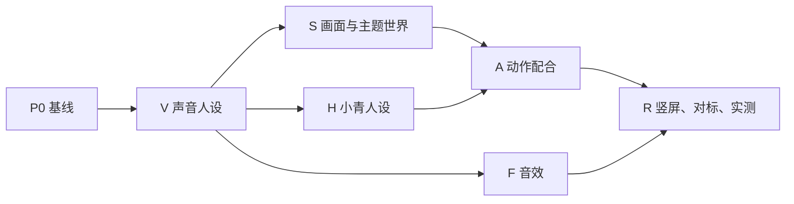

# 个性化路线图：声音、小青、画面、动作与音效

- 日期：2026-11-25
- 状态：owner 已选定"每期选男声或女声，全片固定"（2026-11-25）；各阶段开工前分别写设计，经 owner 确认后再写实施计划
- 关系：接在 [超越路线图](超越路线图.md) 之后。该路线图 M0–M6 已完成，剩下的 M7 同题对标和三家 Agent 实测并入本文 R 阶段。其余仍按 [出片质量设计](出片质量设计.md) 和 [火柴人主持人设计](火柴人主持人设计.md) 执行，冲突处以本文为准
- 对照：参考项目 [kaomei/stickman-video-director](https://github.com/kaomei/stickman-video-director)（MIT）。2026-11-25 通过 GitHub API 读了它的 `SKILL.md` 和 references

---

## 1. 背景

owner 用 agy 出片后的反馈：整体不错，但有五个问题。

1. 配音没有特点，需要能切换男声和女声。
2. 小青没有特点。
3. 画面没有特点。
4. 小青的动作要和画面配合。
5. 画面和动作都要和视频主题相关。

## 2. 现状

依据示例成片 `cache-speed`（100 秒，1080p60）的联系表和代码：

| 问题 | 现在的样子 | 根因 |
| --- | --- | --- |
| 配音 | 全片只有晓晓一个声音，语速 0.96 | `voice` 只能写一个音色名，没有男声、女声或人设预设；`doctor.mjs` 固定推荐晓晓；讲稿是中性的课本腔 |
| 小青 | 12 个出镜镜头的起始动作只有 `point`、`present`、`think`、`emphasize` 四种，基本都站在左下角 | 表情只在脸上小幅变化；没有招牌动作、口头禅和性格小动作 |
| 画面 | 都是标题卡、要点、流程框和对比表 | 只有 6 个模板和 24 个通用图标；没有场景，也没有比喻 |
| 配合 | 小青在左下角对着空气指，图解在右上角 | `host-left` 的图解区固定在 y 80–500 的上方条带，小青站在 y 930 的地面，中间空着；小青只会走过去、指、拍，碰不到任何物体 |
| 主题 | 换一个主题，除了文字和图标，画面不会变 | 流程里没有"由主题定视觉世界"这一步，配色、场景、比喻、服装都不随主题变 |

## 3. 参考项目的做法

| 方面 | 参考项目 | 我们现在 | 阶段 |
| --- | --- | --- | --- |
| 配音 | 每期选一个具名音色，全片固定；先试听再定；只有剧情需要时才用多人对话；默认不调音高之类的参数 | 只有一个音色，没有试听 | V |
| 角色表演 | 表情夸张，全身表演，手真的碰到道具；每期按主题画新道具、做新姿势 | 12 个固定动作，6 件道具 | H、A |
| 语义动作 | 每个动作都有可见的"之前→过程→之后"，用删除测试检验；画面最多静止 2.5 秒 | 只有出现和高亮两种变化；静止上限 8 秒 | A |
| 画面接力 | 一个比喻接一个比喻，物体会变形、被压扁、被拿走 | 模板化的框和表 | S、A |
| 美术随主题 | 按时代和地点换服饰、发型、道具和场景 | 不随主题变 | S、H |
| 音效 | 环境声、动作音效、情绪点缀三层；默认配背景音乐；每条素材记许可；内置程序化合成的原创音效 | 没有音效和音乐 | F |
| 画幅 | 原生 16:9 和 9:16 | 只渲染 16:9 | R |
| 成片复查 | 逐个动作看实际 MP4 | 自动技术检查，审美项标 `not_checked` | 各阶段验收 |

## 4. 决定

| # | 问题 | 结论 |
| --- | --- | --- |
| Q1 | 男女声怎么切换 | 每期选男声或女声，全片固定（owner 2026-11-25 选定）。同一期男女双人对话以后单独评估 |
| Q2 | 新 skill 还是继续 | 继续在 `topic-to-video` 上做 |
| Q3 | 付费服务 | 默认仍不调用付费服务；能控制情绪的 TTS 这类付费或需要重安装的方案只做可选项 |
| Q4 | 预算 | 不放宽，见 §7；例外：一次 L0 要读的 skill 文件上限先从 28 KB 调到 30 KB，给声音人设表和口吻规则（owner 2026-11-25 同意）；H 阶段起再调到 100 KB（owner 2026-11-25 决定，依据见 [小青人设设计](小青人设设计.md) §5.1） |

Q2–Q4 按推荐执行，owner 随时可以推翻。

## 5. 路线图

| 阶段 | 内容 | 估时 | 验收 |
| --- | --- | --- | --- |
| P0 基线 | 用现在的版本出两条"改之前"的片子（缓存，再加一个非技术主题）；评审表加 §8 的 5 项 | 0.5 天 | owner 确认评审表 |
| V 声音人设 | §6.1 | 1–2 天 | owner 试听满意；一句话就能切换男女声 |
| H 小青人设 | §6.2 | 2–3 天 | owner 选定设定图；540p 剪影不看围巾也能认出小青 |
| S 画面与主题世界 | §6.3 | 3–4 天 | 两个主题的联系表一眼看出不同，又认得出是同一个节目 |
| A 动作配合 | §6.4 | 3–4 天 | 每个出镜镜头至少一次小青和物体的互动；画面静止不超过 4 秒 |
| F 音效 | §6.5 | 1–2 天 | 人声始终最清楚；owner 听完整片确认 |
| R 收尾 | §6.6 | 3.5–4.5 天 | §8 和超越路线图 §7 全部评分 |

串行合计约 14–20 个工作日。H 与 S 可以同时做，F 可以和 A 同时做，这样约 11–15 天。每个阶段开工前写一份设计，owner 确认后再写实施计划；完成后用 P0 的两条片子做前后对比。

## 6. 各阶段要点

### 6.1 声音人设（V）

- `voice.preset`：内置配音人设，每个人设包括音色和语速，音高最多微调几 Hz（调多了声音会发假，以试听为准）。旧的 `voice.voice` 写法照样有效。候选音色是 edge-tts 实际提供的中文音色，特点取自它的官方标注：

| 性别 | 音色 | 官方标注 | 适合 |
| --- | --- | --- | --- |
| 女 | 晓晓 `zh-CN-XiaoxiaoNeural` | 温暖 | 通用讲解（现在的默认） |
| 女 | 晓伊 `zh-CN-XiaoyiNeural` | 活泼 | 轻松、生活类 |
| 男 | 云希 `zh-CN-YunxiNeural` | 活泼、阳光 | 通用讲解 |
| 男 | 云健 `zh-CN-YunjianNeural` | 激情 | 体育、励志 |
| 男 | 云扬 `zh-CN-YunyangNeural` | 专业、可靠 | 新闻、严肃话题 |
| 男 | 云夏 `zh-CN-YunxiaNeural` | 可爱（童声） | 儿童向 |
| 女 | 晓北 `zh-CN-liaoning-XiaobeiNeural` | 幽默（东北话） | 搞笑、轻松 |
| 女 | 晓妮 `zh-CN-shaanxi-XiaoniNeural` | 明亮（陕西话） | 地方特色 |

- 选择流程：开工时把配音和时长、受众、比例一起列为默认值（女声·晓晓）。用户说"换男声"就切到默认男声。配音前用本片开头两句给候选人设各出一段试听，选定后写进 `project.json`，全片不换。换人设只重新合成配音，画面时间自动跟着新配音走。
- 讲稿口吻：`script.md` 增加主持人口吻的写法：口语化，多用设问，开场白和结束语固定；同一期口吻不变。
- 可选进阶（默认不开）：能按句控制情绪的 TTS，把小青当句的表情传过去。候选有本地的 CosyVoice、IndexTTS（离线、免费，但安装重），以及云端服务（接入前核实价格，经 owner 同意）。

### 6.2 小青人设（H）

- 招牌特征：保持单线墨线火柴人，加一个剪影上一眼能认出的特征，候选有头顶一根呆毛、一顶小帽、一副圆眼镜；围巾随动作甩得更明显。先出 2–3 版设定图，owner 选定后才进渲染器。
- 表情更夸张：五官变化幅度加大；大情绪时头部挤压、拉伸；汗滴、冒火、星星眼、问号等符号放大。
- 性格：招牌动作（甩围巾、打响指等）、待机小动作（东张西望、挠头、跺脚）、反应动作（吓一跳、猛回头）；口头禅和 V 的开场白一致。
- 主题服装：帽子、眼镜、围裙、安全帽等，由 S 的视觉世界决定穿什么。
- `rights.json` 的 `usage` 不动，外观以 owner 确认的设定图为准。

### 6.3 画面风格与主题世界（S）

- L0 新增"视觉世界"：写分镜前先定，和讲稿、分镜一起在确认①给用户看。
  - 一个贯穿全片的比喻。例如缓存是家门口的冰箱，服务器是远处的超市，三零四是打电话问超市"东西还新鲜吗"。
  - 配色风格包、场景、小青服装、配音人设、音乐情绪。
- 风格包：同一种手绘画法，5–6 套配色和纸面：手账纸、黑板粉笔、蓝图、牛皮纸、夜间。按主题推荐。
- 场景：讲台、街道、厨房、实验室、办公室、户外等 6–8 个手绘场景，带地面线。
- 道具：内置图标从 24 个扩到约 60 个常见物件。另外允许在 `project.json` 里给本期画少量自定义道具：只能用白名单里的 SVG 路径元素，统一走 `ink.mjs` 的手绘描边，`check.mjs` 检查元素、尺寸和数量。
- 新模板：`stage`（物体自由摆放）、`timeline`、`cycle`。
- 全部用代码生成，合并进少数模块，不加图片文件。

### 6.4 动作与画面配合（A）

- 同台版式 `stage`：小青和物体共用一条地面、一套坐标。
- 互动动作（新 cue）：`carry`、`push`、`pull`、`open`、`draw`、`hold_up`、`sit_on`、`react`。用现有的两节反向求解让手握住物体的锚点，物体跟着手走。
- 状态变化（新 cue `state`）：满变空、新鲜变过期、上锁变解锁、打叉、盖章、计数；流程箭头上有物件沿线运送。
- 自动配合：元素出现时小青转头去看，高亮时点头；同一个姿势不连着用。
- 规则与自检：`storyboard.md` 加"动作卡"（句意、动作、对象、前后状态）；`check.mjs` 新增 `NO_INTERACTION`（出镜镜头里小青一次都没碰物体）和 `GESTURE_REPEAT`（同一姿势连用）两个警告；静止上限从 8 秒收紧到约 4 秒，看过样片再调。
- 只做向后兼容的新增，旧的 `host-left`、`full` 照常可用。

### 6.5 音效与背景音乐（F）

- 程序化音效：用代码合成，不带音频文件，也就没有版权问题。元素出现、走路、转场、高亮、结论、跳跃、翻纸各有一种声音，按事件自动卡点，压在人声下面。
- 背景音乐：只用 owner 提供或确认过许可的文件，记下来源和许可；有人声时自动压低；不自动下载。
- QA：检查人声和音效、音乐的电平差，音效和音乐不能盖过人声。

### 6.6 收尾（R）

- 原生 9:16（2–3 天）：竖屏版式单独排，不是把横屏裁一下；字幕安全区按手机尺寸算。
- 同题对标（0.5 天）：同一主题两边各出一条 60–120 秒的片子，按 §8 和超越路线图 §7 评分；官网换上真实演示片。
- 三家实测（1 天）：agy、Claude Code、Codex 各跑一遍场景评测，花配额前先问 owner。

## 7. 约束

- skill 目录现在有 33 个文件、408 KB，上限是 45 个文件、5 MB。新增内容用代码生成，合并进少数模块。
- `SKILL.md` 不超过 150 行，每份 reference 不超过 250 行；运行时 npm 依赖最多 1 个。
- 默认不调用付费服务；付费调用先报价，经 owner 同意，并记进 `jobs`。
- 完全不同的画风（像素、Meme 等）另做 skill，不在本路线图内。
- `project.json` 只做向后兼容的新增，`version` 仍为 1，旧项目照常渲染。
- 每个阶段先写测试，在分支上开发，`npm test` 通过后再合并。

## 8. 评审表新增项

接在 [超越路线图](超越路线图.md) §7 的 12 项后面。每项 1–5 分，改之前、改之后各打一次。

| # | 项 | 怎么看 | 及格线 |
| --- | --- | --- | --- |
| 13 | 声音辨识度 | 只听不看，10 秒内能否说出性别和性格 | 男女声各有至少 2 个人设，owner 试听满意 |
| 14 | 小青辨识度 | 540p 剪影 | 不靠围巾颜色也能认出 |
| 15 | 画面风格 | 两个不同主题的联系表并排 | 一眼看出主题不同，又认得出是同一个节目 |
| 16 | 互动 | 每个出镜镜头里小青碰物体、改变物体状态的次数 | 每个出镜镜头至少 1 次 |
| 17 | 主题关联 | 遮住文字和字幕后看联系表 | owner 能猜出主题 |
