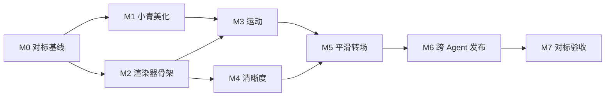

# 超越 stickman-video-director：科普视频 Skill 路线图

- 日期：2026-11-25
- 状态：owner 已审阅通过（2026-11-25）；M0–M6 已完成实现与测试，待 M7 同题对标与三家 Agent 实测配额确认
- 关系：在 [火柴人主持人设计](火柴人主持人设计.md) 和 [出片质量设计](出片质量设计.md) 的基础上，把剩余工作按"美观、清晰、平滑、跨 Agent"重新排序，并补上这两份文档没写的部分（小青美化、清晰度、运动模糊、跨 Agent 发布、对标验收）。冲突处以本文为准，其余仍按这两份文档执行
- 对照：参考项目 [kaomei/stickman-video-director](https://github.com/kaomei/stickman-video-director)（MIT）

---

## 1. 现状

| 部分 | 状态 |
| --- | --- |
| L0 文本包（讲稿、分镜、提示词包、`check.mjs` 自检） | 已完成，场景评测 02、03 通过 |
| 小青形象 S1（17 关节骨架、12 动作、8 表情、6 道具，静态画法，`ink.mjs`、`rig.mjs`） | 已完成 |
| L1 本地渲染器（出 MP4） | 还没写。"画面清晰""过渡平滑"都要靠它，提示词包交给外部模型保证不了 |
| S2 运动（走、跳、反向求解、微表演、口型） | 只有设计 |
| P3 转场与 QA | 只有设计 |

## 2. 对手的短板

依据 [火柴人主持人设计](火柴人主持人设计.md) §1.2 的分析，加上公开介绍。2026-11-25 克隆参考仓库没有成功：第一次很慢，被第二次克隆中断，第二次超时后手动停止。

| 方面 | stickman-video-director | 我们的目标 | 怎么验证 |
| --- | --- | --- | --- |
| 人物一致性 | 每期由图像模型画插图，人物会变样 | 代码绘制，每帧都是同一个人，结果可复现 | 哈希回归测试 |
| 镜头内动作 | 基本是静态图，同一镜头的 4 帧几乎一样 | 连续动作：走位、指向、拍、跳、换道具，带预备和跟随 | 动作预览片，owner 确认 |
| 帧率 | 以静态图加推拉为主 | 默认 60fps，快动作加运动模糊 | ffprobe、卡顿检测 |
| 清晰度 | 位图插图放大会糊 | 全矢量逐帧光栅化，默认 1080p，可选 1440p、4K | 细线和小字的放大对比图 |
| 转场 | 镜头之间硬切或叠化 | 同元素补间（类似 PPT 平滑切换），版式切换时人物跑进跑出 | 转场条、跳变检测 |
| 音画同步 | 依赖 Whisper 对齐 | 关键词锚点，图解在说到那个词时正好落定，误差 ≤ 1 帧 | QA 同步检查 |
| 出片成本 | 需要 Gemini 等付费 API 出图 | 不调用付费 API 也能出完整成片（只有配音可能要钱） | 离线跑通示例 |
| 支持的 Agent | Claude Code、Codex 等 | agy、Claude Code、Codex 三家都实测安装和出片 | 三家各跑一遍场景评测 |

## 3. 已确认的决定

owner 审阅通过时没有逐条作答，下面 Q1–Q3 按推荐项执行，owner 随时可以推翻。

| # | 问题 | 结论 |
| --- | --- | --- |
| Q1 | 新 skill 还是继续 | 继续在 `topic-to-video` 上做，复用 L0 和小青 |
| Q2 | 小青美化方向 | A：保持单线墨线，只做精修。没有选"躯干改空心轮廓"（不像火柴人）和"粗圆卡通线"（图解风格要一起改） |
| Q3 | 清晰度目标 | 默认 1080p60，另外支持 1440p、2160p |
| Q4 | 配音来源 | 本地工具优先：`voice.provider: "command"` 支持 `edge-tts`（含 VTT 词级时间戳）、macOS `say`、本地开源 TTS，兼容 `import` 与 `openai-compatible` |
| Q5 | 对手素材 | 未定；M0 的对照工具读 `out/ref/` 里 owner 放的图，不提交进仓库 |

## 4. 路线图

| 阶段 | 内容 | 估时 | 验收 |
| --- | --- | --- | --- |
| M0 对标基线 | §7 的评审表；评审工具：真实尺寸的 1080p、540p 样帧，H.264 压缩往返后的样帧，美化前后对比，和对手图的并排对比 | 0.5 天 | 评审表由 owner 确认 |
| M1 小青美化（S1.5） | §5.1 | 2–3 天 | 美化前后并排，1080p、540p 和压缩往返都看，owner 确认 |
| M2 渲染器骨架 | 先做 spike：测一帧 1080p 光栅化要多久。然后写 `ease`、`timing`、`scene`（求每个元素在时刻 t 的状态）、6 个图解模板（同时输出元素包围盒）、帧到 FFmpeg 的管道、按镜头并行、镜头缓存、`--preview` | 4–5 天 | 12 秒冒烟片，ffprobe 全部通过 |
| M3 运动（S2） | 走、小跑、跳、挥手、拍；手臂和腿的两节反向求解；错峰、预备、过冲；呼吸、眨眼、视线；按音量连续开合的口型；围巾弹簧；视角切换 | 3–4 天 | 单元测试（脚不打滑、握点跟手等）；10 秒动作预览片，owner 确认不僵硬 |
| M4 清晰度 | §5.2 | 1–2 天 | 小字和细线的放大对比图；色带检测 |
| M5 平滑转场（P3） | §5.3 | 2–3 天 | 用故意做坏的样例确认跳变、卡顿、错位、错色都能检出 |
| M6 跨 Agent 发布 | §5.4 | 1–2 天 | 三家各跑场景评测（花配额前先问 owner） |
| M7 对标验收 | 同一个主题两边各出一条 60–120 秒的片子，按 §7 并排打分；官网换上真实演示片 | 0.5 天 | owner 打分：每项不低于对手，动作、清晰度、转场三项明显更好 |

合计约 15–20 个工作日。M2 之后的阶段，开工前各写一份实施计划。

## 5. 重点展开

### 5.1 小青美化（M1）

从现有速查图和 540p 姿态联系表看到的问题：

| 问题 | 原因 | 改法 |
| --- | --- | --- |
| 手臂在肘部像折断，`jump`、`cheer` 尤其明显 | 上臂和前臂是两笔，各自两头收细，肘部两头都细 | 上臂只在肩端收细，前臂只在手端收细，肘部两笔都是满宽，圆头衔接 |
| 短线条抖成锯齿 | 抖动幅度和线长无关，60 px 的前臂也有一整个正弦周期 | 抖动幅度不超过线长的 2% |
| 膝部和脊柱拐角生硬 | 折线直接取样 | 折线先做 2 次 Chaikin 圆角 |
| `sit` 腿太直，像散架 | 一条腿几乎伸直贴地 | 改成抱膝：两膝都弯，至少一只手搭在膝上 |
| `jump` 腿是倒 V，像站在半空 | 腾空时膝盖几乎不弯 | 收腿：两膝弯 ≥ 35° |
| `emphasize` 驼背太重 | 腰弯 8° 加胸弯 6° | 腰弯不超过 4°，用握拳和前倾表达强调 |
| 540p 下表情看不清 | 五官太小 | 五官放大到 1.2 倍 |
| 围巾在小尺寸下只是一团青色 | 飘带细，和领圈挤在一起 | 领圈加宽；飘带改成末端带 V 形缺口的布条，更长 |
| 手只是一个点 | 只有一种手型 | 3 种手型：拳、张开（带拇指）、指 |
| 有的细线在 540p 下断续 | 文件线条只有 0.006 H，540p 下 1.2 px | 所有线宽不小于 0.0075 H（540p 下 1.5 px），线宽集中写进 `manifest.json` |

### 5.2 清晰度（M4）

| 问题 | 做法 |
| --- | --- |
| H.264 的 `yuv420p` 把色度减半，青色、红色细线和彩色小字边缘发糊 | 彩色线条有最小宽度；彩色文字加深色描边；可选 `yuv444p` 母版 |
| 浅色纸面上的大面积渐变会出色带 | 光栅化后加极轻的抖动噪点；纸面不用细纹理，避免压缩出蚊式噪点 |
| 细线在 540p 下断续 | 线宽下限按输出像素算，不低于 1.5 px |
| 码率不够，快动作出块 | 1080p60 用 CRF 16、preset `slow`；成片另出高码率母版 |
| 中文小字发虚 | 字幕在 1080p 下不小于 40 px；标题用手写体，正文和字幕用黑体；字体文件下载前告知大小并征得同意 |
| 需要更高清 | `settings.resolution` 支持 1440p、2160p（矢量画面不用改素材，只是渲染更慢） |

### 5.3 平滑转场（M5）

- **同元素补间**：前后两个镜头里相同的元素平滑移动到新位置，只在一边的元素淡入或淡出，0.4 秒。
- **叠化**：没有共同元素时，0.3 秒缓动叠化。
- **版式切换**：小青小跑进出画面，图解区同时缩放。
- **镜头运动**：整镜 1.00 → 1.03 倍缓推，背景轻微视差；重点元素出现时可以缓推到它。
- **运动模糊**（新增，对手没有）：只在快动作的时间段（跳、挥手、小跑、元素飞入）做子帧采样，每帧采 4 次再平均，其余时间不做，以控制渲染耗时。
- **曲线统一**：只用 5 种缓动曲线；除了故意的硬切，任何属性都不跳变。
- **QA**：跳变、卡顿（连续 3 帧完全一样）、同步误差、色彩标签、转场条联系表。

### 5.4 跨 Agent 发布（M6）

| Agent | 安装方式 | 需要准备 |
| --- | --- | --- |
| agy | 放进 skills 目录或做成插件 | 复用已有的场景评测脚本 |
| Claude Code | 放进 `~/.claude/skills/` 或项目的 `.claude/skills/` | `SKILL.md` 的 frontmatter 已兼容；补安装说明 |
| Codex | 放进 `~/.codex/skills/`；`agents/openai.yaml` 已有 | 云沙箱可能没有 FFmpeg：没有时自动退回 L0 文本包 |

- 渲染入口统一为 `node scripts/render.mjs <项目文件夹>`，三家调用方式相同。
- 运行时依赖只有 `@resvg/resvg-js` 一个 npm 包，加系统里的 FFmpeg；缺任何一样就退回 L0，并告诉用户缺什么。

## 6. 约束（沿用现有预算，不放宽）

- skill 目录 ≤ 5 MB、≤ 45 个文件；`SKILL.md` ≤ 150 行；每份 reference ≤ 250 行。
- npm 运行时依赖最多 1 个；不带浏览器；不默认调用付费服务。
- 渲染耗时：120 秒、1080p60 成片 ≤ 8 分钟（Apple Silicon 笔记本）；运动模糊和 4K 是可选项，不计入这个预算。
- 每个阶段先写测试，在分支上开发，`npm test` 通过后再合并。
- 对手的图片只在本地比较，放在 `out/ref/`（已被 `.gitignore` 忽略），不提交进仓库，不照搬其画风细节。

## 7. 对标评审表

每项 1–5 分，我们和对手各打一次。M1 结束时评 1–7 项，M7 时全评。

| # | 项 | 怎么看 | 及格线 |
| --- | --- | --- | --- |
| 1 | 线条 | 540p 和 1080p 样帧：有没有折断、锯齿、断续 | 不低于对手，且没有折断 |
| 2 | 表情 | 540p 样帧里 8 种表情能不能一眼分清 | 8 种都能分清 |
| 3 | 全身表演 | 姿态联系表：重心、不对称、剪影 | 不低于对手 |
| 4 | 识别标志 | 540p 下能不能认出围巾 | 能认出 |
| 5 | 一致性 | 同一人物跨镜头是否同一个人 | 完全一致 |
| 6 | 压缩后清晰度 | H.264 往返后的样帧：细线、彩色线、小字 | 不低于对手 |
| 7 | 色带与噪点 | 压缩往返后的纸面 | 看不到色带 |
| 8 | 镜头内动作 | 动作预览片 | 明显好于对手 |
| 9 | 转场 | 转场条 | 明显好于对手 |
| 10 | 音画同步 | QA 同步报告 | 误差 ≤ 1 帧 |
| 11 | 出片成本 | 不调用付费 API 能否出成片 | 能 |
| 12 | 跨 Agent | 三家场景评测 | 三家都通过 |
