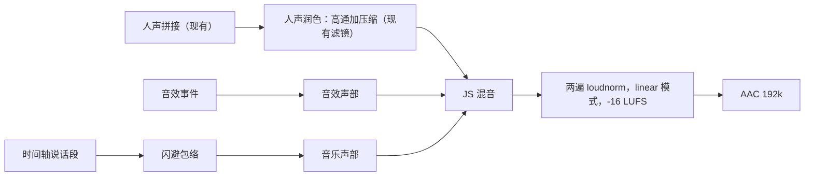

# 音效与配乐设计（F）

- 日期：2026-11-26
- 状态：owner 已确认方案（2026-11-26），待审阅本文后写实施计划
- 关系：展开 [个性化路线图](个性化路线图.md) §6.5；补上 [画面与同台互动设计](画面与同台互动设计.md) D6 留下的"音乐情绪"。人声的合成与润色沿用 [声音人设设计](声音人设设计.md) 和 [出片质量设计](出片质量设计.md)，冲突处以本文为准

---

## 1. 背景与目标

现在的成片只有人声。元素弹出、小青开冰箱、盖章、跳起来，画面在动，耳朵里什么都没有；句与句之间是纯静音。参考项目默认带背景音乐，并分环境声、动作音效、情绪点缀三层。

目标：

- 画面上的动作有声音：声音由渲染器从镜头计划里自动卡点，不需要 agent 逐条写，轻量模型写的分镜也能直接用。
- 默认有背景音乐：代码合成，没有版权问题；用户也可以用自己有许可的音乐文件。
- 人声始终最清楚：音乐在说话时自动压低，音效不盖过人声，QA 用数字检查。
- 向后兼容：`version` 仍为 1；没有 `world` 的旧项目重新渲染，声音和现在完全一样；不加 npm 依赖，不加音频文件。

## 2. 已确认的决定

| # | 问题 | 结论 |
| --- | --- | --- |
| D1 | 没给音乐文件时要不要背景音乐 | 内置代码合成的音乐床，4 种情绪，默认开，可以关；用户给了确认过许可的文件就用文件（owner 2026-11-26） |
| D2 | 默认开关 | 有 `world` 的项目默认开音效和音乐；没有 `world` 的旧项目不变（owner 2026-11-26） |
| D3 | 音效风格 | 克制的纸面手绘风：大多是很轻的"啵""沙""嗒"，只有少数重点时刻明显一点（owner 2026-11-26） |
| D4 | 实现方式 | 纯 JS 合成与混音，不用 FFmpeg 滤镜图合成，不带音频文件（owner 2026-11-26） |
| D5 | 字段放在哪 | 新增顶层 `sound`，和 `voice` 并列。音乐情绪不放进 `world`：和服装、配音一样，`world.md` 按场景推荐，值写在别处 |
| D6 | 谁决定在哪出声 | 只由渲染器根据 cue、走路、转场和互动自动生成；agent 不写单条音效 |

## 3. 数据：`sound` 字段

```json
"sound": {
  "sfx": "auto",
  "music": { "mood": "playful" }
}
```

用户自带音乐时：

```json
"sound": {
  "sfx": "auto",
  "music": { "file": "music/bgm.mp3", "source": "用户自有", "license": "用户自制，可商用" }
}
```

| 字段 | 取值 | 说明 |
| --- | --- | --- |
| `sfx` | `auto`、`off` | 程序化音效开关 |
| `music.mood` | `calm`、`playful`、`curious`、`upbeat`、`none` | 合成音乐床的情绪；`none` 表示不要音乐 |
| `music.file` | 项目文件夹内的相对路径 | 用户提供的音乐文件，扩展名限 `mp3`、`wav`、`m4a`、`aac`、`flac`、`ogg` |
| `music.source` | ≤ 200 字 | 来源：网址、出处或"用户自有" |
| `music.license` | ≤ 200 字 | 许可说明，照抄用户的原话 |

- `music` 里 `mood` 和 `file` 二选一；写了 `file` 就必须同时写 `source` 和 `license`。
- 缺省规则：

| 项目 | `sound` 缺省时 | 只写了一部分时 |
| --- | --- | --- |
| 有 `world` | `sfx: "auto"`，`music.mood` 取场景推荐（§5.1） | 没写的部分按左列补 |
| 没有 `world` | 不出音效和音乐，和现在一样 | 只开写了的部分 |

- 不自动下载任何音乐；`file` 不能是网址、绝对路径或带 `..` 的路径。
- 只记录用户说的许可，不替用户判断许可是否有效（SKILL.md 规则 7）。

## 4. 音效

### 4.1 声音表

16 种合成声音，覆盖约 25 种事件。音量分三档：**底层**（只有脚步）、**普通**、**重点**。

| 事件 | 取自 | 声音 | 档 |
| --- | --- | --- | --- |
| 元素出现 | `reveal` | 啵：短正弦，音高下滑，60 ms | 普通 |
| 高亮 | `highlight` | 沙：带通噪声，像马克笔划过，150 ms | 普通 |
| 走路、小跑 | 走路分段的每一步 | 脚步：低通噪声，30 ms；小跑步频加倍 | 底层 |
| 同元素补间、叠化转场 | `transition` 的 `morph`、`crossfade` | 翻纸：噪声扫频，250 ms | 普通 |
| 版式切换，小青跑进跑出 | `transition.layoutSwitch` | 咻：噪声加音高上滑，200 ms | 普通 |
| 盖章 | `state` → `stamped` | 咚：低频冲击加一点噪声 | 重点 |
| 打叉 | `state` → `crossed` | 划：两下短划线声 | 普通 |
| 计数 | `state` → `count:*` | 嗒：短木质敲击 | 普通 |
| 变坏 | `state` → `expired`、`broken`、`empty`、`off`、`dim` | 噗：下滑音 | 普通 |
| 开合、上锁 | `state` → `open`、`closed`、`locked`、`unlocked` | 咔：短机械声 | 普通 |
| 变好 | `state` → 其余状态 | 叮：单个钟琴音 | 普通 |
| 运送 | `send` | 出发时咻，到达时啵 | 普通 |
| 打开物件 | `open` | 咔 | 普通 |
| 拿起、放下 | `carry` | 拿起时咻（短），放下时嗒 | 普通 |
| 推、拉 | `push`、`pull` | 摩擦：低通噪声，0.5 s | 普通 |
| 坐下 | `sit_on` | 咚（轻） | 普通 |
| 板书 | `draw` | 沙沙：断续带通噪声，持续到写完 | 普通 |
| 举起展示 | `hold_up` | 闪光：高音钟琴三连音 | 重点 |
| 反应 | `react` | 惊退用"吓"，欢呼用闪光 | 重点 |
| 跳 | 手势 `jump` | 起跳时短上滑，落地时咚（轻） | 重点 |
| 响指 | 手势 `snap` | 响指：8 ms 噪声冲击加共振 | 重点 |
| 吓一跳、猛回头 | 手势 `startle`、`double_take` | 吓：短促下行双音 | 重点 |
| 欢呼 | 手势 `cheer` | 闪光 | 重点 |
| 拍 | 手势 `tap` | 嗒 | 普通 |
| 结论 | 最后一节第一个镜头开头 | 钟声：柔和的三音和弦，1.5 s | 重点 |

合计 16 种：啵、沙、脚步、翻纸、咻、咚、划、嗒、噗、咔、叮、摩擦、沙沙、闪光、响指、吓，再加结论钟声（复用叮的音色叠成和弦）。

### 4.2 卡点规则

- **时刻**：声音落在画面上的接触或落定时刻，不是 cue 的起点。例如元素弹出落定的那一帧、手碰到门把的那一刻、盖章落下的那一帧、脚落地的那一帧。这些时刻由画面模块按同一份镜头计划算出，所以音画一致。
- **密度**：重点和普通音效之间至少隔 0.5 秒，也就是每秒最多 2 个。撞上时保留档位高的，同档保留先出现的。脚步不计入，但离其他音效 0.12 秒以内的那一步不出声。
- **变化**：同一种声音每次出现时音高有 ±3% 的变化，音量有 ±1 dB 的变化，种子取镜头 ID 加事件序号，所以重复的声音不机械，结果仍然可以复现。
- **声像**：和位置有关的声音按画面里的 x 坐标做轻微的左右声像，范围 ±0.3，采用等功率声像。小青的声音用小青的位置，元素的声音用元素的中心；转场和结论居中。
- **关闭**：`sfx: "off"` 时一条都不出。

## 5. 合成音乐床

### 5.1 四种情绪

| `mood` | 中文 | 速度 | 调 | 和弦（每小节一个，4 小节一循环） | 音色 | 推荐场景 |
| --- | --- | --- | --- | --- | --- | --- |
| `calm` | 舒缓 | 72 BPM | C 大调 | C – Am – F – G | 柔和垫音，慢速拨弦分解 | `blank`、`podium`、`office` |
| `playful` | 俏皮 | 100 BPM | F 大调 | F – B♭ – Gm – C | 跳音拨弦，轻沙锤 | `kitchen`、`street` |
| `curious` | 好奇 | 84 BPM | D 小调 | Dm – G – Dm – C | 钟琴点缀，低音拨弦，垫音 | `lab` |
| `upbeat` | 明快 | 112 BPM | G 大调 | G – D – Em – C | 拨弦，轻底鼓加沙锤 | `outdoor`、`workshop` |

- 风格包是 `night` 时，推荐情绪改成 `curious`，场景推荐让位给风格包。
- 音色都用代码合成：垫音是 3 个略微失谐的三角波，经过一阶低通，慢起慢落；拨弦用 Karplus-Strong；钟琴用 3 个正弦泛音，指数衰减；沙锤用高通噪声；底鼓用正弦下扫。最后加一个简单的混响（4 个梳状滤波器加 2 个全通滤波器），湿声占 20%。
- 种子取 `project.title`，同一个项目每次合成的结果相同。

### 5.2 结构

- 开头 1.5 秒淡入，第一小节只有垫音。
- 章节交界（`sections` 之间）所在的那一小节去掉拨弦和打击乐，只留垫音，给观众换气。
- 结尾最后一小节回到主和弦，延长音在成片最后 3 秒淡出，到最后一帧时正好静音。
- 长度按整条时间轴生成；`--sample` 和 `--preview` 截取对应的时间段，所以样片里的音乐和整片同一位置的音乐一样。

### 5.3 用户自带音乐

- 用 FFmpeg 解码成 48 kHz 立体声。
- 比成片短时循环播放，接缝处做 1 秒交叉淡化；比成片长时截断，并在最后 3 秒淡出。
- 先测出文件的均方根电平，再换算到和合成音乐床相同的目标电平（§6），闪避规则也相同。
- 文件不存在时渲染报错并写出路径，不悄悄退回成没有音乐。

## 6. 混音与闪避

### 6.1 流程



- 声音全关时（没有 `world` 的旧项目，或 `sfx: "off"` 加 `mood: "none"`）走原来的路径：人声拼接后做润色和 loudnorm，结果不变。
- 声音打开时：只对人声做现有的润色，然后以润色后的人声为基准生成音效和音乐，三轨相加；混音的峰值超过 0.99 时整体同比缩小，再做两遍 loudnorm。linear 模式只做整体缩放，三轨之间的比例不变。
- 混音只依赖时间轴和镜头计划，不进视频镜头缓存：只改声音时不用重新渲染画面。

### 6.2 电平

以润色后的人声在说话部分的平均均方根为基准，记作 V（dB）。

| 声部 | 说话时 | 句间停顿 | 说明 |
| --- | --- | --- | --- |
| 音乐 | V − 20 dB | V − 14 dB | 先把整段音乐缩放到均方根 V − 14 dB，说话时再压低 6 dB。说话开始前 120 ms 开始压低，压低过程 150 ms；说完后等 300 ms 再回升，回升过程 500 ms |
| 普通音效 | V − 14 dB | V − 10 dB | 按 100 ms 窗的均方根算 |
| 重点音效 | V − 12 dB | V − 8 dB | 同上 |
| 脚步 | V − 26 dB | V − 26 dB | — |

- 说话段直接取时间轴里每句的说话区间（`timing.json` 的 `speech`），不靠检测，所以闪避不会慢半拍。
- 用户的录音（`voice.provider: "import"`）同样适用。

## 7. QA

在 loudnorm 之前，用内存里的三个声部计算。只看说话段，人声取该句说话部分的平均均方根，避免字与字之间的空隙造成误报。

| 代码 | 级别 | 条件 |
| --- | --- | --- |
| `MUSIC_TOO_LOUD` | 技术问题 | 说话时某个 400 ms 窗口（步长 200 ms）里，音乐比该句人声低不到 15 dB |
| `SFX_OVER_VOICE` | 技术问题 | 说话时某个 100 ms 窗口（步长 50 ms）里，音效比该句人声低不到 8 dB |

- `qa.json` 新增 `audio`：音乐与人声的最小差、音效与人声的最小差、音效数量（按种类计）、音乐来源（`synth:<mood>` 或文件路径）和许可。
- `qa.md` 新增"声音"一节，写出上面这些数字；人工复核项加一条"混音听感：`not_checked`"。
- 用故意做坏的样例确认两项检查都能报出来：音乐在说话时不压低，以及在一句话中间放一个重点音效并放大 10 dB。

## 8. 流程与文档

### 8.1 L0

- `SKILL.md`"开工前"的默认值列表加一行：音乐按场景推荐情绪（可关），用户提供音乐文件时要说明来源和许可。默认值照例写在 `讲稿.md` 开头，在确认①时一起给用户看。
- `world.md` 的场景表加一列"推荐音乐"；新增 §8"声音"（约 20 行），写 `sound` 字段、缺省规则、4 种情绪和用户音乐的规则。
- `prompt-pack.md`：使用说明加一行配乐建议，写出情绪的中文名，供剪辑参考。
- `check.mjs`：
  - schema 校验 `sound`。
  - `MUSIC_LICENSE_MISSING`（错误）：写了 `file`，但缺 `source` 或 `license`。
  - `MUSIC_PATH_INVALID`（错误）：`file` 是网址、绝对路径、带 `..`，或扩展名不在允许范围内。
  - `MUSIC_FILE_MISSING`（警告）：文件现在不在项目文件夹里。

### 8.2 L1

- `providers.md` 补充：混音怎么做、两项 QA 的含义、怎样关掉音效或音乐、怎样换成自己的音乐。
- `render.mjs <项目文件夹> --audition-sound [calm,playful,...]`：在 `out/audition/` 里为每种情绪写一段 15 秒的 `music-<mood>.wav`，再写一段 `sfx.wav`，把 16 种音效依次放一遍，间隔 0.8 秒。WAV 由 JS 直接写出，不需要 FFmpeg、resvg 和 TTS。

### 8.3 示例

- `examples/cache-speed/project.json` 显式写 `"sound": {"sfx": "auto", "music": {"mood": "playful"}}`。

## 9. 文件与预算

| 文件 | 改动 |
| --- | --- |
| `scripts/lib/sound.mjs`（新） | 16 种音效的合成、事件收集、密度控制、声像 |
| `scripts/lib/music.mjs`（新） | 4 种情绪的音乐床、混响、用户音乐的解码和循环、闪避包络 |
| `scripts/lib/encode.mjs` | 混音流程（§6.1） |
| `scripts/lib/qa.mjs` | 两项电平检查和"声音"报告 |
| `scripts/lib/project.mjs`、`schema/project.schema.json` | `sound` 字段、缺省规则、三项自检 |
| `scripts/render.mjs` | `--audition-sound` |
| `SKILL.md`、`references/world.md`、`references/providers.md`、`references/prompt-pack.md` | §8 |
| `README.md`、`README.en.md` | 功能列表同步 |

- skill 目录从 36 个文件增加到 38 个，体积增加约 30 KB，在 45 个文件、5 MB 以内。
- 一次 L0 要读的文件仍在 100 KB 以内（只有 `world.md` 增加约 2 KB）。
- 不加 npm 依赖。
- 渲染耗时：120 秒的成片，合成与混音增加不超过 5 秒。

## 10. 测试（先写测试）

- 合成：16 种声音每种都可复现（同一种子得到相同的采样）；时长符合表里的数值；峰值 ≤ 0.99；没有 NaN；直流分量接近 0；最后 5 ms 低于 −60 dB（结尾没有爆音）。
- 事件收集：用一个覆盖 `reveal`、`highlight`、`state`、`send`、8 种互动、手势、走路和三种转场的夹具项目，检查每个事件的种类和时刻（和画面的接触时刻相差不超过 1 ms）；最后一节开头有结论钟声。
- 密度：相隔 0.3 秒的两个音效只留档位高的那个；离其他音效 0.12 秒以内的脚步被去掉。
- 缺省规则：有 `world` 且没写 `sound` 时，音效开，情绪取场景推荐（`night` 风格取 `curious`）；没有 `world` 时全关；`sfx: "off"` 和 `mood: "none"` 分别生效。
- 闪避：说话时音乐的增益是 V − 20 dB，停顿时是 V − 14 dB；提前压低 120 ms，压低和回升过程的长度符合 §6.2。
- 音乐：4 种情绪的长度都等于要求的长度；开头淡入、结尾最后一帧静音；章节交界那一小节的能量更低；结果可复现。用户音乐：短文件循环（接缝有交叉淡化），长文件截断并淡出。
- 混音回归：没有 `world` 的项目，送进 loudnorm 的 WAV 和改动前逐字节相同。
- QA：正常混音通过；两个故意做坏的样例分别报 `MUSIC_TOO_LOUD` 和 `SFX_OVER_VOICE`。
- 自检：`sound` 的合法和非法写法；三项自检的触发和不触发例子。
- CLI：`parseArgs` 能识别 `--audition-sound` 和情绪列表。
- 文档：reference 行数、预算、两份 README 同步的测试都通过。

## 11. 验收

- `npm test` 全部通过。
- `cache-speed` 出 1080p60 整片，`qa.md` 没有技术问题；另出 `--audition-sound` 的 4 段情绪和音效集锦。
- owner 听完整片和试听后确认：人声始终最清楚，音效卡在动作上而且不吵，音乐不廉价。
- 路线图评审表新增第 18 项"声音层次"：只听不看整片，人声是否始终最清楚、音效是否卡在动作上、音乐是否抢戏；及格线是 owner 听完整片确认。R 阶段对标时一起打分。

## 12. 风险与应对

| 风险 | 应对 |
| --- | --- |
| 合成音乐听着廉价 | 先出 4 段试听给 owner；不满意的情绪先改或去掉；4 种都不满意时，把默认情绪改成 `none`，只留音效 |
| 音效太密、太吵 | 密度上限、三档电平和两项 QA；owner 听完整片后再调数值 |
| 卡点和画面对不上 | 和画面共用同一份镜头计划和动作时刻；单测按毫秒检查 |
| 渲染变慢 | 120 秒立体声 48 kHz 约 1150 万个采样，混响只作用在音乐声部；用 120 秒的整片测量耗时 |
| 用户音乐的许可有问题 | 只照抄用户给的来源和许可，不判断；缺来源或许可时报错 |
| 旧项目的声音被意外改变 | 没有 `world` 的项目走原路径，并有逐字节回归测试 |

## 13. 不做的事

- 环境声底层（厨房嗡嗡声、街道车流声）：克制风格下容易显脏，以后单独评估。
- agent 逐条指定或屏蔽某个音效。
- 分轨导出。
- 用户音乐的音量调节字段、多段音乐、带人声的歌曲检测。
- 按句控制情绪的 TTS（仍按路线图 §6.1 作为可选进阶）。
- 自动下载或搜索音乐。
